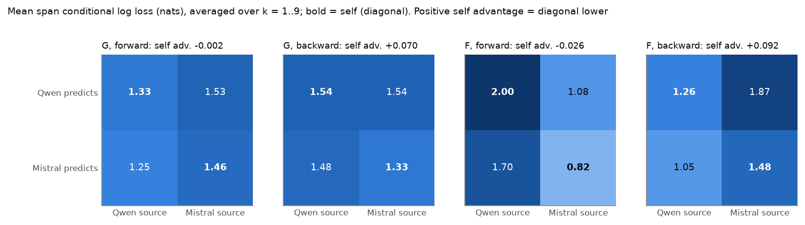
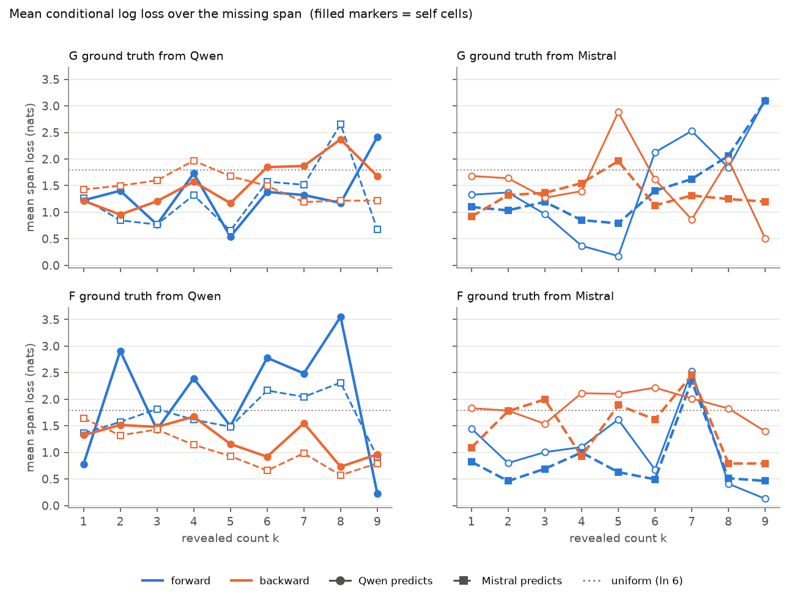
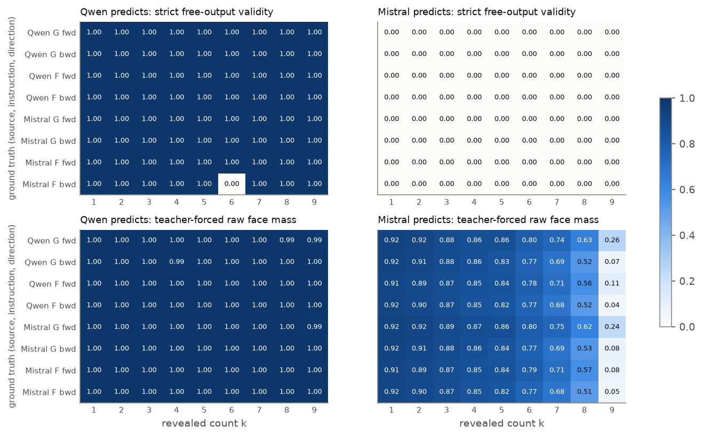

# Experiment 29: Bidirectional cross-model dice completion

`SPAR_DICE_BIDIRECTIONAL_COMPLETION_v1.1` · 2026-10-31 · Track 1 (static self-prediction). Direct sequel to
[Experiment 28](../../track1_self_prediction/28_2026-10-31_dice_logprob_crossmodel/). Behavioural study of free completions and output probabilities;
not mechanistic interpretability.

## Summary

Qwen3-32B and Mistral Small 3.2 24B reconstructed missing rolls of Experiment 28's four greedy ten-roll sequences: Qwen G and
F, Mistral G and F. Each prompt quoted the original instruction (G or F) verbatim, revealed some rolls, and asked for the rest.
The prompt never named the model that produced the sequence, so both predictors received identical bytes. There were three
task types:
- **forward:** given rolls 1..k, predict k+1..10;
- **backward:** given rolls 11−k..10, predict 1..10−k, in left-to-right order;
- **middle (supplementary):** given rolls 3–8, predict 1, 2, 9 and 10.

The primary measure is the conditional log loss of the true missing digits under teacher forcing, in nats; uniform guessing
scores ln 6 = 1.79. All 152 cells and 456 calls were collected. Every hard gate passed, and both models reproduced
Experiment 28 bit for bit.

- **No self-specific advantage (H2 not supported).**
  - Averaged over k, the balanced predictor × source contrast is −0.002 (G forward), +0.070 (G backward), −0.026 (F forward)
    and +0.092 nats (F backward).
  - Across individual k it is positive in only 4, 6, 4 and 5 of 9 cases.
  - The large differences are **source effects**: both models find some ground-truth sequences much easier than others. For
    example, Mistral's F, a strict period-6 cycle, is completed at 0.82–1.08 nats by both models; Qwen's F costs 1.70–2.00.
- **Forward context helps only where a generic rule pins the next roll (H1 partly supported).**
  - The boundary roll (k+1) is predicted well at k = 5 by every predictor on every sequence (0.36–0.70 nats). All four
    sequences open with a permutation of 1–6, so rolls 1–5 determine roll 6 under a "cover every face" rule.
  - Elsewhere, boundary losses are mostly *above* uniform (up to 6.6 nats), and the trend with k is irregular.
- **Direction asymmetry depends on the sequence, not on direction itself (H3).**
  - Backward minus forward is −0.65 to −0.75 nats on Qwen's F (backward easier) and +0.66 to +0.79 on Mistral's F (backward
    harder), whichever model predicts. It is ≤ 0.22 in size on the G sequences.
  - Overall, forward and backward are within 0.07 nats for each predictor.
- **Free behaviour and probabilities diverge (H4).**
  - Qwen answers 75 of 76 cells in the strict format, with 29% digit accuracy (teacher-forced top-1: 41%).
  - Mistral answers **0 of 76** in the strict format: it writes prose, 183 of 228 calls hit the 128-token cap, and the first
    token is a face with probability 0.16.
  - Mistral's teacher-forced probabilities are still informative (top-1 49%, mean span loss 1.31–1.34, lower than Qwen's
    1.49–1.55). Its raw face mass falls with k, to 0.04–0.26 at k = 9.
- **Middle arm.** The revealed middle helps the early pair (mean 1.11 nats) and the late pair (1.12) about equally. Its 2×2
  contrasts are large (±0.42–0.48) and flip sign between G and F and between early and late, so they show no consistent
  self effect.

**Reading.** On these four fixed sequences, reconstruction depends on how regular each sequence is and on generic die-roll
priors, not on whether the predictor produced it. A positive diagonal contrast would not have shown introspection anyway;
there is none to explain.

## Main outcomes

| | Qwen predicts | Mistral predicts |
|---|---|---|
| Hard gates (preflight / main) | 14/14 PASS / 15/15 PASS | 14/14 PASS / 15/15 PASS |
| Archival G and F vs Experiment 28 | identical, max \|Δp\| = 0.0 | identical, max \|Δp\| = 0.0 |
| Triplicates | bit-identical in all 76 cells | bit-identical in all 76 cells |
| Numerical floor: max \|Δp6\| / max \|Δ loss\| (median) | 0.167 / 0.69 nats (0.011) | 0.043 / 0.22 nats (0.008) |
| Strictly valid free completions | 75/76 cells (one answered 3 integers to a 4-integer request) | **0/76** (prose) |
| Free digit accuracy / exact spans | 29% / 7 cells | n/a (no valid outputs) |
| Teacher-forced mean span loss: forward / backward / middle | 1.49 / 1.55 / 1.14 | 1.31 / 1.34 / 1.08 |
| Teacher-forced top-1 correct, beyond the floor: fwd / bwd / mid | 87/180 / 60/180 / 7/16 | 94/180 / 84/180 / 6/16 |
| Teacher-forced raw face mass | ≥ 0.99 | 0.91 at k = 1, falling to 0.04–0.26 at k = 9 |

| Balanced self advantage, mean span loss (nats; + = diagonal lower) | k-averaged | positive at k = 1..9 |
|---|---|---|
| G forward | −0.002 | 4/9 |
| G backward | +0.070 | 6/9 |
| F forward | −0.026 | 4/9 |
| F backward | +0.092 | 5/9 |
| Middle arm, early pair (positions 1, 2): G / F | −0.421 / +0.483 | n/a |
| Middle arm, late pair (positions 9, 10): G / F | +0.479 / −0.221 | n/a |



## 1. Questions

These are the handoff's predeclared expectations, all reported regardless of direction:

- **H1, forward conditioning:** loss at the next missing roll falls with informative revealed prefixes.
- **H2, self-specific advantage:** a predictor × source interaction favouring diagonal (self) cells beyond source difficulty,
  for G/F and forward/backward separately.
- **H3, direction asymmetry:** backward reconstruction (known suffix, missing prefix emitted left to right) differs from
  forward continuation. This is retrospective inference in ordinary output order, not reverse-time generation.
- **H4, calibration:** free completions and teacher-forced probabilities may diverge.
- **Supplementary (v1.1):** a revealed middle helps the late tail more than the early head.

This is a fixed-reference assay: four deterministic ground-truth strings, not 456 independent samples. There are no p-values
or confidence intervals anywhere.

## 2. Methods

### Ground truth and prompts

The ground truths are Experiment 28's main greedy outputs, checked against all 20 replicates of each at freeze and again at
every gate:

| Source | Instruction | Sequence |
|---|---|---|
| Qwen | G | `5 2 6 3 1 4 6 2 5 3` |
| Qwen | F | `3 1 4 6 2 5 3 2 6 4` |
| Mistral | G | `4 2 6 1 3 5 2 4 6 1` |
| Mistral | F | `3 1 5 2 6 4 3 1 5 2` |

The prompt is the handoff's wrapper, byte-exact: "A language-model instance received the following instruction:", then
Experiment 28's G or F prompt verbatim in `<ORIGINAL INSTRUCTION>`, then the revealed rolls in `<REVEALED>`, then the request.
It never names a model. All prompts are in [`prompts_frozen.md`](../../track1_self_prediction/29_2026-10-31_bidirectional_dice_completion/prompts_frozen.md), and all 152 cells are in
[`conditions.csv`](../../track1_self_prediction/29_2026-10-31_bidirectional_dice_completion/conditions.csv).

The design has 144 primary cells (2 predictors × 2 sources × G/F × forward/backward × k = 1..9) and 8 middle cells. That gives
76 prompt slots, each sent identically to both predictors.

**Count note, accepted before collection ([`APPROVALS.md`](../../track1_self_prediction/29_2026-10-31_bidirectional_dice_completion/APPROVALS.md)).** The 76 slots contain only 74 distinct texts. Qwen's
F and Mistral's F share their first two rolls, so the F forward prompts at k = 1 and k = 2 are byte-identical for the two
sources, while their targets differ. The data confirm the consequence: identical free outputs, and identical first-position
loss when the first target digit is the same. In these four cells the predictor cannot tell the sources apart, so their
diagonal contrast measures source difficulty only.

### Serving

Both models used Experiment 28's configuration, unchanged:
- **Qwen:** Qwen3-32B @ `9216db57…`, Qwen3 template, `enable_thinking=False`.
- **Mistral:** Mistral-Small-3.2-24B-Instruct-2506 @ `95a6d26c…`, mistral_common tekken, text path only.
- **Arithmetic:** bf16 weights and activations, fp32 output layer and logits, batch 1, KV-cache incremental decoding,
  full-vocabulary log-softmax, greedy decoding.
- **Tokens:** face ids Qwen 16–21 and Mistral 1049–1054, re-validated on the host by a full vocabulary scan.
- **Hardware:** one vast.ai A100-SXM4-80GB in North Carolina, driver 595.91.07, with torch 2.11.0+cu128, transformers 5.22.0
  and mistral_common 1.13.0. One model was loaded at a time; no hosted API was used.
- **Deployment:** the GPU code was deployed from the frozen commit with `git -c core.autocrlf=false archive`. It is
  byte-identical to the LF-normalised hashes in [`inputs_sha256.json`](../../track1_self_prediction/29_2026-10-31_bidirectional_dice_completion/inputs_sha256.json).

### Measurements

- **Free completion:** greedy, up to 128 tokens. Strictly valid means exactly n integers 1–6, separated by single spaces,
  nothing else, ended by EOS. Digits inside prose are never extracted.
- **Teacher forcing:** the true missing digits are forced as the assistant answer, never placed in the user prompt. Before each
  forced digit, the six face log-probabilities are recorded.
  - p6 renormalises them over the six faces, i.e. conditional on emitting a face.
  - Raw mass is their sum.
  - Conditional loss is −ln p6(true).
- **Numerical floor:** incremental vs single-full-pass scoring of the same rows.

### Gates and collection

- **Preflight**, per predictor: archival G and F ×2, and 28 cells (k = 1, 5, 9 plus the 4 middle cells). Both predictors
  passed all 14 hard gates ([`preflight/*/PREFLIGHT_REPORT.md`](../../track1_self_prediction/29_2026-10-31_bidirectional_dice_completion/preflight/)).
- **Main:** all 76 slots × 3, plus archival G/F ×2, in seeded shuffled order, then one teacher-forced pass per cell: 752 rows
  (720 primary + 32 middle). Both predictors passed all 15 main checks ([`main/*/MAIN_CHECKS.md`](../../track1_self_prediction/29_2026-10-31_bidirectional_dice_completion/main/)), including
  completeness, deterministic triplicates, target mapping, the teacher-forced mass review rule and raw-file hashes.

## 3. Results

Sources: [`analysis/summary.json`](tables/summary.json), [`analysis/cells.csv`](tables/cells.csv) (152 rows),
[`analysis/positions.csv`](tables/positions.csv) (752 rows), `analysis/crossed_*.csv` and `analysis/middle_*.csv`. Raw data:
`main/<predictor>/{raw_attempts,teacher_forced}.jsonl`.

### 3.1 Integrity

- Every condition gave one deterministic output across its three calls, with bit-identical probabilities.
- Archival G and F reproduced Experiment 28 exactly on both models.
- Own-output rescoring reproduced generation exactly: difference 0.0 nats.
- The two prompt-identical pairs gave identical free outputs, as required.
- **Floor.** Qwen's floor (0.167 in Δp6) is larger than in Experiment 28 (0.091), because these prompts are longer. It is below
  the 0.25 stop line. In loss units, the incremental vs full-pass difference has a median of 0.011 nats (Qwen) and 0.008
  (Mistral), but a maximum of 0.69 and 0.22. **Single-cell differences of a few tenths of a nat are therefore not robust.**
  This loss-unit floor is exploratory; it was not in the frozen plan.

### 3.2 Self vs other (H2)

**Mean span loss**, averaged over k (fig. 3):

| | Qwen←Qwen | Qwen←Mistral | Mistral←Qwen | Mistral←Mistral | Self advantage |
|---|---|---|---|---|---|
| G forward | 1.33 | 1.53 | 1.25 | 1.46 | −0.002 |
| G backward | 1.54 | 1.54 | 1.48 | 1.33 | +0.070 |
| F forward | 2.00 | 1.08 | 1.70 | 0.82 | −0.026 |
| F backward | 1.26 | 1.87 | 1.05 | 1.48 | +0.092 |

- **The columns differ, not the diagonal.**
  - In F forward, both predictors find Mistral's sequence about 0.9 nats easier than Qwen's.
  - In F backward the reverse holds: both find Qwen's easier by about 0.4–0.6.
  - The per-predictor self-minus-other numbers are large but cancel. In F forward, Qwen is worse on its own sequence by
    +0.93 and Mistral better on its own by −0.87; this is the source effect showing up twice.
- **Across individual k the contrast changes sign often.** It is positive in 4, 6, 4 and 5 of 9 k values for the four
  instruction × direction combinations. Its single-k values span −0.87 to +0.71 nats, which is within or near the loss-unit
  floor.
- **First missing position.** The contrast is −0.290 (G fwd), −0.119 (G bwd), −0.082 (F fwd) and +0.049 (F bwd): three of
  four negative, i.e. slightly in favour of the *other* model.
- **Source-continuation reference** (forward cells only; a descriptive diagnostic, not a test). This is the JS divergence
  between the predictor's teacher-forced distribution and the source's own Experiment 28 generation distribution at the same
  true prefix:
  - on Mistral's sequences, Mistral is closer to Mistral's policy than Qwen is (0.145 vs 0.242 bits on F; 0.237 vs 0.276 on G);
  - on Qwen's sequences, Qwen is no closer to Qwen's policy than Mistral is (0.458 vs 0.460 on F; 0.297 vs 0.278 on G).

  As the handoff warns, part of such closeness is circular: a model's completion resembles its own continuation policy. It
  does not translate into lower loss on the true rolls.

**H2: not supported.** No consistent diagonal advantage for G or F, forward or backward.

### 3.3 Forward conditioning (H1)

The forward boundary loss (roll k+1, before any forced answer digits) by k is in fig. 4 and [`summary.json`](tables/summary.json).

- **Mean of k = 7–9 vs k = 1–3:** lower in 7 of 8 predictor/source/instruction combinations. The exception is Qwen on its own
  F (2.37 → 3.08).
- **Not a smooth trend.** At k = 5 every combination predicts roll 6 well (0.36–0.70 nats), because the first five rolls of
  each sequence leave one unused face. Other k values are often far above uniform. For example, Qwen on its own F at k = 8
  costs 6.57 nats, and Mistral on its own G at k = 3 costs 4.37.
- **The models do use the revealed prefix**, mostly via generic "avoid repeats, cover all faces" structure, which is shared
  by both models and all four sequences.

**H1: partly supported**, through generic sequence regularities rather than source-specific continuation.

### 3.4 Direction (H3)

Mean span loss, backward minus forward at equal k, averaged over k:

| Predictor ← source | G | F |
|---|---|---|
| Qwen ← Qwen | +0.21 | −0.75 |
| Qwen ← Mistral | +0.00 | +0.79 |
| Mistral ← Qwen | +0.22 | −0.65 |
| Mistral ← Mistral | −0.13 | +0.66 |

- The sign follows the **sequence**. Qwen's F is easier backward and Mistral's F is easier forward, for both predictors.
- Overall, forward and backward differ by only 0.07 (Qwen) and 0.03 nats (Mistral).
- Backward first-output loss (roll 1, after the revealed suffix) is lower than forward boundary loss (roll k+1) in 26/36 cells
  for Qwen and 28/36 for Mistral (fig. 4). Means are 1.27 vs 2.31 (Qwen) and 1.22 vs 2.14 (Mistral). That is not a
  like-for-like comparison: roll 1 has a strong generic prior and a different target.

**H3: an asymmetry exists, but it belongs to the individual sequences, not to direction as such.**

### 3.5 Free completions vs probabilities (H4)

- **Qwen.**
  - 75/76 cells strictly valid. The one exception, Qwen←Mistral F backward k = 6, answered `5 2 6`: three integers for a
    four-integer request.
  - Free digit accuracy is 29%; teacher-forced top-1 is 41% and mean p(true) 0.42.
  - The free first digit equals the teacher-forced argmax in all 75 valid cells. This is expected, because the context is
    identical at that step.
  - Seven cells were reproduced exactly, all short spans except Qwen←Mistral G forward k = 5 (`5 2 4 6 1`, all five).
- **Mistral.**
  - **0/76 strictly valid.** Every answer opens with prose such as "Given that the last integer in the sequence is 1, …", and
    183 of 228 calls ran into the 128-token cap.
  - Free-generation first-token face mass averages 0.16.
  - Under teacher forcing, Mistral's six-face distributions are as good as or better than Qwen's: top-1 49%, lower mean loss.
  - **Its raw face mass falls with k** (fig. 5): about 0.91 at k = 1, 0.5–0.6 at k = 8 and 0.04–0.26 at k = 9. Its k = 8–9
    distributions describe a face it would rarely emit. The frozen review rule (median ≥ 0.10, no cell entirely < 0.01) passed.

**H4: supported.** Free behaviour and teacher-forced probabilities diverge sharply for Mistral, and moderately for Qwen.

### 3.6 Supplementary middle-anchored arm

This arm is reported separately from all primary results (fig. 7). Rolls 3–8 were revealed and rolls 1, 2, 9 and 10 asked for.

- **Loss:** early pair mean 1.11 nats and late pair 1.12. Late beats early in 3 of 8 cells. **The predicted late-tail
  advantage is not seen.**
- **Crossed contrasts:**
  - early: −0.42 (G), +0.48 (F);
  - late: +0.48 (G), −0.22 (F);
  - all four positions: +0.03 (G), +0.13 (F).

  They are large but flip sign by instruction and part, on 2 positions × 4 cells each, so they show no consistent self effect.
- Qwen's free answers were valid (e.g. `4 2 1 6` for Mistral G, whose true answer is `4 2 6 1`). Mistral's were prose.
- Compared with k = 6 forward and backward (the same amount revealed, but different content and structure), middle-arm
  losses are lower: 1.14 (Qwen) and 1.08 (Mistral), against k = 6 means of 1.65–1.74 (Qwen) and 1.23–1.41 (Mistral).

### 3.7 Illustrative distributions

Fig. 6 shows the cells with the lowest and highest first-position loss per predictor. Fig. 1 shows the design.





## 4. Discussion

Experiment 28 showed that a prediction wrapper changes how a model opens a sequence, not how it continues one. Experiment 29
asked a sharper question: given part of a specific output, can a model fill in the rest better when the output is its own?

On these four sequences, no. Reconstruction quality is driven by the sequence:
- Mistral's F is a period-6 cycle that both models complete easily forward.
- The first six rolls of every sequence form a permutation, which makes roll 6 predictable for everyone.
- Qwen's F happens to be easier to infer backward.

Once those source effects are balanced out, the diagonal contrast is a few hundredths of a nat with inconsistent sign. That is
within the single-cell numerical noise.

This agrees with Experiment 27, which found no self-advantage on sampled targets, and with Experiment 26, where revealed
history helped only where the continuation was predictable. Two cautions:
- A null diagonal on four deterministic sequences does not rule out self-knowledge that would show on other sequences or
  tasks.
- Mistral's failure to answer in the requested format means its free behaviour could not be tested at all. Its probability
  results depend on teacher forcing a format it does not choose.

## 5. Caveats

- **Sample.** Four fixed ground-truth strings. Triplicates confirm determinism, not variability. Positions within a cell are
  dependent. No inferential statistics are reported.
- **Source effects dominate.** Per-predictor self-minus-other numbers are confounded with source difficulty. Only the balanced
  contrast addresses H2.
- **Identical-prompt cells.** F forward k = 1 and k = 2 have identical prompts for both sources (74 distinct texts over 76
  slots; accepted before collection).
- **Mistral conditional distributions.** They are conditional on emitting a face, with low raw mass at k ≥ 8, and Mistral has
  no valid free outputs.
- **Numerical floor.** Up to 0.69 nats per position for Qwen; per-cell contrasts of that size are not interpretable.
- **Backward vs forward first position.** These are different original positions (1 vs k+1), with different priors.
- **Line-ending provenance.** Experiment 28's recorded hash of the unchanged engine file (`models.py`, `fe0d0368…`) was of a
  CRLF working copy. Its LF content (`e70e6497…`) is the same git blob, unchanged since Experiment 27. Experiment 29 hashes
  LF-normalised content throughout.

## 6. Reproduction

```bash
PYTHONPATH=src python -m pytest tests/test_dice_bidirectional_completion.py    # 15 offline tests
PYTHONPATH=src python -m spar_dynamic.dice_bidirectional_completion gate_preflight {qwen,mistral}
PYTHONPATH=src python -m spar_dynamic.dice_bidirectional_completion gate_main {qwen,mistral}
PYTHONPATH=src python -m spar_dynamic.dice_bidirectional_completion analyse    # tables, summary.json, 7 figures
```

On the GPU host:

```bash
bash src/spar_dynamic/dice_logprob_crossmodel/remote_setup.sh
bash src/spar_dynamic/dice_bidirectional_completion/run_stage.sh {preflight,main} qwen mistral
```

Cost and GPU destruction: see [`manifest.json`](../../track1_self_prediction/29_2026-10-31_bidirectional_dice_completion/manifest.json). One vast.ai A100-SXM4-80GB, instance 58564973, created
18:23:09Z and destroyed 19:25:30Z on 2026-10-31 (1.04 h).
