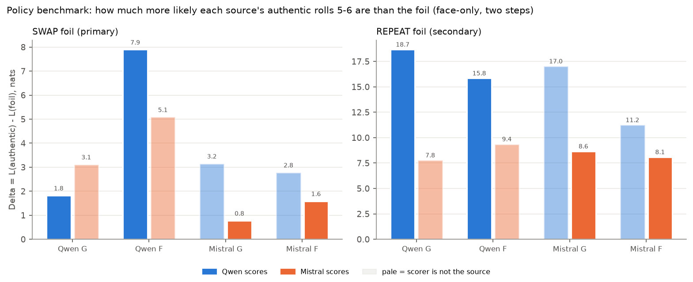
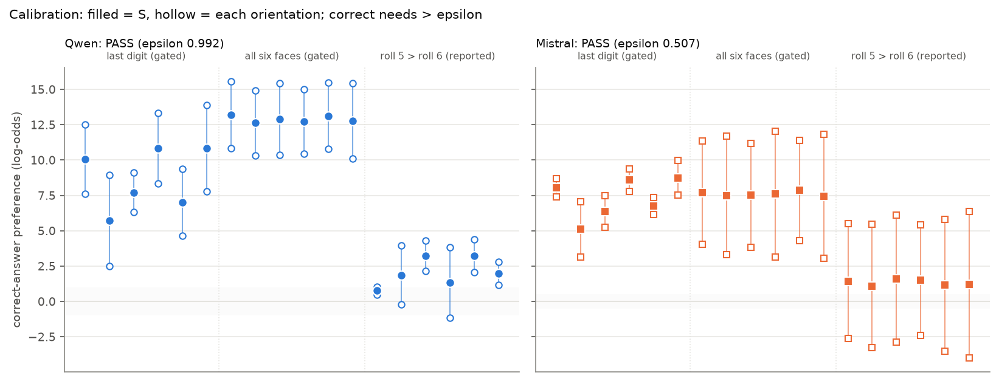
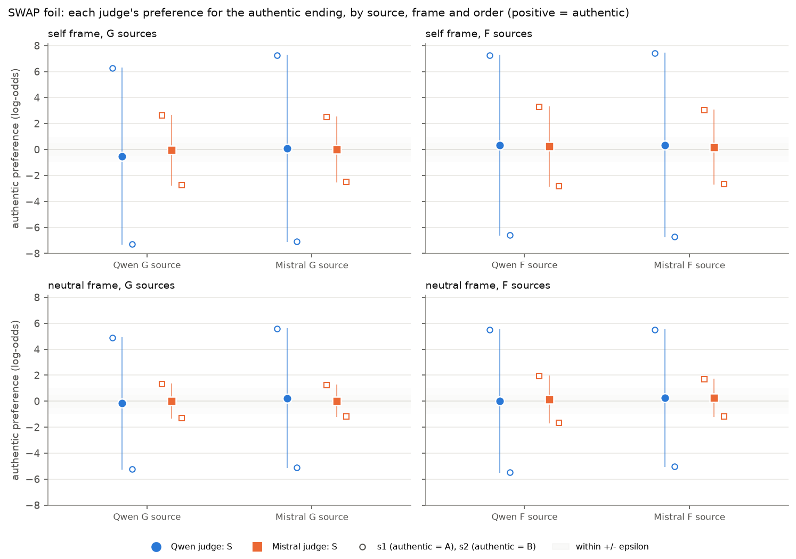
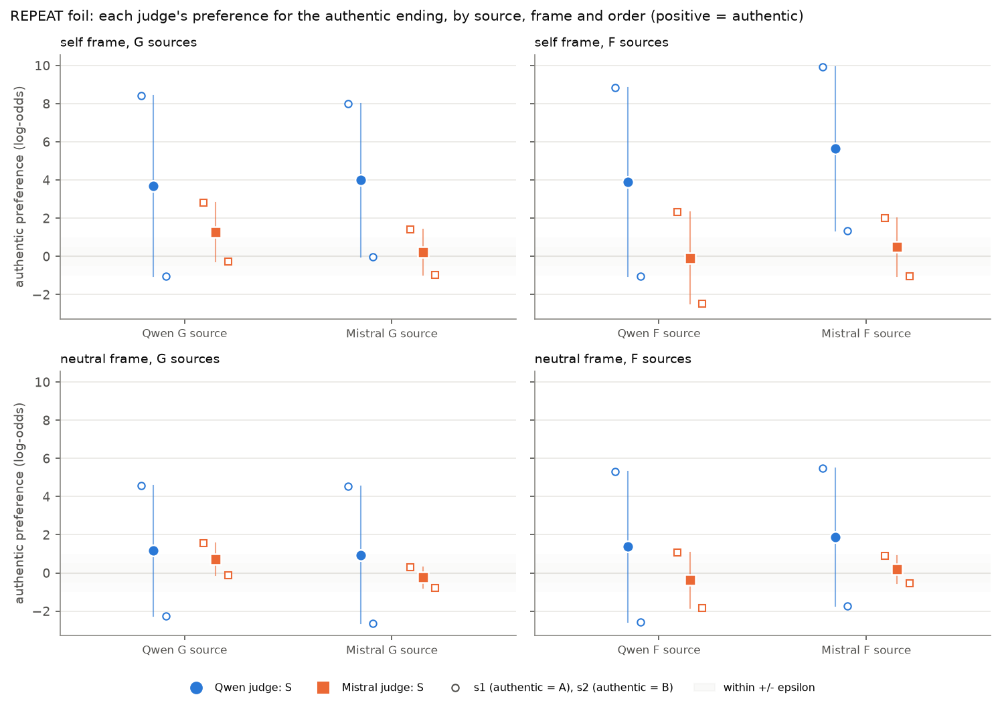
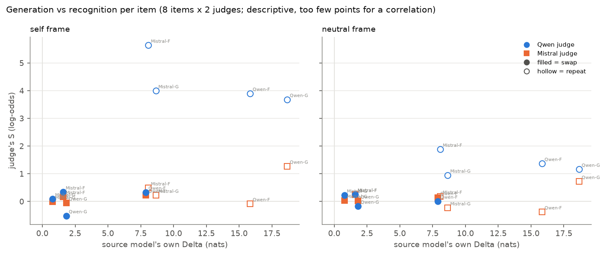
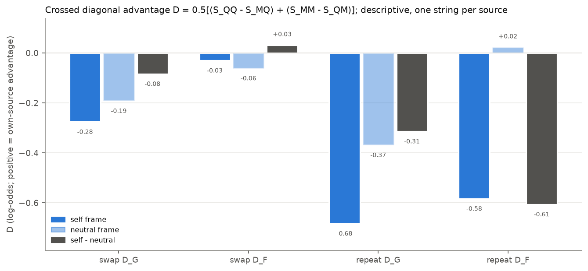

# Experiment 30: six-roll self-recognition by minimal-pair discrimination

`SPAR_EXP30_SIX_ROLL_RECOGNITION_v1.0` · 2026-11-01 · Qwen3-32B and Mistral Small 3.2 24B, open weights on one A100 ·
protocol [PROTOCOL_FROZEN.md](../track1_self_prediction/30_2026-11-01_six_roll_recognition/PROTOCOL_FROZEN.md) (frozen at `d9d8f6b`, approvals [APPROVALS.md](../track1_self_prediction/30_2026-11-01_six_roll_recognition/APPROVALS.md)) ·
decision memo [DECISION_MEMO.md](DECISION_MEMO.md)

## Summary

- **No self-specific recognition.**
  - On the primary SWAP pairs, each judge's order-averaged preference for the authentic ending is close to zero for every
    source, between −0.52 and +0.34 log-odds.
  - The crossed diagonal advantage is negative: D_G = −0.28 and D_F = −0.03 in the self frame, and −0.19 and −0.06 in the
    neutral frame.
- **The generative policies do discriminate.**
  - Under its own instruction, every source model prefers its authentic rolls 5–6 to the swapped pair: P(authentic | two) is
    0.86 and 0.9996 for Qwen G and F, and 0.68 and 0.83 for Mistral G and F.
  - The advantage is not self-specific: for three of the four sources, the *other* model's policy favours the authentic
    ending more strongly than the source's own policy does.
  - This is a generation–recognition dissociation (handoff outcome 4).
- **The REPEAT pairs show a generic no-repeat preference, mainly in Qwen.**
  - In the self frame Qwen's S is 3.7–5.6 log-odds on all four sources, larger on Mistral's sources than on its own, so the
    repeat D is negative (−0.68 for G, −0.58 for F).
  - Mistral's S is small (−0.1 to +1.3).
  - Only 1 of the 16 judge × frame × repeat items is order-consistent.
- **Answer-position bias dominates every single presentation.**
  - Every swap pair is order-inconsistent (s1 and s2 have opposite signs), because a constant "A" preference of about 5–7
    log-odds (Qwen) or 1.2–3.1 (Mistral) outweighs the content difference.
  - The greedy answer is "A" in 62 of 64 first-replicate presentations.
- **Measurement caveat.** Both judges passed calibration on its two gated tasks: they read the last digit and the all-six-faces
  rule correctly in both orders, 12 of 12 items each.
  - On the ungated task with the swap's own structure (which sequence has roll 5 > roll 6), both orders were correct for only
    3 of 6 items (Qwen) and 0 of 6 (Mistral).
  - So the swap null partly reflects the instrument's inability to read the order of rolls 5–6 robustly across orders, not
    only an absence of self-knowledge.
- **Integrity.**
  - Every hard gate passed for both judges at preflight, calibration and main, and reproduced locally.
  - Experiment 28's G and F outputs reproduced bit for bit (six-face |dp| = 0.0), as did its position 1–6 vectors.
  - Instance destroyed; billed total **$2.09**.

## What was run

| Stage | Qwen | Mistral |
|---|---|---|
| Preflight: archival G/F ×2, 4 technical prompts ×3, policy benchmark (144 rows), vocabulary scan | PASS | PASS |
| Calibration: 18 items × 2 orders (last digit and all six faces gated; roll 5 > roll 6 reported) | PASS, ε = 0.992 | PASS, ε = 0.507 |
| Main: 32 prompts (2 frames × 8 items × 2 orders) × 3 identical calls | PASS (96 calls) | PASS (96 calls) |

The 3 identical calls were bit-identical: the same log-probabilities and the same text. The tables below use replicate 1, so
there are 8 unique content comparisons per judge and frame. Order reversals and repeats are measurement checks, not further
items. No p-values or intervals.

## 1. Generative-policy benchmark (handoff section 5)

Each model teacher-forced each source's six-roll authentic, swap and repeat strings as the assistant answer to the source's own
instruction (Experiment 28's G or F prompt, byte-exact). The swap's sixth roll was scored after the swapped fifth.
Δ = L(authentic) − L(foil) in nats, with face-only log-probabilities at positions 5 + 6. In every row the raw full-vocabulary Δ
equals the face-only Δ to three decimals, because face mass ≈ 1.

| Source | Foil | Δ by the source model | P(auth \| two) | Δ by the other model | P(auth \| two) |
|---|---|---|---|---|---|
| Qwen G | swap | 1.82 | 0.861 | 3.12 (Mistral) | 0.958 |
| Qwen F | swap | 7.90 | 0.9996 | 5.09 (Mistral) | 0.994 |
| Mistral G | swap | 0.78 | 0.685 | 3.15 (Qwen) | 0.959 |
| Mistral F | swap | 1.59 | 0.831 | 2.78 (Qwen) | 0.942 |
| Qwen G | repeat | 18.67 | 1.000 | 7.77 | 0.9996 |
| Qwen F | repeat | 15.84 | 1.000 | 9.35 | 0.9999 |
| Mistral G | repeat | 8.65 | 0.9998 | 17.02 | 1.000 |
| Mistral F | repeat | 8.08 | 0.9997 | 11.24 | 1.000 |

- **The swap advantage sits entirely at roll 5.**
  - At roll 6 both models put almost all their mass on the one unused face, whichever ending came first: the position-6 share
    is −0.02 to 0.00 nats.
  - Each first-six block is a permutation, so after five distinct rolls the sixth is fixed by a rule shared by both models.
- **The source's own policy is not the strongest discriminator.** Only Qwen F is favoured more by its source (7.90) than by
  the other model (5.09).
  - Mistral's policy prefers Qwen G's authentic ending more than Qwen's does (3.12 vs 1.82).
  - Qwen's policy prefers Mistral's authentic endings more than Mistral's does (3.15 vs 0.78; 2.78 vs 1.59).
  - Policy-based discrimination of these four endings is therefore generic, not self-specific.
- **Repeats are near-impossible for every scorer** (8–19 nats): both policies complete the first six rolls without a repeat.
- **Checks.**
  - The source model's authentic rows reproduce Experiment 28's generation steps 1–6 exactly.
  - Shared contexts were bit-identical: the swap at roll 5 and the repeat at roll 6 share contexts with the authentic string.
  - Incremental vs full-pass scoring differs by ≤ 0.072 (Qwen) and ≤ 0.010 (Mistral) in six-face p.



## 2. Calibration (the reading gate)

| | Qwen | Mistral |
|---|---|---|
| last digit (gated): S > ε / both orders > ε | 6/6 / 6/6 | 6/6 / 6/6 |
| all six faces (gated): S > ε / both orders > ε | 6/6 / 6/6 | 6/6 / 6/6 |
| roll 5 > roll 6 (reported): S > ε / both orders > ε | 5/6 / 3/6 | 6/6 / **0/6** |
| mean label bias (d1 + d2)/2 | +2.05 | +3.16 |
| ε = max(0.05, 2 × max \|d_prefill − d_tokenwise\|) | 0.992 (stop at 1.0) | 0.507 |
| median P(A)+P(B) | 0.988 | 0.990 |

- **The gated reading tasks are easy for both judges.** S is 5–13 log-odds, well above the A bias.
- **The swap-structured task is not.**
  - Mistral's content effect on "roll 5 > roll 6" is about 1.1–1.6 log-odds against a 3.2 bias, so it answers "A" whichever
    sequence is shown first.
  - Qwen's is 0.8–3.2.
  - The greedy answer is correct for 10/12 of these presentations for Qwen and 6/12 for Mistral.
- The protocol gated only the two easy tasks, so both judges are formally interpretable. The weakness on the roll-5/6 task is
  reported because the primary swap contrast depends on the same reading.
- **Qwen's floor is high.** Feeding the prompt token by token rather than in one prefill moves d by up to 0.50 log-odds, so
  ε = 0.99, just under the frozen stop at 1.0. In main the gap is ≤ 0.37 for Qwen and ≤ 0.09 for Mistral, both below ε.



## 3. Recognition: SWAP (primary)

S = (s1 + s2)/2 in log-odds, where s1 is the authentic-in-A score and s2 the authentic-in-B score. Positive = prefers the
authentic ending.

| Judge, frame | Qwen G | Qwen F | Mistral G | Mistral F | label bias (mean) |
|---|---|---|---|---|---|
| Qwen, self | −0.52 (6.25 / −7.28) | 0.33 (7.27 / −6.60) | 0.09 (7.24 / −7.07) | 0.34 (7.41 / −6.73) | 6.98 |
| Mistral, self | −0.06 (2.64 / −2.75) | 0.23 (3.29 / −2.84) | −0.00 (2.51 / −2.51) | 0.17 (3.02 / −2.68) | 2.78 |
| Qwen, neutral | −0.17 | 0.01 | 0.22 | 0.25 | 5.29 |
| Mistral, neutral | 0.02 | 0.14 | 0.03 | 0.26 | 1.44 |

Parentheses: s1 / s2.

- **All 16 swap pairs are order-inconsistent.** Each judge prefers whichever sequence is labelled A by roughly the size of its
  label bias.
- **No |S| exceeds the judge's ε**: 0.99 for Qwen, 0.51 for Mistral.
- **Greedy answers are "A" in every swap presentation.**

| Crossed contrast (log-odds) | D_G | D_F |
|---|---|---|
| self frame | −0.28 | −0.03 |
| neutral frame | −0.19 | −0.06 |
| self − neutral | −0.08 | +0.03 |

- **Every contrast is negative or within a few hundredths of zero, and all are below either judge's ε.** None suggests a
  diagonal advantage.
- The largest single term is Qwen judging its own G source (S_QQ = −0.52). Qwen's s2 there is slightly more negative than its
  s1 is positive: a −1.03 log-odds asymmetry against an A bias of 6.8, which is inside Qwen's floor.



## 4. Recognition: REPEAT (secondary)

| Judge, frame | Qwen G | Qwen F | Mistral G | Mistral F |
|---|---|---|---|---|
| Qwen, self | 3.68 | 3.90 | 3.99 | **5.64** (order-consistent) |
| Mistral, self | 1.27 | −0.08 | 0.22 | 0.49 |
| Qwen, neutral | 1.16 | 1.37 | 0.95 | 1.88 |
| Mistral, neutral | 0.72 | −0.38 | −0.23 | 0.18 |

- **Qwen prefers the no-repeat ending on every source**, more in the self frame (mean 4.3) than in the neutral frame (1.3).
  - The self frame also raises its A bias: mean d is +5.7 in the self frame and +4.5 in the neutral frame.
  - The preference is not larger on Qwen's own strings: S_QM exceeds S_QQ for both G and F.
- **Mistral's repeat preference is small and sign-unstable.**
- **Crossed D is negative**: self frame −0.68 (G) and −0.58 (F); neutral −0.37 and +0.02.
  - These are driven by a large judge main effect (Qwen's S is 3.1–4.6 log-odds higher than Mistral's in the self frame), not
    by a diagonal pattern.
- One Qwen output was not a single letter: in the self frame, Mistral-G repeat with authentic as B, it answered "A or B are
  equally likely." (3 identical calls). It is invalid by the strict format rule. Its first-token d (+0.01) is still scored,
  as the protocol specifies.



## 5. Generation versus recognition



The source models' policies separate the authentic ending by 0.8–7.9 nats (swap) and 8–19 nats (repeat). The judges' answers
track neither the size of that separation nor its source:

- swap S stays within ±0.5 log-odds, whether the source policy's Δ is 0.8 or 7.9;
- Qwen's repeat S is large everywhere.

With 8 items, this is descriptive only.



## Outcome (handoff taxonomy)

- **SWAP:** outcome 4 (strong generative Δ, null recognition S), combined with outcome 2's absence of any own-source edge. The
  roll-5/6 reading weakness in calibration is a partial measurement caveat (outcome 5 in spirit, though not by the frozen
  gate).
- **REPEAT:** outcome 3 for Qwen, in the order-averaged sense: a robust, shared no-repeat preference with no self-specificity.
  For Mistral it is weak. The preference is order-robust in only 1 of 16 items, because of label bias.
- **Overall:** no evidence that either model recognises its own preferred ordering of rolls 5–6 better than the other model
  does. Nothing here bears on introspection.

## Limitations

- There are four fixed strings and 8 content comparisons. A/B reversal and repeats are checks, not items. With one string per
  source and instruction, any D is one coincidence of sequence structure.
- F sources are prediction-prompt outputs, not observed generations. G and F are reported separately.
- The A/B label bias (2–7 log-odds) is larger than every content effect in main. The order-averaged S removes a constant bias
  but not an order × content interaction. Most of the order-consistency criterion is therefore unreachable for subtle items.
- Qwen's numerical floor is large (ε = 0.99). Effects under about 1 log-odds are not distinguishable from arithmetic-path
  noise for Qwen.
- Calibration validated reading a stated last digit and the all-faces rule, not the order of rolls 5–6 (3/6 and 0/6 in both
  orders). A swap null is therefore weaker evidence than a repeat null would be.

## Reproduction

The commands below need Experiment 28's main records, which are in the repository, and LF-normalised checkouts.

```bash
PYTHONPATH=src python -m spar_dynamic.dice_six_roll_recognition dryrun
# on the GPU host, after src/spar_dynamic/dice_logprob_crossmodel/remote_setup.sh:
bash src/spar_dynamic/dice_six_roll_recognition/run_stage.sh qwen mistral      # chain per judge, gates in process
# locally:
PYTHONPATH=src python -m spar_dynamic.dice_six_roll_recognition gate_preflight qwen   # etc.; rewrites gate files
PYTHONPATH=src python -m spar_dynamic.dice_six_roll_recognition analyse
pytest tests/test_dice_six_roll_recognition.py
```

## Run record

- **Host:** vast.ai instance 58680335 (offer 53873539, North Carolina; A100-SXM4-80GB; driver 595.91.07), the same host as
  Experiment 29. Image `pytorch/pytorch:2.7.1-cuda12.8-cudnn9-runtime` with Experiment 28's pins. Code commit `0acf376`.
- **Interruption:** the instance stopped once by itself, about 3 minutes after creation and before any setup. One manual
  restart fixed it; no data were affected.
- **Timing:** Qwen's chain finished at 16:31 UTC (calibration 16:23–16:27, main 16:27–16:31); Mistral's ran 16:31–16:36 UTC. Mean time per recognition call (including
  tokenwise passes) was 0.19 s (Qwen) and 0.10 s (Mistral).
- **Cost:** $2.092 billed (GPU 0.355 h $0.633, disk $0.077, 103 GB download $1.374, upload remainder). Destroyed 16:36:46 UTC
  and absent from `vastai show instances` afterwards.
- **Data integrity:** all 10 raw JSONL files match the host's SHA-256. Every gate re-run locally gives the host's statuses.
- **Post-freeze code change (layout only):** after collection, two figure layout fixes were made in `figures.py` (legend placement in figures 1 and 2, y-margin in figure 3). No data, gate, analysis or table code changed; `figures.py` therefore differs from its hash in `inputs_sha256.json`.
