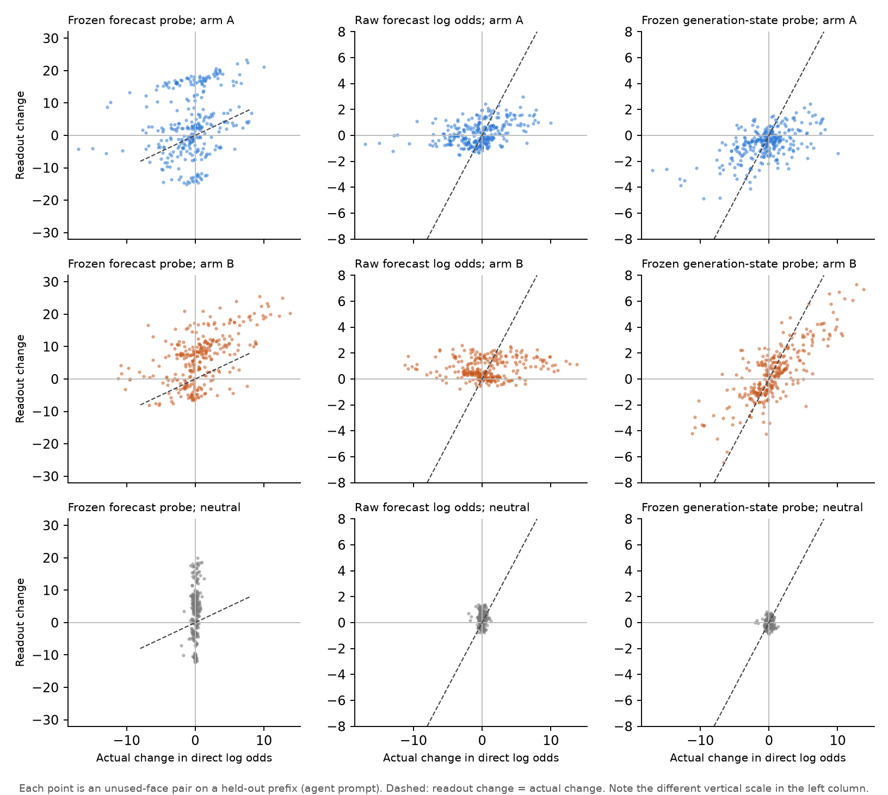

# Experiment 37: does a frozen probe follow Qwen when its dice policy changes?

Exploratory; Qwen3-32B only. Protocol and code frozen at `6b22a50` before adapter training; probe coefficients (hash) frozen at `2f49cb1` before any held-out adapted forecast. All checks pass ([CHECKS.md](../../track1_self_prediction/37_2026-11-25_frozen_probe_policy_swap/results/CHECKS.md)): base bit-identical to Experiment 36, disabled adapter bit-identical to base in scores and stored states, prompts and tokens identical across arms.

## Verdict

**Not established. The frozen forecast probe moves a lot under every adapter, including one that barely changes the policy, and it does not track the difference between A and B.**

- **The policy swap worked.** Both arms pass every holdout gate, and the generation-state probe follows the measured change, including A minus B (correlation 0.635).
- **The forecast probe's movement is mostly adapter drift.** Its median absolute change is 5.96 (A), 7.48 (B) and **5.66 (neutral)**, where the actual median change is 1.95, 1.84 and 0.20. A's and the neutral adapter's probe changes correlate 0.86. The neutral adapter started from A's weights, so this shared component is expected, but it is not policy.
- **A minus B fails:** correlation −0.10 (CI −0.31 to +0.03).
- **Literal criteria, stated openly.** For pooled A+B on agent, the correlation is 0.398 (CI 0.140 to 0.546), above the wrong-history 97.5% point (0.345), and the fixed-digit-demeaned correlation is 0.434 (CI 0.358 to 0.523). By point estimate these meet the frozen criteria. The protocol's wording ("lies above") is ambiguous: the interval's lower end (0.140) is below 0.345. Taken with the neutral and A-minus-B results, we do not claim tracking. Arm B alone looks better (0.576, demeaned 0.566); arm A does not (0.200, demeaned 0.270).
- **No demonstrated advantage over output.** Probe minus raw-forecast correlation is +0.07 (CI −0.06 to +0.19) and probe minus calibrated output +0.35 (CI −0.08 to +0.69).

## The intervention (held out: 192 prefixes, 288 pairs, 8 families)

| Gate (threshold) | A | B | Neutral | Disabled |
|---|---|---|---|---|
| Median abs. change in log odds (≥ 0.5) | 1.95 | 1.84 | 0.20 | 0 |
| Prefixes switching preferred face (≥ 20%) | 48.4% | 58.3% | 6.3% | 0% |
| Median abs. change in unused mass (≤ 3 points) | 0.06 | 0.17 | 0.01 | 0 |
| Same, roll 4: log odds, switch, mass | 3.04, 81%, 0.02 | 2.83, 85%, 0.13 | 0.24, 6%, 0.00 | |
| Same, roll 5 | 1.05, 38%, 0.07 | 1.17, 49%, 0.19 | 0.17, 6%, 0.02 | |
| Median digit mass | 0.99999 | 0.99997 | 1.00000 | 1.00000 |

- Both passed development on the first schedule (c1: rank 8, 24 epochs; best epoch 24 for A, 8 for B). Trainable part: blocks 24–39; adapters are 33 MB each; three adapters took about 12 minutes.
- **A and B are less opposed than intended.** The measured change correlates 0.70 between them, and 56–60% of each arm's development change is explained by one fixed shift per roll and face pair. The measured policy, not the target, is the ground truth, as specified. A versus B still differ in preferred face on 80% of prefixes.
- **Free G generation** (greedy, ten rolls): base `5 2 6 3 1 4 6 2 5 3`, A `5 3 6 4 1 2 5 6 4 3`, B `3 5 2 1 4 6 2 5 3 1`, neutral `3 5 1 6 2 4 3 6 5 2`. The neutral adapter preserves the trained-position policy but still changes the opening, where it was not trained.

## Does each readout follow the change? (agent prompt, A+B pooled)

Correlation of actual and decoded change; skill is 1 − error ÷ (error of predicting no change), so below zero is worse than predicting no change. Nothing is refitted or rescaled.

| Readout (frozen) | Correlation [95% CI] | Skill [95% CI] | Demeaned correlation | Wrong-history mean (97.5%) |
|---|---|---|---|---|
| **Forecast probe** | **0.398 [0.140, 0.546]** | **−6.08 [−10.7, −3.7]** | 0.434 | 0.332 (0.345) |
| Raw forecast log odds | 0.324 [0.153, 0.388] | +0.11 [−0.03, +0.18] | −0.080 | 0.345 (0.365) |
| Calibrated output | 0.051 [−0.169, 0.253] | −0.56 [−0.76, −0.28] | 0.425 | −0.097 (−0.065) |
| History + output (output part) | 0.165 [0.021, 0.266] | +0.03 [−0.01, +0.07] | 0.225 | 0.082 (0.108) |
| History + logits (logit part) | 0.305 [0.120, 0.454] | +0.01 [−0.10, +0.10] | 0.340 | 0.161 (0.198) |
| History + output + activation | 0.516 [0.311, 0.585] | +0.27 [+0.04, +0.39] | 0.300 | 0.465 (0.480) |
| Generation-state probe (control) | 0.727 [0.638, 0.781] | +0.47 [+0.39, +0.54] | 0.671 | 0.448 (0.488) |

| Arm | Forecast probe | Raw forecast | Generation-state probe |
|---|---|---|---|
| A: correlation / skill | 0.200 / −9.94 | 0.366 / +0.11 | 0.552 / +0.28 |
| B: correlation / skill | 0.576 / −3.54 | 0.168 / +0.11 | 0.804 / +0.60 |
| A − B: correlation / skill | **−0.096 / −3.83** | 0.159 / +0.13 | 0.635 / +0.53 |
| Neutral: correlation / median readout change | 0.280 / 5.66 | 0.030 / 0.45 | 0.012 / 0.19 |

- **Calibration is poor as well as direction.** The probe's changes are three to four times the actual ones, partly a shift in the probe's units under any adapter.
- **Output carries little.** The raw forecast moves by about a third of the actual change, with the skill near zero. Qwen's forecast wording does not carry the policy change over much.
- **Wrong-history control:** for A and B pooled, 0.33 of the probe's 0.398 correlation is already present with the wrong history, i.e. the history-independent part of the change. For arm A it is 0.162 (97.5% point 0.178) against 0.200; for B, 0.469 (0.494) against 0.576.

## Favourite reversals (defined from direct behaviour only)

| | A | B |
|---|---|---|
| Prefixes whose favourite changes | 93 of 192 | 112 of 192 |
| Forecast probe moves toward the new favourite | 48 | 83 |
| Raw forecast moves toward it | 59 | 70 |
| Generation-state probe | 74 | 97 |
| Shape prompt: forecast probe / raw forecast (no refit) | 42 / 67 | 85 / 73 |
| Unused mass stable (within 3 points) | 90 | 105 |

Chance is half. A's probe is at chance. B's is well above, but the neutral adapter shows that much movement occurs without any policy change. Gaining faces are mostly 3, 4, 5 (A) and 2, 1, 3 (B). Per-prefix rows are in `results/favourite_reversals.csv`.

Examples (log odds of the new over the old favourite):

| | Prefix, arm | Actual change | Probe base → arm | Raw forecast base → arm |
|---|---|---|---|---|
| Tracked | `4 5 1`, B (fold 1), 6 → 2 | +9.34 | −11.59 → +13.99 | −3.96 → −2.71 |
| Missed | `5 6 1 3`, A (fold 0), 2 → 4 | +1.21 | +0.19 → −17.49 | +2.41 → +2.96 |
| Forecast tracks | `1 5 4 2`, A (fold 1), 6 → 3 | +5.97 | −4.18 → −0.96 | −1.07 → +1.91 |

Unused-face mass changed by 0.12, 0.74 and 0.04 points in these three examples; more detail is in `summary.json`.

## Shape (same agent-trained probe, no refit)

Correlation 0.425 (CI 0.133 to 0.567), skill −7.3. Experiment 36 showed this probe does not transfer to other prompts, so this is weak evidence.

## Base validity

On the held-out base histories the probe is informative: correlation 0.85 and skill 0.72 against the actual base policy (generation-state probe 0.88 and 0.78; calibrated output 0.73 and 0.52). So the baseline gate is met. The swap result is not a decisive negative either. The generation-state probe shows the method can follow the change, so the failure is at the forecast site. Two explanations that this cannot separate are that the forecast state does not carry the currently implemented policy, and that adapter-induced drift dominates the probe's direction there. The neutral arm favours the second as at least a large part.

## Deviations and limits

- Eight holdout families; all intervals are rough. 
- Neutral was feasible and informative: it revealed large drift at a site where the policy is nearly unchanged. Neutral's correlation (0.28) against tiny actual changes is not meaningful in size.
- Activations, adapters and probes are not in git. Hashes are in `raw/env_evaluate.json` and `probes_manifest.json`; regenerate with `python -m spar_dynamic.policy_swap.gpu train|evaluate` on the pinned image, after `python -m spar_dynamic.hidden_policy.gpu` and `python -m spar_dynamic.policy_swap probes`. Only the local copies of the arrays exist.
- Cost: $6.16 for the whole rental of Experiments 35–37 (`run_record.json`).
