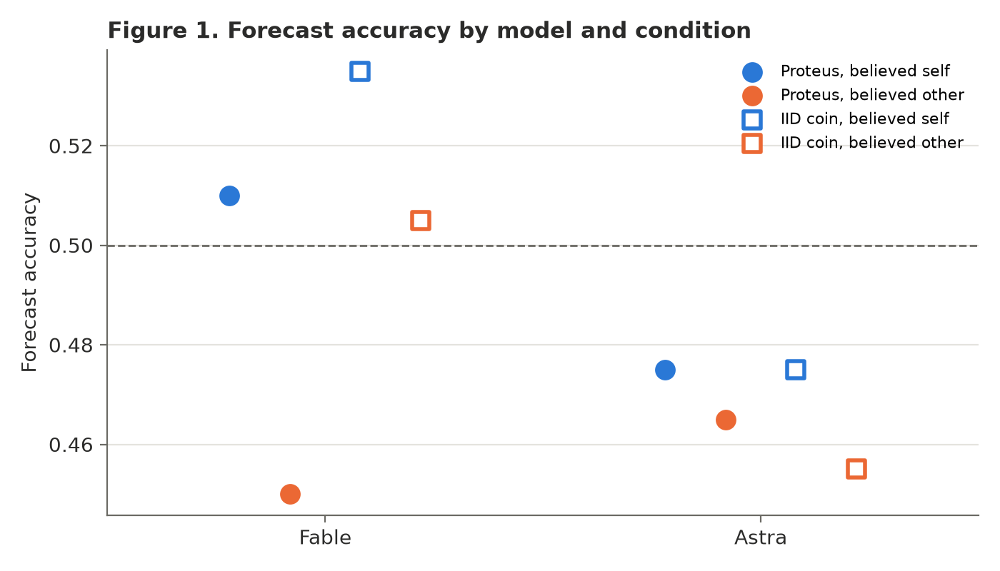
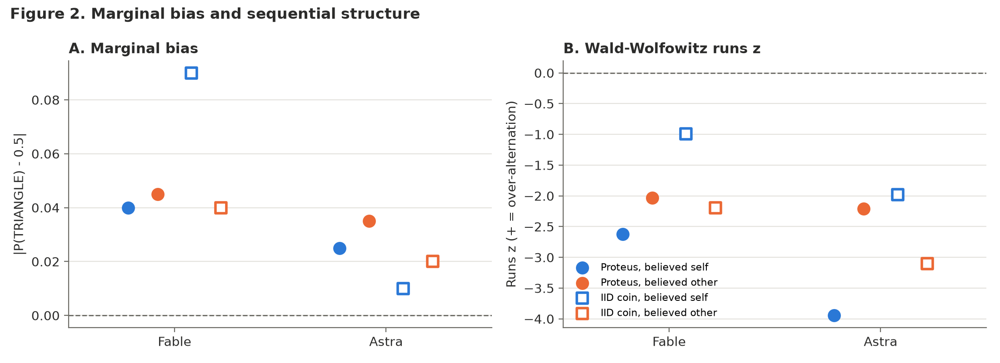
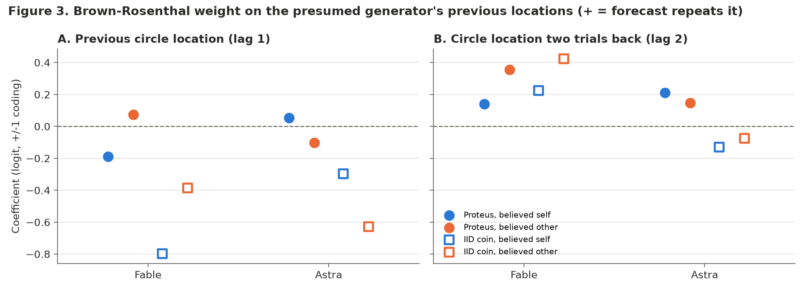
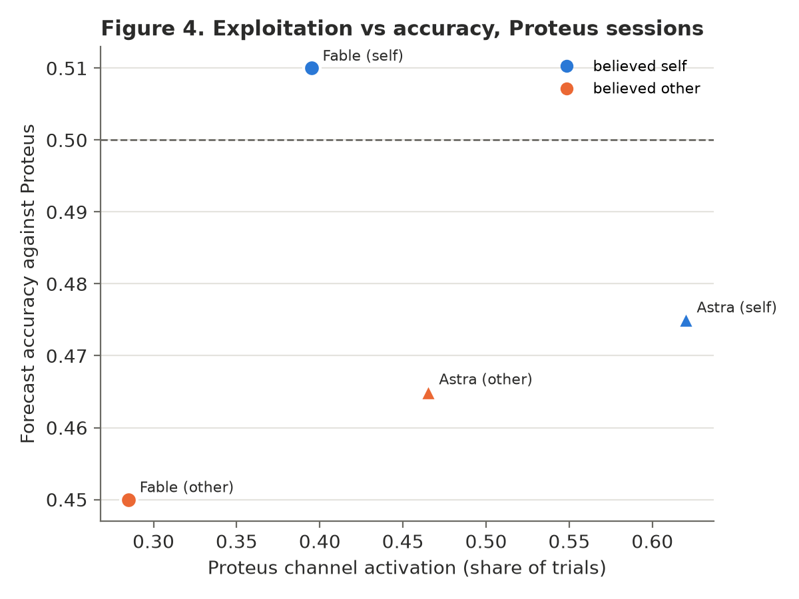

# PACA believed-self generator pilot: report

Experiment `paca_believed_self_pilot_v1`. Generated by `task/analyze_believed_self.py`. One 200-trial session per (model x actual generator x believed generator); all comparisons are descriptive.

## Design and execution

- Baseline PACA minimalist forecasting task: the model chooses where the blue circle will land (TRIANGLE/STAR); it sees the last 5 trials in words and a 25-trial grid of its forecasts and the circle's locations. The only manipulation is one sentence prepended to the system prompt: *"Another instance of your model is generating the sequence of blue circle landings."* vs *"An instance of a different language model is generating the sequence of blue circle landings."*
- Actual generator, hidden in both conditions: Proteus (PACA's nine-channel opponent, full-session history, commits before the model's forecast) or an IID fair coin. Believed-self and believed-other sessions of the same model and generator share an opponent seed, so the IID coin sequences are identical across the belief contrast.
- Charged cost: $22.16 for session calls (incl. 2 re-requested attempts) + $0.28 preflight.

| session | status | trials | accuracy | P(T) | switch | runs z | copy last circle | Proteus activation | mean attempts | exact final line |
|---|---|---:|---:|---:|---:|---:|---:|---:|---:|---:|
| fable_P-S | complete | 200 | 0.510 | 0.460 | 0.407 | -2.62 | 0.457 | 0.395 | 1.00 | 1.000 |
| fable_P-O | complete | 200 | 0.450 | 0.455 | 0.427 | -2.03 | 0.513 | 0.285 | 1.00 | 1.000 |
| fable_R-S | complete | 200 | 0.535 | 0.590 | 0.452 | -0.99 | 0.347 | 0.700 | 1.01 | 1.000 |
| fable_R-O | complete | 200 | 0.505 | 0.540 | 0.422 | -2.19 | 0.417 | 0.265 | 1.00 | 1.000 |
| astra_P-S | complete | 200 | 0.475 | 0.475 | 0.362 | -3.94 | 0.497 | 0.620 | 1.00 | 1.000 |
| astra_P-O | complete | 200 | 0.465 | 0.465 | 0.422 | -2.21 | 0.457 | 0.465 | 1.00 | 1.000 |
| astra_R-S | complete | 200 | 0.475 | 0.490 | 0.432 | -1.98 | 0.427 | 0.150 | 1.00 | 1.000 |
| astra_R-O | complete | 200 | 0.455 | 0.480 | 0.392 | -3.10 | 0.347 | 0.385 | 1.00 | 1.000 |
| qwen_P-S | not_run | 0 | NA | NA | NA | NA | NA | NA | NA | NA |
| qwen_P-O | not_run | 0 | NA | NA | NA | NA | NA | NA | NA | NA |
| qwen_R-S | not_run | 0 | NA | NA | NA | NA | NA | NA | NA | NA |
| qwen_R-O | not_run | 0 | NA | NA | NA | NA | NA | NA | NA | NA |

## Primary: history dependence (Brown-Rosenthal, per session)

Coefficients are logits with +/-1 coding (TRIANGLE = +1): a positive circle coefficient means the forecast tends to repeat that earlier landing. Block p-values are PACA's nested likelihood-ratio tests. `sep` flags separation or near-separation (coefficients unreliable). Outcome is a main effect (previous forecast correct = +1). PACA's own x outcome block is omitted: with +/-1 coding it is identical to the circle lags.

| session | own1 | own2 | circle lag1 | circle lag2 | outcome1 | outcome2 | p Own | p Circle | p Outcome (main) | sep |
|---|---:|---:|---:|---:|---:|---:|---:|---:|---:|---|
| fable_P-S | +0.36 | +0.12 | -0.19 | +0.14 | -0.05 | +0.08 | 0.025 | 0.367 | 0.790 |  |
| fable_P-O | +0.26 | +0.23 | +0.07 | +0.35 | +0.27 | +0.25 | 0.062 | 0.101 | 0.078 |  |
| fable_R-S | +0.23 | +0.28 | -0.80 | +0.22 | +0.14 | -0.09 | 0.154 | 0.000 | 0.573 |  |
| fable_R-O | +0.40 | +0.15 | -0.39 | +0.42 | +0.04 | -0.03 | 0.050 | 0.001 | 0.942 |  |
| astra_P-S | +0.48 | +0.27 | +0.05 | +0.21 | +0.26 | +0.11 | 0.000 | 0.400 | 0.165 |  |
| astra_P-O | +0.30 | +0.22 | -0.10 | +0.15 | -0.10 | +0.28 | 0.028 | 0.619 | 0.140 |  |
| astra_R-S | +0.23 | +0.10 | -0.30 | -0.13 | -0.14 | -0.01 | 0.135 | 0.112 | 0.631 |  |
| astra_R-O | +0.42 | -0.11 | -0.63 | -0.07 | -0.08 | -0.01 | 0.008 | 0.000 | 0.870 |  |

## Believed self minus believed other (descriptive)

| model | measure | Proteus: self − other | IID coin: self − other | difference (Proteus − coin) |
|---|---|---:|---:|---:|
| fable | accuracy | +0.060 | +0.030 | +0.030 |
| fable | abs_bias | -0.005 | +0.050 | -0.055 |
| fable | runs_z | -0.592 | +1.201 | -1.793 |
| fable | copy_last_circle | -0.055 | -0.070 | +0.015 |
| fable | proteus_activation | +0.110 | +0.435 | -0.325 |
| fable | coef_opp1 | -0.263 | -0.413 | +0.149 |
| fable | coef_opp2 | -0.214 | -0.201 | -0.014 |
| astra | accuracy | +0.010 | +0.020 | -0.010 |
| astra | abs_bias | -0.010 | -0.010 | +0.000 |
| astra | runs_z | -1.734 | +1.121 | -2.856 |
| astra | copy_last_circle | +0.040 | +0.080 | -0.040 |
| astra | proteus_activation | +0.155 | -0.235 | +0.390 |
| astra | coef_opp1 | +0.156 | +0.331 | -0.175 |
| astra | coef_opp2 | +0.064 | -0.055 | +0.120 |
| qwen | accuracy | NA | NA | NA |
| qwen | abs_bias | NA | NA | NA |
| qwen | runs_z | NA | NA | NA |
| qwen | copy_last_circle | NA | NA | NA |
| qwen | proteus_activation | NA | NA | NA |
| qwen | coef_opp1 | NA | NA | NA |
| qwen | coef_opp2 | NA | NA | NA |

## Parsing and completion

- Qwen: not run by decision (APPROVAL.md, 2026-10-11). At PACA's default reasoning its preflight forecasts used 28-31k output tokens (~$0.075, ~10 min) each, making 800 sequential calls infeasible.
- Failed attempts (re-requested; never coin-substituted): 2 {'fallback_parse_fail/content_filter': 2}.

## Figures

## Interpretation limits

- One session per cell: a self − other difference confounds the framing with session-to-session variation (the test-retest work in the SPAR repo found models reproduce only ~80% of their own choices on identical prompts). Rounds are not independent replications of the framing effect.
- Against the IID coin, accuracy is 0.5 in expectation whatever the policy; behavioural measures can still differ.
- This pilot can show an identity-framing effect on forecasting policy and its consequence against Proteus. It cannot show accurate self-modelling or privileged self-knowledge.
