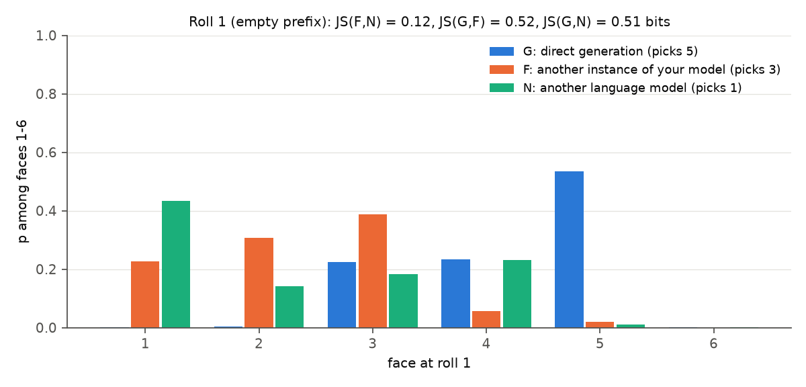
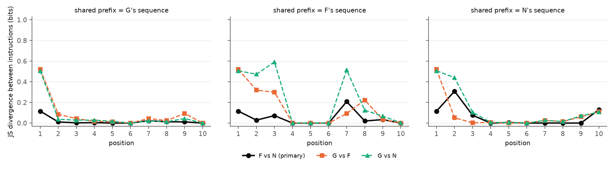

# Generic-model framing control for the dice log-probability study (amendment v1.1, 2026-10-29)

**Parent:** [Experiment 21 report](../main-qwen3-32b-a100/REPORT.md). **Handoff:** `GPT_SPAR_Dice_Logprob_Generic_Model_Control_Claude_Code_Handoff_v1.1`. **Run:** `control-main-qwen3-32b-a100` (preflight `control-preflight-qwen3-32b-a100`). **Cost:** about $1.02 against an $8 cap; the instance was destroyed.

## 1. Question

Experiment 21 found that asking Qwen3-32B to predict "another instance of your model" (F) shifts the first-roll distribution far from what the model generates directly (G): JS 0.52 bits, and G's choice, face 5, drops from .54 to .02. Given the same history, F then continues like G, which is the early-deviation cascade Ackerman raised on 2026-10-25.

But F differs from G in two ways at once: self-reference *and* a long prediction wrapper. **This control changes only the self-reference.** In N, "another instance of your model" becomes "another language model"; every other byte of F is kept.

## 2. Methods and compatibility with Experiment 21

- **Prompts.** G and F are byte-identical to Experiment 21 (SHA-256 `edc7a4a2…` and `8adcaddf…`). N is generated from F by that one substitution, and a test asserts it is the only difference. N's hash is in `prompts_frozen.md`. N is 8 characters shorter (a residual length difference, not balanced).
- **Serving: identical to Experiment 21.**
  - Model: Qwen3-32B at commit `9216db57…`, bf16 with an fp32 output layer, `transformers` 5.22.0, torch 2.11.0.
  - Decoding: greedy, batch 1; non-thinking chat template; one user message; no system message; no tools.
  - Hardware: the **same** Vast.ai A100-SXM4-80GB machine (ID 153016).
- **Design.**
  - Preflight: 3 each of G, F and N.
  - Main: 10 each = 30 fresh-context generations, in a seeded interleaved order.
  - Matched prefix: every instruction (G, F, N) × every modal history (G, F, N), scored token by token through the cache. Roll 1 has the same empty prefix under every history, so it is one comparison per instruction, not three.
- **Precision floor.** Recomputing the same probabilities in one forward pass instead of token by token moves the six-face distribution by up to **0.15** in this run (0.09 in Experiment 21, which had fewer comparisons). Faces closer than that are reported as near-ties.

## 3. Preflight and replication of Experiment 21

All gates passed: prompt hashes frozen, valid 10-face outputs, non-thinking, complete six-face vectors, reproducibility, and teacher forcing reproducing generation (difference 0).

**G and F reproduce Experiment 21 exactly:** G = `5 2 6 3 1 4 6 2 5 3`, F = `3 1 4 6 2 5 3 2 6 4`, with **zero** difference in the six-face probabilities at every position against the archived run. N gives **`1 3 5 2 6 4 2 5 1 6`**. In the main run every condition was identical across its 10 repeats; these are repeatability checks of one deterministic path, not 10 independent observations.

## 4. Primary result: roll 1



| Probability among faces | 1 | 2 | 3 | 4 | 5 | 6 | Picks | Gap from top face to runner-up | Raw face mass |
|---|---|---|---|---|---|---|---|---|---|
| **G** direct generation | .001 | .004 | .225 | .234 | **.535** | .002 | 5 | .30 | 1.000 |
| **F** another instance of your model | .226 | .308 | **.388** | .058 | .021 | .000 | 3 | .08 (near-tie) | 0.998 |
| **N** another language model | **.434** | .141 | .182 | .230 | .011 | .000 | 1 | .20 | 0.995 |

| Comparison | JS divergence (bits) |
|---|---|
| **F vs N** (identity wording only) | **0.12** |
| G vs F | 0.52 |
| G vs N | 0.51 |
| Self-specific increment, JS(G,F) − JS(G,N) | 0.01 |

- **The big shift away from G happens under both wordings.** G's choice, face 5, falls from .54 to .021 under F and .011 under N; it ranks 5th of 6 in both. Both wordings move probability onto faces 1–3.
- **F and N differ less from each other than either does from G** (0.12 vs about 0.5 bits). They do pick different first faces: F picks 3 and N picks 1. F's own pick is a near-tie (3 at .39 vs 2 at .31), so "F picks 3" is not a robust contrast. N's lead of 1 over 4 (.20) is just above the floor.

## 5. Matched prefix (same history under every instruction)



Rolls 2–10 (9 positions per history). "Follows" means the instruction's top face equals the history's actual next face.

| History fed as prefix | F follows | N follows | G follows | F and N pick the same face | Largest JS(F,N) |
|---|---|---|---|---|---|
| G's sequence | 9/9 | 8/9 | 9/9 | 8/9 | 0.02 |
| F's sequence | 9/9 | 9/9 | 5/9 | 9/9 | 0.21 |
| N's sequence | 7/9 | 9/9 | 7/9 | 7/9 | 0.31 |

- **Given G's history, F and N both continue as G does.** The one exception is roll 4, where N picks 1 instead of 3; both F and N are near-ties between 1 and 3 there. The parent run's shared continuation therefore also holds under the generic-model wording.
- **Given F's history, F and N agree at every roll.** G's instruction departs at rolls 2, 3, 7 and 8, the asymmetry seen in Experiment 21.
- **Given N's history, the self-wording departs at rolls 2–3**, picking 4 and 6, the same faces as G's instruction, instead of N's 3 and 5. This is the largest F-vs-N difference under a shared prefix (JS 0.31 at roll 2). After roll 3 all three instructions agree.
- **Overall, instruction effects of any kind are concentrated in the first two or three rolls.** From roll 4 on, all three instructions follow whatever history they are given, apart from a few near-ties and G's departures on F's history.

## 6. Interpretation

Of the handoff's three outcomes, this is **N ≈ F relative to G**:

- **The large first-roll shift in Experiment 21 is not specific to self-reference under this comparator.** Wording the same prediction wrapper as "another language model" produces nearly the same departure from direct generation (JS 0.51 vs 0.52 bits) and the same suppression of G's first choice. The prediction framing, not its *self* content, drives most of the shift. Which part of the wrapper matters (asking for a prediction, the length, the nested instruction) is not isolated here.
- **The identity wording still has a smaller effect.** F and N differ at roll 1 (JS 0.12; different top faces, though F's is a near-tie) and, given N's history, at rolls 2–3. These differences are a fraction of the wrapper effect and confined to the opening. They show sensitivity to the words "instance of your model", not knowledge of its own behaviour: neither F nor N predicts G's sequence.
- **The shared-continuation finding generalizes.** Under every fixed history, all three instructions mostly agree from roll 4 onward. So the dissociation between generation and prediction in this task sits almost entirely in how the sequence *starts*.

## 7. Limitations

- One deterministic path per prompt on one model, one task and one serving configuration: a case study, with no p-values or confidence intervals.
- One generic comparator. "Not self-specific under this comparator" does not rule out every other self/other contrast.
- N is 8 characters shorter than F, and "that instance" still appears in N's final sentence, a slight mismatch with "another language model" that the handoff required keeping.
- The precision floor (0.15) means that near-ties, including F's own first pick, are not robust.
- Output probabilities do not reveal internal mechanisms.

## 8. Summary for the investigators

Replacing "another instance of your model" with "another language model" **preserves** the large first-roll departure from direct generation that Experiment 21 found:
- JS(G,N) 0.51 vs JS(G,F) 0.52 bits.
- G's first choice falls to .01–.02 under both wordings.

So that shift belongs to the prediction wrapper, not to self-reference. The self wording has a smaller, opening-only effect: JS(F,N) 0.12 bits at roll 1 and divergence at rolls 2–3 under N's history. Under any shared history, all three instructions largely agree from roll 4 on. G and F replicated Experiment 21 exactly on the same machine.

**No decision is required before another run.** A natural next contrast is to vary the wrapper rather than the identity, for example asking for a prediction about "a fair die" or "a random sequence", to find which part of the wrapper moves the opening. It is not run, and it needs approval.

## Files

| File | Contents |
|---|---|
| `prompts_frozen.md`, `manifest.json`, `env_control_main.json` | Exact G/F/N texts and hashes; serving, hardware, versions, seeds, cost |
| `raw_attempts.jsonl`, `responses.csv`, `position_probabilities.csv` | All 30 generations with exact per-position face log-probabilities |
| `matched_prefix.jsonl`, `matched_prefix.csv`, `matched_prefix_comparison.csv` | Instruction × history × position six-face vectors (incremental primary; full pass for the floor) |
| `first_roll_comparison.csv`, `analysis_summary.json` | The roll-1 table and JS values; per-history matched-prefix summaries |
| `main_gate_check_report.md` | Gates re-checked on the main run |
| `figures/first_roll_G_F_N.png`, `figures/matched_prefix_js.png` | The two figures above |
| Preflight: `../control-preflight-qwen3-32b-a100/` (`control_preflight_report.md`) | 9 generations, all gates PASS |

Reproduce offline:

```bash
PYTHONPATH=src python -m spar_dynamic.dice_logprob.control analyse --run <this folder>
```

Tests: `python -m pytest tests/test_dice_logprob.py` (31 pass).
