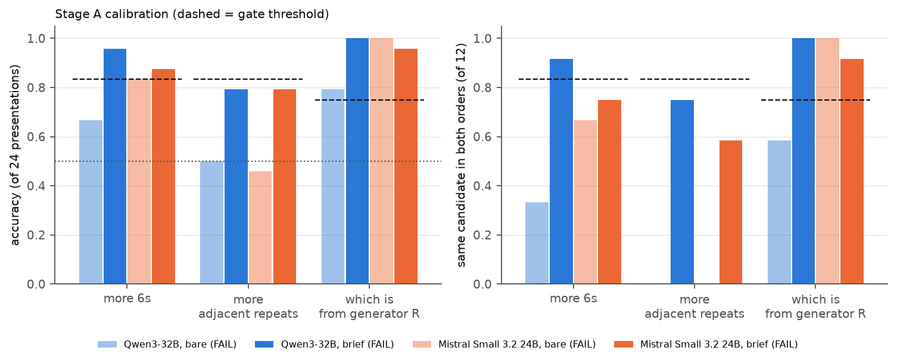

# 23 · Loula dice self-recognition v2: does the A/B instrument read the sequences? (2026-10-29)

| | |
|---|---|
| Track | 1: static self-prediction |
| Tag | `LOULA_DICE_RECOGNITION_v2.0` |
| Handoff | `GPT_SPAR_Loula_Dice_Recognition_Redesign_Claude_Code_Handoff_v2.0` (2026-10-29) |
| Models | Qwen3-32B (OpenRouter, SiliconFlow pinned, reasoning off) and Mistral Small 3.2 24B (DeepInfra pinned), as in 22 |
| Size and cost | 12 preflight + 288 calibration calls; **$0.0074** of the $5 cap |
| Previous | [← 22 Loula-style dice self-recognition pilot](../22_2026-10-29_loula_dice_recognition_pilot/) |
| Full report | [**reports/REPORT.md**](reports/REPORT.md) · [decision memo](reports/DECISION_MEMO.md) |

## Question

In Experiment 22 both judges answered A/B by position, so its 50% recognition score measured nothing. This staged redesign first asks whether the judges can make **content-dependent** A/B choices on dice sequences at all. Only then would it test authorship recognition vs typicality, evidence dose (1/3/5 ten-roll blocks), named-model controls with counterbalanced name order, and familiarization.

## What was done

- The protocol was frozen before any call ([`PROTOCOL_FROZEN.md`](PROTOCOL_FROZEN.md)), and the API preflight passed.
- **Stage A calibration** used 12 synthetic item pairs for each of three tasks:
  - which sample has more 6s;
  - which has more adjacent repeats;
  - which came from a "repeating" generator R (70% repeats) vs an "avoiding" generator S (5%).
- Each item was shown in both A/B orders, to both judges, in two answer formats: bare "A/B", and a one-sentence observation followed by `ANSWER: A/B`.

## Results

**Neither judge passed in either format, so the experiment stopped after Stage A, as prespecified.** Stages B–D are `NOT_RUN`.

| Judge | Format | 6s (correct/24, consistent/12) | Repeats | Generator R | Cell |
|---|---|---|---|---|---|
| Qwen3-32B | bare | 16, 4 | 12, 0 (always "A") | 19, 7 | FAIL |
| Qwen3-32B | brief | 23, 11 | 19, 9 (gates 20, 10) | 24, 12 | FAIL |
| Mistral Small 3.2 | bare | 20, 8 | 11, 0 (always "A") | 24, 12 | FAIL |
| Mistral Small 3.2 | brief | 21, 9 | 19, 7 | 23, 11 | FAIL |

- **The bare format collapses to "A"** whenever the content difference is small, as in Experiment 22.
- **A one-sentence observation removes most of the position bias** but leaves counting errors. Stated counts are often wrong even when the final answer is right.
- **An obvious generator rule is applied correctly; small count differences are not.** The real Qwen/Mistral phenotype difference (classifier AUC about 0.75) is subtler than either.

So the Experiment 22 null is a measurement failure, not evidence about self-recognition. A valid source-recognition test needs a better instrument first.



## What it led to

Decision: **stop; no confirmatory study.** Proposed, not run:
1. **Scored A/B on open weights** (the Experiment 21 A100 pipeline), averaging P(A) vs P(B) over both orders, after the same calibration battery.
2. Or a frozen v2.1 structured-tally format, rerunning Stage A only.

## Re-running

```bash
PYTHONPATH=src python -m pytest tests/test_dice_recognition_v2.py            # 37 offline tests
PYTHONPATH=src python -m spar_dynamic.dice_recognition_v2 dryrun             # 0 API calls; refuses if the frozen protocol would change
PYTHONPATH=src python -m spar_dynamic.dice_recognition_v2 analyse            # offline, from the archived responses
```

The live phases (`api_preflight`, `calibrate`, `elicitation_screen`, `generate_corpus`, `recognition_dose`, `familiarization`) need `OPENROUTER_API_KEY`. Each refuses to start unless its prerequisite gate passed; with this archive, `elicitation_screen` refuses because Stage A failed.
