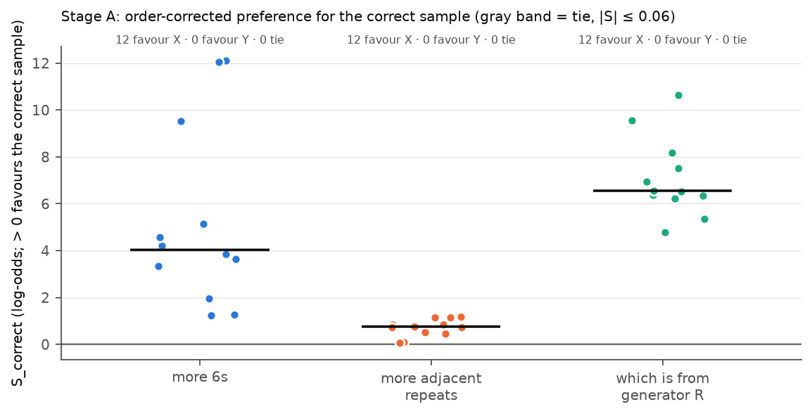
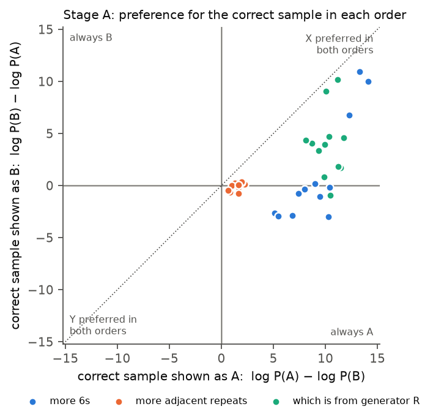

# Loula dice recognition v2.1: open-weight A/B probability scoring (2026-10-30)

**Tag:** `LOULA_DICE_AB_LOGPROB_v2.1`. **Handoff:** `GPT_SPAR_Loula_v2_1_OpenWeight_AB_Logprob_Claude_Code_Handoff` (protocol dated 2026-10-29; run 2026-10-30).
**Judge:** Qwen3-32B open weights (commit `9216db57…`), the Experiment 21 configuration: bf16 with an fp32 output layer, thinking off, one user message, no system message.
**Hardware:** one A100-SXM4-80GB on Vast.ai for 13.9 minutes, about **$0.28** of the $8 cap. The instance was destroyed after the run.
**Outcome:** technical preflight **PASS**; Stage A calibration **FAIL** on one of five criteria; Stage B recognition screen **`NOT_RUN`**.

## 1. What this pilot asked

Experiments 22 and 23 found that judges asked "A or B?" about dice sequences mostly answer by position. This pilot asks whether the model's **probabilities** for A and B still carry content information when its emitted answer does not. For each item it reads log P(A) − log P(B) at the first answer token in both orders, then averages across orders to cancel a constant A/B bias. It then checks this score against the same 36 reading-check items Experiment 23 used.

## 2. What ran

| Stage | Status | Scored prompts |
|---|---|---|
| Offline: schema validation, 20 unit tests, local end-to-end test on Qwen3-0.6B, protocol freeze | done | 0 on the 32B |
| 0. Technical preflight | **PASS** | 5 (+ tokenwise diagnostics, greedy completions, 3 determinism repeats) |
| A. Calibration: 36 Experiment 23 items × 2 orders | **FAIL** (one criterion) | 72 |
| B. Recognition screen: AUTH, TYP and the named comparator on the 20 Experiment 22 pairs | `NOT_RUN`: Stage A stop rule | 0 |

Nothing was changed after the freeze: no prompt, threshold, epsilon rule or item. No prompt was rerun.

## 3. Technical preflight

All eight gates passed ([`preflight/preflight_report.md`](preflight/preflight_report.md)):
- **Serving:** the pinned revision was loaded. The chat template hash `a55ee1b1…` is identical to Experiment 21's.
- **Thinking off:** every rendered prompt ends with the empty think block, with no system turn and no think text in the output.
- **Labels:** `A` (id 32) and `B` (id 33) are single tokens and each appends as one token after the assistant prefix.
- **Greedy replies:** 5/5 begin with the bare letter. The greedy first token always equals the argmax used for scoring.
- **Determinism:** three repeats were bit-identical (spread 0).
- **Numerical floor:** recomputing the scores token by token instead of in one pass moves S by at most **0.029** log-odds. So **epsilon = 0.058** (the rule is max(0.05, 2 × delta)).
- **A+B mass:** P(A) + P(B) is 0.80–1.00 on the technical prompts. The rest goes mainly to "Let…" and "Sample…", which would start a worked answer.

## 4. Stage A calibration

**The frozen gate** (all criteria must hold):
- S_correct > ε on ≥ 29/36 items;
- per task: ≥ 10/12 generator rule, ≥ 9/12 more 6s, ≥ 8/12 adjacent repeats;
- ≥ 24/36 items preferring the correct sample in **both** orders.

| Task | S > ε (gate) | both orders correct | mean S [95% CI over items] | mean label bias B_pair | min P(A)+P(B) |
|---|---|---|---|---|---|
| More 6s | **12/12** (≥ 9) ✓ | 4/12 | +5.24 [+3.29, +7.43] | +4.06 | 0.93 |
| More adjacent repeats | **12/12** (≥ 8) ✓ | 5/12 | +0.71 [+0.50, +0.90] | +0.77 | 0.80 |
| Generator R vs S | **12/12** (≥ 10) ✓ | 11/12 | +7.09 [+6.24, +8.05] | +3.12 | 0.97 |
| **All** | **36/36** (≥ 29) ✓ | **20/36 (≥ 24) ✗** | +4.34 [+3.20, +5.55] | +2.65 | 0.80 |

Figures: [`calibration_scores_by_task.png`](analysis/figures/calibration_scores_by_task.png), [`calibration_order_bias.png`](analysis/figures/calibration_order_bias.png). Per-item rows: [`calibration/paired_scores.csv`](calibration/paired_scores.csv).

**What the pattern shows:**
1. **The model's probabilities do carry content information.** The order-corrected score favours the correct sample on every one of the 36 items; no item is a tie or reversed. The emitted answers in Experiment 23 hid this.
2. **But a large "A" bias outweighs it in one order.**
   - The average bias is +2.65 log-odds toward A: up to +6.6 on 6s items, +0.5 to +1.2 on repeats.
   - When the correct sample is shown as A, the bias and the content point the same way.
   - When it is shown as B, the bias wins on 16 items, and the model still prefers A.
   - So 20/36 items, not the required 24, prefer the correct sample in both orders. The gate requires both orders, so it fails.
3. **The content effect is large for 6s and the generator rule, small for adjacent repeats.**
   - On adjacent repeats, S averages only +0.71 (minimum +0.07, just above ε = 0.058).
   - S does not grow with the size of the count difference: +0.82 for a 1-repeat difference, +0.71 for a 3-repeat difference.
   - So the signal on this task is real in sign but weak, and it is not a graded count.
4. **The greedy answer from the open weights reproduces Experiment 23's bare-format results.**
   - Qwen's argmax letters give 16/24 correct with 4/12 consistent on 6s, identical to Experiment 23 bare. They give 23/24 on the generator rule.
   - That is despite different serving (local bf16 vs SiliconFlow) and a different answer instruction.
   - So the position default is a property of the model, not of the provider.

Points below the diagonal are pulled toward "always A". The adjacent-repeats items (orange) sit near the origin. 6s items (blue) often fall below zero on the vertical axis: the correct sample, shown as B, still loses to A.

**Historical benchmark: Experiment 23's emitted Qwen answers.** These used different serving and answer wording, so they are descriptive, not paired trials.

| Task | bare: correct /24, consistent /12 | brief: correct /24, consistent /12 | v2.1 scored: S > ε /12, both orders /12 |
|---|---|---|---|
| More 6s | 16, 4 | 23, 11 | 12, 4 |
| More adjacent repeats | 12, 0 | 19, 9 | 12, 5 |
| Generator rule | 19, 7 | 24, 12 | 12, 11 |

## 5. Interpretation

Constructs, kept separate:
- **Content sensitivity of the underlying distribution:** present on all three tasks, once the constant bias is subtracted. Strong for 6s and the generator rule, weak but consistent in sign for adjacent repeats.
- **Order-robust content preference** (prefers the correct sample whatever its position): present on 20/36 items; fails the prespecified 24/36.
- **Source recognition, typicality, named-model attribution:** `NOT_RUN`. These were not measured, so there are no zeros for them.

Why the stop matters for the recognition question:
- The bias-cancelling average S is exactly what the recognition screen would have relied on, and here it worked on every calibration item. So the pilot does not show the instrument is useless.
- The handoff deliberately required order robustness as well, because averaging removes only a **constant** bias.
- On the repeats task, the content effect (about 0.7) is smaller than the bias (about 0.8). The real Qwen-vs-Mistral difference is subtler than any calibration task.
- So a recognition score would probably sit in the same regime: a small S produced by subtracting two bias-dominated orientations. That is the regime where order-by-content interactions cannot be ruled out.
- The prespecified rule is to stop here, and that rule was followed.

## 6. Limitations

- The calibration items were already inspected in Experiment 23, so this is method development, not fresh evidence.
- 12 items per task, one wording, one judge.
- ε comes from two prompt pairs. The S values that decide the gate, apart from two repeats items, are well above ε.
- The P(A)+P(B) mass of 0.80–0.93 on repeats items means 7–20% of the probability goes to starting a worked answer ("Let…"). Scores are conditional on answering with a letter.

## 7. Files

| Path | Contents |
|---|---|
| `PROTOCOL_FROZEN.md`, `prompts_frozen.md`, `manifest.json`, `inputs_sha256.json` | Frozen protocol, all 237 rendered prompts with hashes, source hashes, serving and rental record |
| `trials/` | Frozen trial lists for preflight (5), calibration (72) and screen (160, not run) |
| `preflight/` | Raw records, `env_preflight.json`, `diagnostics.json` (gates, delta, ε), report, remote log |
| `calibration/` | 72 raw scored orientations (raw logits, log-probabilities, top 10 tokens), `paired_scores.csv`, `calibration_gate.json`, report, remote log |
| `analysis/summary.json`, `analysis/figures/` | Offline summary (screen `NOT_RUN`) and the two calibration figures |
| Code and tests | `src/spar_dynamic/dice_recognition_logprob/`; `tests/test_dice_recognition_logprob.py` (20 offline tests) |
