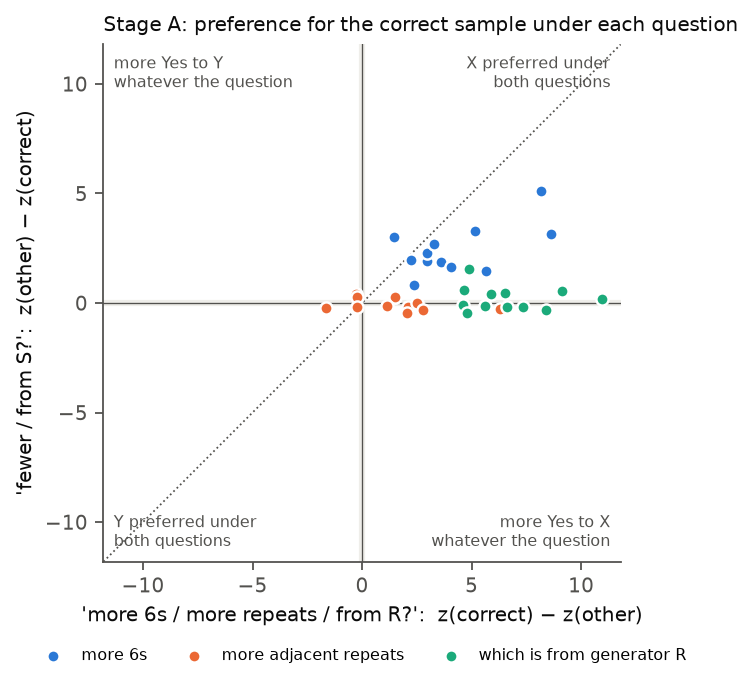

# 25 · Loula dice recognition v3.0: one sequence per prompt, scored Yes/No, to remove the A/B bias by design (2026-10-30)

| | |
|---|---|
| Track | 1: static self-prediction |
| Status | **Incomplete, failed:** stopped at the Stage A calibration gate; the recognition screen was never run |
| Tag | `LOULA_DICE_YESNO_LOGPROB_v3.0` (methodology pilot) |
| Design source | [Experiment 24 decision memo](../24_2026-10-29_loula_ab_logprob_pilot/DECISION_MEMO.md), option 2, chosen by the PI on 2026-10-30 |
| Judge | Qwen3-32B open weights, Experiment 21 configuration (commit `9216db57…`, bf16 with fp32 output layer, thinking off) |
| Size and cost | 5 preflight + 144 calibration scored prompts; one A100-SXM4-80GB for 8.2 min, **about $0.18** of the $5 cap |
| Previous | [← 24 open-weight A/B probability scoring](../24_2026-10-29_loula_ab_logprob_pilot/) |
| Full report | [**REPORT.md**](REPORT.md) · [decision memo](DECISION_MEMO.md) |

## Question

Experiment 24 found that Qwen3-32B's P(A) vs P(B) reads dice content, but a strong pull toward "A" beat the content in one order on 16/36 items. This pilot removes the label instead of subtracting it:
- **Each prompt shows one sequence** and asks a Yes/No question, scored as z = log P(Yes) − log P(No). There is no second sample, no position and no A/B label.
- **A unit's score compares its two sequences under the same question.** Any Yes/No bias shared by the two prompts cancels exactly.
- **Each question is asked both ways** ("more 6s?" / "fewer 6s?", "from R?" / "from S?"). This is the analogue of Experiment 24's two orders, and it uses the same gate.

## What was done

- **36 new calibration items** (Experiment 23's generator, new seed; no sequence shared with Experiment 23). The protocol and all 309 prompts were frozen before any GPU call.
- **Tests:** 14 offline tests, plus an end-to-end run on Qwen3-0.6B on the local GPU.
- **Technical preflight: PASS.**
  - Yes and No are single tokens, and greedy replies start with them.
  - Repeats are bit-identical.
  - Numerical floor 0.048, so ε = 0.097 log-odds.
- **Stage A calibration** scored all 144 prompts.

## Results

**Stage A failed one of five criteria (the same one as Experiment 24), so the recognition screen was not run, as prespecified.**

| Task | correct after averaging both questions (gate) | correct under both questions | Exp 24: correct in both orders |
|---|---|---|---|
| More 6s | 12/12 (≥ 9) | **12/12** | 4/12 |
| More adjacent repeats | 8/12 (≥ 8) | 2/12 | 5/12 |
| Generator R vs S | 12/12 (≥ 10) | 6/12 | 11/12 |
| **All** | **32/36 (≥ 29) ✓** | **20/36 (≥ 24) ✗** | 20/36 |

- **The label bias is gone.** On 6s, the task Experiment 24's "A" bias hurt most, the correct sequence wins under both "more 6s?" and "fewer 6s?" on every item.
- **The new failure is the reversed question.**
  - "Fewer adjacent repeats?" and "From Generator S?" get almost the same mildly-Yes answer whatever the sequence (mean contrast −0.04 and +0.20).
  - "More repeats?" and "From R?" discriminate well (+1.5 and +6.6).
  - The model will say a 20-roll sequence with 12 adjacent repeats is very likely from R (z +4.5) and also somewhat likely from S (z +1.4).
- **Adjacent repeats remain the weak task** in every format tried (22–25).



## What it led to

Decision: **stop; no recognition scoring.** The [decision memo](DECISION_MEMO.md) recommends parking the recognition line and writing up 22–25 together. The alternative, not run, is to adopt the single-question contrast, which is bias-free by construction, under a new protocol on fresh items.

## Re-running

```bash
PYTHONPATH=src python -m pytest tests/test_dice_recognition_yesno.py                 # 14 offline tests
PYTHONPATH=src python -m spar_dynamic.dice_recognition_yesno freeze                   # refuses if the frozen protocol or items would change
PYTHONPATH=src python -m spar_dynamic.dice_recognition_yesno preflight_eval           # offline, from the archived records
PYTHONPATH=src python -m spar_dynamic.dice_recognition_yesno calibration_eval
PYTHONPATH=src python -m spar_dynamic.dice_recognition_yesno analyse
```

GPU module: `python -m spar_dynamic.dice_recognition_yesno.gpu {preflight,calibration,screen} --trials trials/<stage>.json --out <dir> [--gate <json>]`. With this archive, the screen refuses to start because the calibration gate failed.
