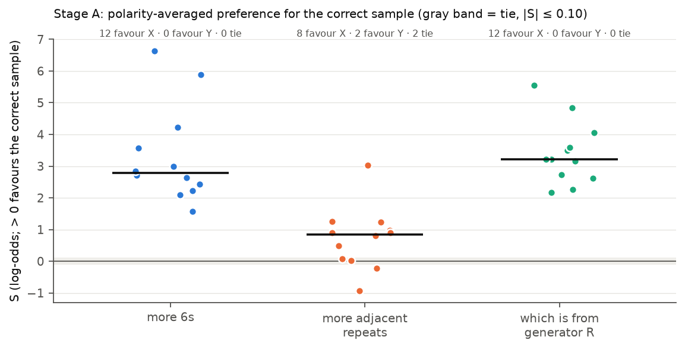

# Loula dice recognition v3.0: single-sample Yes/No probability scoring (2026-10-30)

**Tag:** `LOULA_DICE_YESNO_LOGPROB_v3.0`.
**Design source:** Experiment 24 decision memo, option 2 ("remove the label bias by design"), chosen by the PI. No external handoff; the protocol below was written and frozen by Claude Code before any GPU call.
**Judge:** Qwen3-32B open weights (commit `9216db57…`), the Experiment 21 configuration: bf16 with an fp32 output layer, thinking off, one user message, no system message.
**Hardware:** one A100-SXM4-80GB on Vast.ai (Oregon) for 8.2 minutes, about **$0.18** of the $5 cap. The instance was destroyed after the calibration stage.
**Outcome:** technical preflight **PASS**; Stage A calibration **FAIL** on one of five criteria; Stage B recognition screen **`NOT_RUN`**.

## 1. What this pilot asked

Experiment 24 read log P(A) − log P(B) with two dice sequences in one prompt. Averaged over both orders, the score favoured the correct sequence on 36/36 reading-check items. But the pull toward "A" (+2.7 log-odds on average) beat the content in one order on 16 items, so the both-orders gate failed (20/36, gate 24).

v3.0 asks whether that failure goes away when there is nothing to be biased toward:
- **One sequence per prompt and one Yes/No question.** The score is z = log P(Yes) − log P(No) at the first answer token.
- **A unit has two sequences, X (correct) and Y.**
  - Under the "positive" question (Yes favours X): `c_pos = z(X) − z(Y)`.
  - Under the reversed question (Yes favours Y): `c_neg = z(Y) − z(X)`.
  - `S = (c_pos + c_neg)/2`.
- **A Yes/No bias cancels exactly** inside each contrast, because both prompts carry the same question.
- **The gate is v2.1's, unchanged,** with "both questions" in place of "both orders":
  - S > ε on ≥ 29/36 items, with per-task minimums of 10/9/8;
  - c_pos > ε and c_neg > ε on ≥ 24/36 items.

## 2. What ran

| Stage | Status | Scored prompts |
|---|---|---|
| Offline: 36 new items (seed 2026103011, no overlap with Experiment 23), 14 unit tests, local end-to-end run on Qwen3-0.6B, protocol freeze | done | 0 on the 32B |
| 0. Technical preflight | **PASS** | 5 (+ tokenwise diagnostics, greedy completions, 3 determinism repeats) |
| A. Calibration: 36 items × 2 sequences × 2 questions | **FAIL** (one criterion) | 144 |
| B. Recognition screen: AUTH and TYP on the 40 Experiment 22 held-out sequences, both questions | `NOT_RUN`: Stage A stop rule | 0 |

Nothing was changed after the freeze (protocol sha256 `a1bac8ee…`). No prompt was rerun.

## 3. Technical preflight

All eight gates passed ([`preflight/preflight_report.md`](preflight/preflight_report.md)):
- **Serving:** the pinned revision was loaded, and the chat template hash is identical to Experiments 21 and 24.
- **Prompt format:** non-thinking template, no system turn.
- **Labels:** `Yes` (id 9454) and `No` (id 2753) are single tokens.
- **Greedy replies:** 5/5 start with Yes or No.
- **Determinism:** the repeats were bit-identical.
- **Numerical floor:** delta = 0.048, so **ε = 0.097**.
- **Answer mass:** P(Yes) + P(No) ≥ 0.997 on the technical prompts and ≥ 0.994 on every calibration prompt. Unlike Experiment 24, almost no probability goes to starting a worked answer.

## 4. Stage A calibration

| Task | S > ε (gate) | both questions correct | mean S [95% CI] | mean c_pos | mean c_neg | mean z, pos / neg question |
|---|---|---|---|---|---|---|
| More 6s | **12/12** (≥ 9) ✓ | **12/12** | +3.32 [+2.56, +4.19] | +4.20 | +2.43 | −2.57 / +0.94 |
| More adjacent repeats | **8/12** (≥ 8) ✓ | 2/12 | +0.71 [+0.20, +1.27] | +1.46 | −0.04 | +0.05 / +0.72 |
| Generator R vs S | **12/12** (≥ 10) ✓ | 6/12 | +3.41 [+2.90, +3.99] | +6.62 | +0.20 | +1.96 / +2.12 |
| **All** | **32/36** (≥ 29) ✓ | **20/36 (≥ 24) ✗** | +2.48 [+1.92, +3.03] | +4.09 | +0.86 | |

Per-item rows: [`calibration/unit_scores.csv`](calibration/unit_scores.csv). Gate: [`calibration/calibration_gate.json`](calibration/calibration_gate.json).

**What the pattern shows:**
1. **Removing the label removed the bias problem.**
   - On 6s, the correct sequence gets more Yes to "more 6s than a fair die?" and more No to "fewer 6s?" on all 12 items.
   - That is 12/12 under both questions, against 4/12 in both orders in Experiment 24.
   - The Yes/No bias differs a lot between the two questions (−2.6 vs +0.9), but by construction it cannot move a contrast.
2. **The reversed question is not read against the sequence for repeats and the generator rule.**
   - Under "fewer adjacent repeats than a fair die?", z sits between +0.3 and +1.2 for every sequence, whatever its repeat count. The mean contrast is −0.04.
   - Under "was this produced by Generator S?", z sits between +0.6 and +2.9 for every sequence. The mean contrast is +0.20, and 6/12 items are on the wrong side or inside ε.
   - The same sequences are separated sharply under "more repeats?" (mean c_pos +1.5) and "from R?" (+6.6).
   - So the model's answers to the two questions are not coherent. GEN_RULE-03's R sequence gets z = +9.0 for "from R?" and z = +2.7 for "from S?".
   - Points in the figure lie along the horizontal axis: content moves the answer to one question only.
3. **Adjacent repeats stay weak.**
   - Even under the positive question, 4/12 items are wrong or tied, and S does not grow with the count difference.
   - The task has been the weakest in every format tried (Experiments 23, 24 and 25).
4. **The 20/36 both-ways count matches Experiment 24's, but for a different reason and on different items.**
   - Experiment 24 failed through a label bias that hit 6s hardest.
   - v3.0 fails through question-wording asymmetry that hits repeats and the generator rule.
   - The match is a coincidence; it does not show the same problem.

## 5. Interpretation

Constructs, kept separate:
- **Content sensitivity of the distribution:** present on all three tasks under the positive question, and on 6s under both questions.
- **Robust content reading (correct under both wordings):** 20/36, so it fails the prespecified 24/36 again. The failure now lies in reading absence or "the other" category ("fewer", "from S"), not in a response-label default.
- **Source recognition and typicality:** `NOT_RUN`, so there are no zeros for them.

What this means for the recognition question:
- The recognition screen would ask "was this generated by your model?" and "by a different model?" about single sequences.
- Calibration shows the model can answer a "does it have property P?" question about a single sequence, but its answer to the complementary question does not move with content when the property is subtle (repeats) or a category label (R vs S).
- The AUTH reversed question ("a different model, not you?") has exactly that form. A recognition score would therefore again rest mostly on one wording.

## 6. Limitations

- 12 items per task, one wording per question, one judge.
- The reversed questions are not perfect logical complements. "Fewer than typical" and "more than typical" can both be false for a typical sequence, and R and S are not described as the only two possibilities in the question line. The items were built so the correct sequence is clearly on one side, but a model could reasonably read the reversed question as less decisive.
- The new items are new, but the generator recipe and the three tasks were known from Experiments 23 and 24.
- ε comes from two contrasts. Most deciding values are far from it, except near-zero c_neg values, where ε decides the count.

## 7. Files

| Path | Contents |
|---|---|
| `PROTOCOL_FROZEN.md`, `prompts_frozen.md`, `manifest.json`, `inputs_sha256.json` | Frozen protocol and all 309 rendered prompts with hashes, source hashes, serving and rental record |
| `trials/` | Frozen trial lists: preflight (5), calibration (144), screen (160, not run) |
| `calibration/items.csv` | The 36 new items |
| `preflight/` | Raw records, `env_preflight.json`, `diagnostics.json` (gates, delta, ε), report, remote log |
| `calibration/` | 144 raw scored prompts (logits, log-probabilities, top 10 tokens), `unit_scores.csv`, `calibration_gate.json`, report, remote log |
| `analysis/summary.json`, `analysis/figures/` | Offline summary (screen `NOT_RUN`) and the two calibration figures |
| Code and tests | `src/spar_dynamic/dice_recognition_yesno/`; `tests/test_dice_recognition_yesno.py` |
