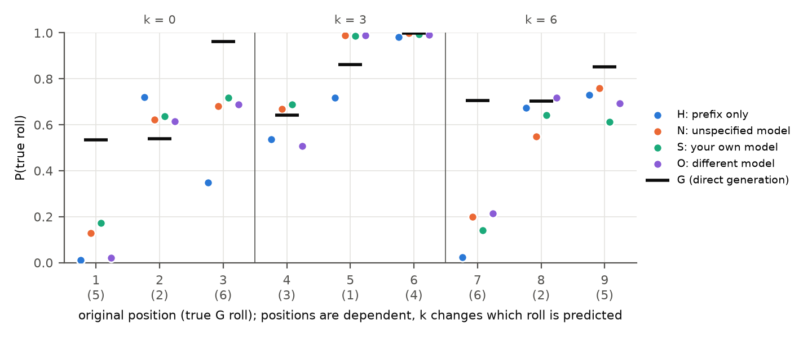
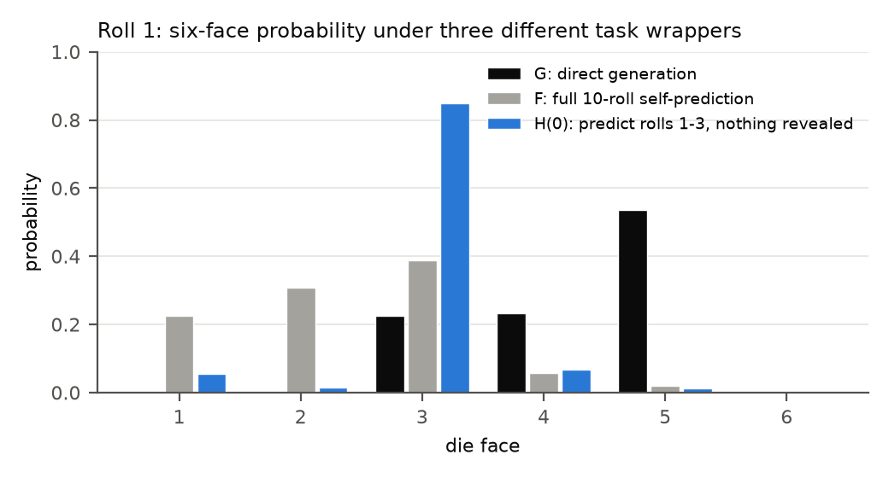
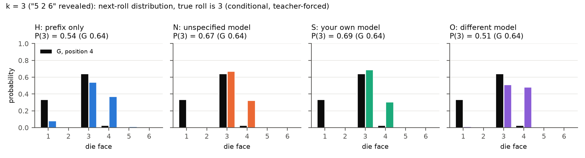
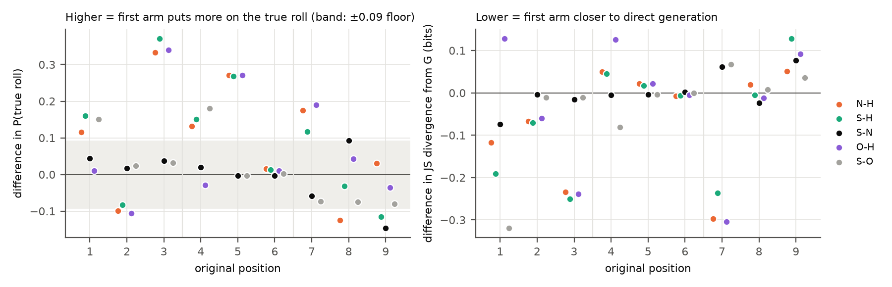
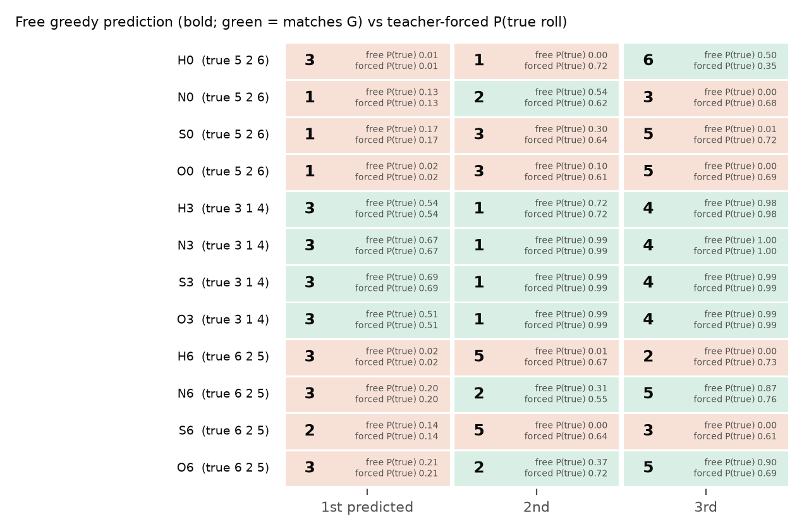

# Does partial history or a declarative description improve Qwen3-32B's hypothetical self-prediction? (2026-10-30)

**Tag:** `SPAR_DICE_PREFIX_DECLARATIVE_v1.0` (exploratory, gated pilot).
**Design source:** `GPT_SPAR_Qwen_Dice_Partial_History_Declarative_Knowledge_Logprob_Handoff_v1.0.md`, a follow-up to [Experiment 21](../../21_2026-10-29_dice_logprob/).
**Model and serving:** Qwen3-32B open weights at Experiment 21's commit `9216db57…`, with Experiment 21's runner unchanged:
- bf16 with an fp32 output layer;
- thinking off;
- greedy decoding;
- exact six-face log-probabilities.

**Hardware:** one A100-SXM4-80GB on Vast.ai (Texas) for 7.2 minutes, **about $0.13** of the $10 cap. The instance was destroyed after collection. No OpenRouter calls.
**Outcome:**
- Preflight **PASS** (9/9 gates). Experiment 21's G and F were reproduced bit-for-bit.
- Main checks **PASS**.
- All 12 conditions × 3 repeats were collected. The repeats are bit-identical, so the 3 repeats amount to one deterministic observation per condition.

## 1. Question and design

Experiment 21 found that when Qwen3-32B is asked to predict "another instance of your model" (F), its first roll differs from what it actually generates (G). Given the same history, though, F continues like G. This pilot asks two questions:
- Does revealing part of G's actual output bring the prediction closer to G?
- Does a true sentence about G's pattern do so, and does it matter whether that sentence is attributed to the model itself?

Each prompt embeds Experiment 21's G instruction verbatim. It reveals the first k rolls of G (`5 2 6 3 1 4 6 2 5 3`), for k = 0, 3 or 6, and asks for the next three rolls. Each k has four arms:

| Arm | Extra paragraph, inserted directly before "Predict …" |
|---|---|
| H | none (prefix only) |
| N | "An earlier response to this exact instruction, from **an instance of an unspecified model**, used each die face exactly once in its first six integers; this observation does not guarantee anything about the response you are predicting, and it does not determine any order." |
| S | the same paragraph with **an instance of your own model** |
| O | the same paragraph with **an instance of a different model** |

**Why this wording.** The handoff's draft neutral sentence described the target itself, while the self sentence described a prior sample. That would have made N more informative than S. The version used here makes all three report a *separate earlier response*:
- The three versions have the same word count and differ only in the source phrase.
- None contains a digit or any order information.
- All three are true:
  - S and N refer to Experiment 21's greedy G.
  - O refers to Experiment 22, where Mistral Small 3.2 24B was given this exact instruction at temperature 0.7 and 49/50 of its sequences had six distinct first values.

All 12 prompts, their hashes and a comparison of the paragraphs are in [`../prompts_frozen.md`](../prompts_frozen.md). The full gate definitions are in [`../PROTOCOL_FROZEN.md`](../PROTOCOL_FROZEN.md).

**Measurements:**
- **Primary (teacher-forced conditional scoring).** The six-face distribution at each target position, with G's *true* rolls fed as the assistant's history.
- **Comparison.** That distribution is compared with **G_j**: the direct-generation prompt's distribution at the same original position, given the same true preceding rolls.
- **Supplementary (free).** The model's own greedy three-roll answer.

**What is and is not controlled.** The prediction prompts reveal the prefix *in the user message*, while G sees it *as its own assistant output*. The comparison therefore measures predictive fidelity to a fixed reference, not identical computations.

## 2. Technical checks

| Check | Result |
|---|---|
| G and F greedy outputs vs Experiment 21 | identical in 3/3 repeats each |
| Six-face distributions vs the Experiment 21 archive (G and F generation steps; matched-prefix G\|G, F\|G, F\|F) | max \|Δp\| = **0.0** (bit-identical, on a different host and driver: 580.173 vs 595.91) |
| Chat template, rendered G prompt, prompt hashes | match Experiment 21 |
| Thinking off, no system turn | yes, on every prompt |
| Face tokens | `1`–`6` = ids 16–21; the separator is a separate space token |
| Teacher-forced scorer vs generation on the same context | max \|Δ log p\| = 0.0 |
| Six-face mass at every scored digit | ≥ 0.998 |
| Repeats (main) | bit-identical; no condition's free output varied |
| Numerical floor (incremental vs full-pass arithmetic) | max \|Δp\| = **0.091** over 66 distributions; differences below this are treated as ties |

## 3. Results

Values are six-face probabilities of the true roll, from the teacher-forced measurement. Every per-position distribution is in [`../analysis/teacher_forced_by_position.csv`](../analysis/teacher_forced_by_position.csv).

| k | Position (true roll) | G | H | N | S | O |
|---|---|---|---|---|---|---|
| 0 | 1 (5) | .535 | .012 | .128 | .172 | .021 |
| 0 | 2 (2) | .539 | .721 | .621 | .638 | .614 |
| 0 | 3 (6) | .963 | .348 | .681 | .719 | .688 |
| 3 | 4 (3) | .641 | .537 | .669 | .688 | .508 |
| 3 | 5 (1) | .861 | .718 | .990 | .987 | .990 |
| 3 | 6 (4) | 1.000 | .982 | .998 | .994 | .993 |
| 6 | 7 (6) | .705 | .024 | .199 | .141 | .214 |
| 6 | 8 (2) | .702 | .674 | .549 | .642 | .717 |
| 6 | 9 (5) | .851 | .730 | .760 | .614 | .694 |

**Teacher-forced log-likelihood of the true three-roll window** (sum of six-face log p; higher is better):

| k | H | N | S | O |
|---|---|---|---|---|
| 0 | −5.83 | −2.92 | **−2.54** | −4.70 |
| 3 | −0.97 | −0.42 | **−0.39** | −0.70 |
| 6 | −4.45 | −2.49 | −2.89 | **−2.24** |

**Free greedy answers** (the same in all 3 repeats):

| k | True | H | N | S | O |
|---|---|---|---|---|---|
| 0 | 5 2 6 | 3 1 6 | 1 2 3 | 1 3 5 | 1 3 5 |
| 3 | 3 1 4 | **3 1 4** | **3 1 4** | **3 1 4** | **3 1 4** |
| 6 | 6 2 5 | 3 5 2 | 3 2 5 | 2 5 3 | 3 2 5 |

### 3.1 Roll 1 without a prefix (k = 0)

- G puts .53 on 5 at position 1.
- Experiment 21's full self-prediction F puts .02 on 5 (its top face is 3, at .39).
- The new three-roll question H(0) is even more concentrated on 3: .85 on 3 and .01 on 5. The free answer begins with 3.

The prediction wrapper's shift of roll 1, found in Experiment 21, is present and stronger here. H(0) and F are different tasks: three rolls vs ten.

### 3.2 Revealing three rolls (k = 3): the prefix alone suffices

- After "5 2 6", every arm, H included, answers `3 1 4`, which is exactly G's continuation. No arm answers k = 0 or k = 6 exactly.
- Under teacher forcing, H's top face is the true roll at positions 4, 5 and 6.
- H already puts 98% of its mass on the faces not yet used among the first six. G puts 99.99% there.

The prefix-only arm therefore gets the "six different faces" rule without being told it.

The k = 3 window is the easiest of the three for G as well: G_j for the true roll is .64, .86 and 1.00. So "k = 3 works and k = 6 does not" says more about *which* rolls are predicted than about how much was revealed (handoff 4.1).

### 3.3 Adding the paragraph (N, S, O vs H)

Paired at the same k and position (band = the 0.091 floor; [`../analysis/paired_contrasts.csv`](../analysis/paired_contrasts.csv)):

- **N and S raise P(true) at k = 0 and k = 3.**
  - k = 0, positions 1 and 3: +.12 to +.37.
  - k = 3, positions 4 and 5: +.13 to +.27.
  - JS divergence from G falls at positions 1 and 3 (by .12–.25 bits).
- **"Closer to the true roll" is not always "closer to G".**
  - At position 4, the paragraphs sharpen the choice between 3 and 4, while G's runner-up is 1.
  - So JS rises slightly (+.05) even though P(3) rises.
- **The negative control moved too.**
  - At k = 6 the paragraph carries no information about positions 7–9: the first six are already shown.
  - Yet N, S and O raise P(6) at position 7 from .02 to .14–.21 and cut JS from G there by .24–.30 bits.
  - The window log-likelihood improves by about 2 nats.
  - A sentence that adds no relevant information shifts the distribution about as much as one that does. Part of every description effect is therefore a non-specific effect of changing the prompt, not use of the stated rule.

### 3.4 Self vs unspecified vs other source (RQ3)

- **S − N is within the numerical floor at positions 1–7** (|Δp| ≤ .06).
  - It exceeds the floor only at positions 8 (+.09) and 9 (−.15), and with opposite signs.
  - Window log-likelihood: S is ahead of N by .38 (k = 0) and .02 (k = 3), and behind by .40 (k = 6).
  - **There is no consistent self-attribution advantage.**
- **S − O exceeds the floor at positions 1 (+.15) and 4 (+.18).** At those positions the "different model" paragraph helps less than either other paragraph; O − H is within the floor there.
  - Elsewhere S − O is within the floor.
  - The model may discount another model's observation at the two hardest first positions. But N, which names no source, does as well as S, so the difference is not specific to *self*.

**Free vs teacher-forced.** At k = 0 and k = 6 every arm's first free roll is wrong, so its second and third rolls are conditioned on its own wrong history. N(6) and O(6) still get rolls 8 and 9 right (`3 2 5` vs `6 2 5`).

## 4. Interpretation

**Observed:**
- With nothing revealed, the prediction wrapper moves roll 1 away from G (P(5) .01 vs .53).
- With "5 2 6" revealed, all four arms reproduce G's next three rolls exactly.
- A true sentence about G's first six values raises the probability of the true roll at most k = 0 and k = 3 positions.
- The same kind of sentence also shifts k = 6, where it is uninformative.
- Attributing the sentence to "your own model" is indistinguishable from "an unspecified model" at 7 of 9 positions, and the remaining two differences have opposite signs.

**Inferred:**
- At k = 3, the observed prefix restores G-like continuation without any description. This matches Experiment 21's finding that F continues like G given G's history.
- The description effects are best explained by generic prompt change plus, at k = 0 and k = 3, use of a stated constraint.
- There is no evidence for a self-specific benefit (H4 is not supported).

**Untested:**
- Whether any of this generalises beyond one greedy trajectory, one wording and one model.
- Whether Qwen has a *population* tendency to use six distinct faces first. Experiment 22's sampled sequences suggest it (Qwen 50/50, Mistral 49/50), but that was not tested here.
- Internal mechanisms.
- Whether "declarative" and "procedural" information are processed differently. The Blandfort framing motivated the arms; this experiment measures output distributions only.

## 5. Limitations

- **One reference trajectory.** The 3 repeats are identical, so each condition is one deterministic observation. The 9 positions are dependent. No significance tests are reported.
- **Prefix length is confounded with target position.** The rolls predicted at k = 0, 3 and 6 differ, so comparisons across k are descriptive.
- **The k = 6 control shows non-specific prompt effects of similar size to the description effects.** A length-matched irrelevant sentence would be needed to separate information from perturbation. That arm was not in the authorised design.
- **Asymmetric truth of the paragraphs.** S and N describe the very G response the model is predicting (it is greedy and deterministic); O describes a different model's response.
- **Prefix placement differs.** The user-message prefix in prediction prompts is not the same computation as the assistant-history prefix in G.

## 6. Files

| Path | Contents |
|---|---|
| `PROTOCOL_FROZEN.md`, `prompts_frozen.md`, `inputs_sha256.json`, `manifest.json` | Frozen design, 12 prompts plus G and F with hashes, input hashes, serving and rental record |
| `preflight/` | Raw records, teacher-forced and full-pass scores, reference scores, env, `preflight_gates.json`, `PREFLIGHT_REPORT.md`, remote log |
| `main/` | 36 raw records (free generation with per-step six-face log-probs, own-output rescoring), 108 teacher-forced rows, full-pass floor, reference G/F scores, `main_checks.json`, env, remote log |
| `analysis/` | Tidy CSVs (per position, contrasts, window log-likelihood, free answers, k = 3 rule mass, reference, roll 1), `summary.json`, five figures |
| Code and tests | `src/spar_dynamic/dice_prefix_declarative/`; `tests/test_dice_prefix_declarative.py` |
