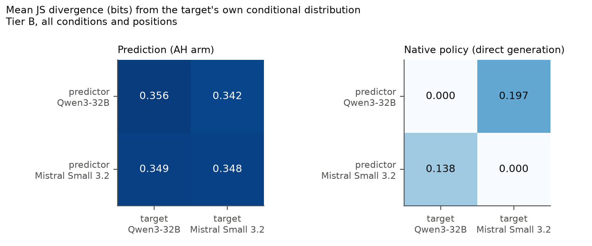

# 27 · Crossed Qwen × Mistral guided self-prediction (2026-10-30/31)

| | |
|---|---|
| Track | 1: static self-prediction |
| Tag | `SPAR_CROSSED_GUIDED_SELFPRED_v1.0` + [amendment v1.1](AMENDMENT_v1.1.md) (mass gated on direct generation only) |
| Status | **Complete.** Both preflights PASS (Qwen: Experiment 21/26 reproduced bit-for-bit; Mistral under v1.1). All 4 crossed cells collected (5,400 trials). Main checks PASS. |
| Design source | `GPT_SPAR_Experiment_27_Crossed_Qwen_Mistral_Guided_Self_Prediction_Claude_Code_Handoff.md` |
| Models | Qwen3-32B @ `9216db57…` and Mistral-Small-3.2-24B-Instruct-2506 @ `95a6d26c…`, open weights, bf16 with fp32 output layer, full-vocabulary log-softmax |
| Size and cost | 48 sampled targets plus 2 greedy references; 2 predictors × 50 items × 6 history conditions × 9 arms; one A100-SXM4-80GB for 5.6 h, **$12.12 billed** of the $15 cap |
| Previous | [← 26 partial history and declarative descriptions](../26_2026-10-30_dice_prefix_declarative/) · builds on [21 dice log-probabilities](../21_2026-10-29_dice_logprob/) |
| Full report | [**reports/REPORT.md**](reports/REPORT.md) · [decision memo](DECISION_MEMO.md) · [manifest](manifest.json) |

## Question

Two models each generated 10-roll die sequences. Each model then predicted held-out rolls of **both** models' sequences.
The question is whether a model predicts its own continuations better than the other model does (the predictor ×
generator interaction). If so, does that survive two baselines:
- the predictor's own plain generation policy;
- an anonymous description of the target?

Guidance arms vary the framing of the target and the evidence shown with the revealed rolls.

**Framing:**
- A, "a language model";
- T, the true model name;
- R, "your own model" or "not your own model".

**Evidence:**
- H, revealed rolls only;
- I, an irrelevant die fact;
- D, an earlier output of the same model.

The scoring reference is the target generator's own six-face distribution, given the true history.

## Results

- **No self-advantage in prediction.**
  - Interaction −0.006 bits JS [−0.026, 0.011], with 24 targets per generator and cluster bootstrap.
  - Every metric variant is null.
  - On the immediate next roll, the other model is closer.
- **Plain generation has the self-advantage; prediction prompts discard it.**
  - A model's own generation policy matches its targets exactly, and the other model's at 0.14–0.20 bits.
  - Every prediction cell is 0.34–0.36 bits away in the AH arm (0.30–0.41 across all arms).
- **Experiment 26's `3 1 4` after `5 2 6` is generic.** Mistral gives the same answer for Qwen's sequence under the
  anonymous prompt.
- **Identity cues act as prompt effects.**
  - Naming the target helps both predictors on both targets (DiD +0.001).
  - "Your own model" shows a 0.011-bit diagonal effect on Qwen targets only. It is wording-confounded and not robust.
- **Showing a real earlier output of the target makes predictions worse** in all four cells.



Mistral usually wants to answer prediction prompts in prose. Its scored distributions are conditional on starting with a
digit (mean first-digit mass 0.21–0.57), and sensitivity estimands that drop low-mass trials are reported. Qwen's 24
targets contain 15 distinct strings.

## Folder

| Path | Contents |
|---|---|
| `PROTOCOL_FROZEN.md`, `prompts_frozen.md`, `inputs_sha256.json` | Frozen before any GPU work (commit `447565e`) |
| `AMENDMENT_v1.1.md` | Approved before any Mistral corpus or prediction data |
| `preflight/{qwen,mistral}/` | Regression vs Experiments 21/26, tokenisation, mass, floors, gates |
| `corpus/{qwen,mistral}/` | Reference (8) and target (24) samples per generator, with seeds and full six-face vectors |
| `trials/` | 50 items, 5,400 frozen trials with prompt hashes, data-integrity table, call table |
| `main/{qwen,mistral}/` | Free outputs, teacher-forced six-face vectors (incremental and full pass), native-policy rows, environment, log |
| `analysis/` | Tidy per-position scores, tables, `summary.json` (all estimands with CIs), figures |

## Re-running

```bash
PYTHONPATH=src python -m pytest tests/test_dice_crossed_guidance.py         # 14 offline tests
PYTHONPATH=src python -m spar_dynamic.dice_crossed_guidance dryrun          # prompts, call table, GPU estimate
PYTHONPATH=src python -m spar_dynamic.dice_crossed_guidance analyse         # checks, estimands, figures
```

GPU stages: `python -m spar_dynamic.dice_crossed_guidance.gpu {preflight,corpus,predict} --model {qwen,mistral} --out <dir>`.
Then run the `gate_preflight`, `gate_corpus` and `build_trials` phases locally between stages. The predict stage resumes
from an existing `predictions.jsonl`.
