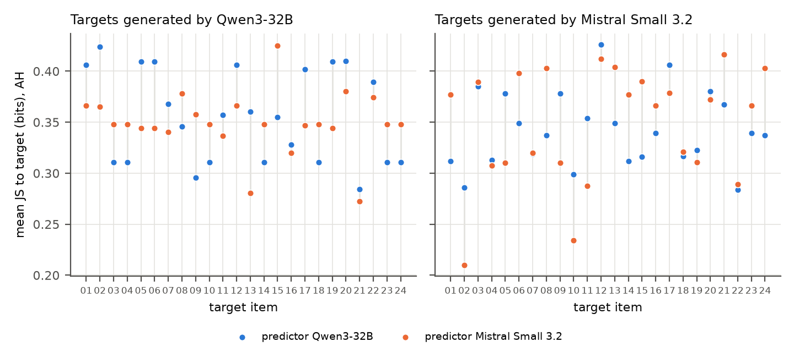
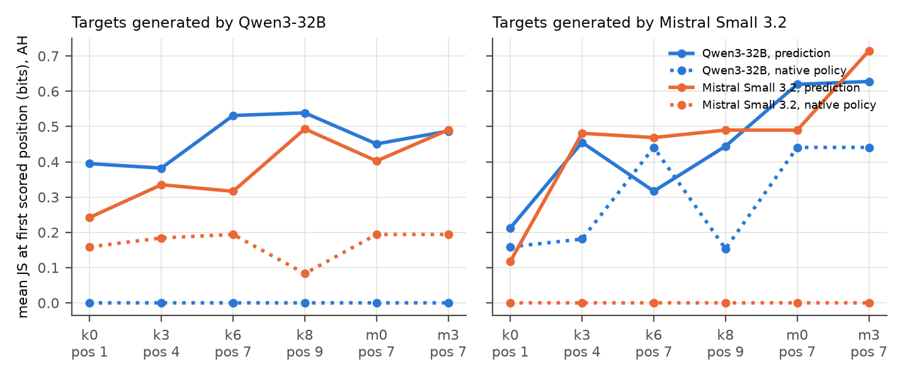
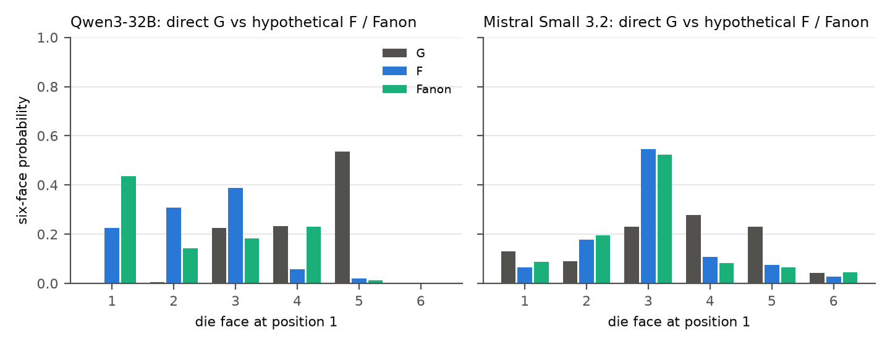
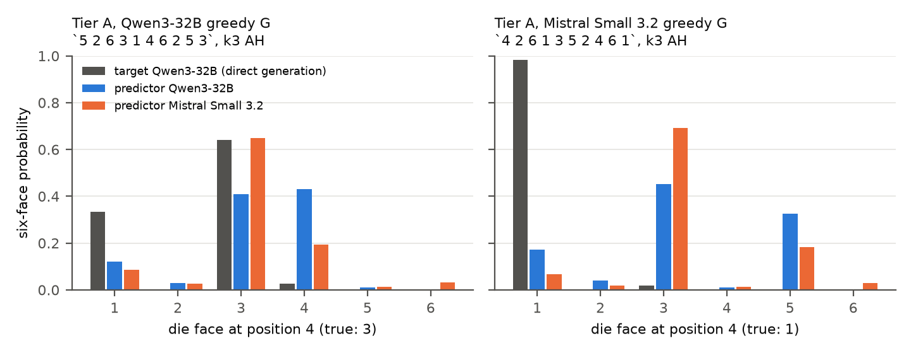

# Experiment 27 report: crossed Qwen × Mistral guided self-prediction

Protocol `SPAR_CROSSED_GUIDED_SELFPRED_v1.0` ([PROTOCOL_FROZEN.md](../PROTOCOL_FROZEN.md)), with amendment v1.1
([AMENDMENT_v1.1.md](../AMENDMENT_v1.1.md)). Collected 2026-10-31 on one A100-SXM4-80GB. Everything below was measured on
the frozen trial file (`trials/trials.jsonl`, sha256 `41dbc944…`), except for sections labelled **Interpretation**.

## 1. What was run

| Stage | Result |
|---|---|
| Phase 0, freeze | Protocol, prompts and code frozen in commit `447565e`, before any GPU work |
| Phase 1, preflight Qwen3-32B | **PASS.** Experiment 21's G `5 2 6 3 1 4 6 2 5 3` and F `3 1 4 6 2 5 3 2 6 4` were reproduced. All 12 of Experiment 26's free outputs were identical. The new engine matched Experiment 21's class bit-for-bit. Numerical floor 0.091. |
| Phase 1, preflight Mistral Small 3.2 24B | **FAIL, then PASS under amendment v1.1.** The original gate failed on prediction-prompt first-digit mass (0.31–0.43). The investigator approved v1.1, which gates mass on direct generation only, before any Mistral corpus existed. Greedy G `4 2 6 1 3 5 2 4 6 1`, F `3 1 5 2 6 4 3 1 5 2`, both deterministic. |
| Phase 2, Tier A (historical case) | Collected: both greedy Gs × 2 predictors × 6 history conditions × 9 arms. Descriptive only. |
| Phase 3, Tier B corpus | 24 targets per generator at T = 0.7, plus 8 reference outputs each, all collected before any prediction. Qwen: **15 distinct strings** (its greedy G appears 7×). Mistral: 22 distinct strings. |
| Phase 3, predictions | **All 5,400 trials collected:** 2 predictors × 50 items × 6 conditions × 9 arms. Every item was scored by both predictors, so all four crossed cells are complete. Each predictor's native policy (G, F and Fanon prompts) was also scored on all 50 items. |
| Phase 4, analysis | Main checks PASS after one check-code fix (§7). Cluster bootstrap B = 10,000 over distinct target strings within each generator (15 Qwen and 22 Mistral clusters). |

Nothing was skipped. One sensitivity estimand (E3s, R vs A on Qwen targets) is **not estimable** (§5) and is reported
as null, not as zero.

## 2. Design in one paragraph

Each target is a 10-roll sequence produced by one generator under Experiment 21's instruction. The predictor sees that
instruction verbatim, plus:
- a **framing** of who produced it:
  - A, "a language model";
  - T, the target's true name;
  - R, "another instance of your own model" on the diagonal or "a different model, not your own model" off it;
- **evidence**:
  - H, the revealed rolls only;
  - I, plus a length-matched die fact that says nothing about the response;
  - D, plus a separate earlier output of the same target model, taken from the reference corpus.

The history conditions are:
- k0/k3/k6/k8: reveal 0/3/6/8 rolls, predict the next window;
- m0/m3: predict positions 7–9 with 0 or 3 rolls revealed, stating that rolls 4–6 are hidden.

For each scored position, the prediction is the predictor's six-face distribution, teacher-forced on the true rolls. The
reference is the **target generator's own conditional distribution** under the G instruction, given the same true
history.

The primary metric is Jensen–Shannon divergence in bits; lower means closer. The **native-policy baseline** is the
predictor's own G-instruction distribution on the same history, with no prediction wrapper.

## 3. RQ2: is there a self-advantage? (Tier B, primary)

Mean JS divergence (bits) to the target distribution, AH arm, all conditions and positions. Each cell has 24 targets and
408 scored positions.

| Predictor ↓ / target → | Qwen3-32B targets | Mistral Small 3.2 targets |
|---|---|---|
| Qwen3-32B predicting | **0.356** (self) | 0.342 (cross) |
| Mistral Small 3.2 predicting | 0.349 (cross) | **0.348** (self) |
| *Qwen3-32B native policy* | *0 (by construction)* | *0.197* |
| *Mistral native policy* | *0.138* | *0 (by construction)* |

The self-advantage contrast is (cross − self). It is positive when the model's own predictions are closer. The interaction
is the mean of the two targets' contrasts. Values are 95% cluster-bootstrap CIs.

| Estimand | On Qwen targets | On Mistral targets | Interaction |
|---|---|---|---|
| E1 JS, AH (primary) | −0.007 [−0.040, 0.019] | −0.006 [−0.027, 0.017] | **−0.006 [−0.026, 0.011]** |
| E1 KL (excess cross-entropy), AH | −0.84 [−1.31, −0.50] | +0.54 [0.36, 0.75] | −0.15 [−0.40, 0.05] |
| E1 TV, AH | +0.011 [−0.022, 0.038] | −0.028 [−0.054, 0.001] | −0.008 [−0.030, 0.011] |
| E1 −log₂ P(true roll), AH | −0.70 [−1.15, −0.43] | +0.41 [0.26, 0.58] | −0.15 [−0.38, 0.02] |
| E1 JS, all nine arms | +0.005 [−0.025, 0.028] | −0.001 [−0.018, 0.017] | +0.002 [−0.015, 0.016] |
| E6 JS vs target tempered to T = 0.7 | +0.004 [−0.031, 0.031] | −0.021 [−0.042, 0.002] | −0.009 [−0.029, 0.009] |
| E1s JS, AH, trials with mass ≥ 0.5 | −0.156 [−0.196, −0.127] | +0.180 [0.152, 0.209] | +0.012 [−0.013, 0.032] |
| **E2 native policy JS** | +0.138 [0.111, 0.181] | +0.197 [0.159, 0.243] | **+0.168 [0.144, 0.199]** |

**Measured.**
- No prediction-based estimand shows a self-advantage interaction. Every CI includes 0, and every point estimate is within
  ±0.15 bits (KL) or ±0.012 bits (JS).
- Where the per-target contrasts are non-zero (KL, −log₂ P, the mass-filtered E1s), they have **opposite signs** on the
  two targets. That is a predictor main effect, not self-advantage.
  - By KL and −log₂ P, Mistral is the closer predictor on both targets: KL 1.72 vs 2.56 bits on Qwen targets, and 1.72 vs
    2.26 on Mistral targets.
  - In E1s, after dropping low-mass trials, Mistral is also the closer predictor on both targets.
- Each model's native generation policy has a large, certain diagonal advantage (E2, +0.168 bits). This is partly by
  construction, because the self cell is the target distribution itself.

**Prediction minus native policy** (E2b, JS, AH): Q→Q +0.356 [0.330, 0.389], Q→M +0.145 [0.101, 0.181], M→Q +0.211
[0.165, 0.239], M→M +0.348 [0.322, 0.370]. In every cell, cross cells included, prediction is further from the target than
the predictor's own plain generation. The prediction wrapper loses the whole native self-advantage and more.

### By suite (E5, AH, JS)

| Suite | Scored positions | Interaction |
|---|---|---|
| Fixed position 7 (m0, m3, k6; first scored position) | 7 | **−0.062 [−0.088, −0.023]** |
| Immediate next roll (k3, k6, k8; first scored position) | 4, 7, 9 | **−0.089 [−0.119, −0.048]** |
| Bridge to Experiment 26 (k0, k3, k6; all positions) | 1–9 | −0.013 [−0.038, 0.011] |

**Measured.** On the single next roll, the **cross** predictor is closer than the self predictor, for both targets. The
signs are reversed from a self-advantage.

## 4. RQ1: hypothetical vs direct generation

These are each model's native F ("if you were asked…") and Fanon distributions, compared with its own G distribution on G
histories. JS is averaged over positions 1–10 of each item.

| Model | F vs G, mean JS | F vs G, position 1 | Fanon vs G, mean JS | Fanon vs G, position 1 |
|---|---|---|---|---|
| Qwen3-32B | 0.084 | 0.521 | 0.070 | 0.506 |
| Mistral Small 3.2 | 0.029 | 0.125 | 0.030 | 0.135 |

**Measured.**
- Experiment 21's G/F gap is reproduced exactly for Qwen. At roll 1, G puts .53 on 5; F puts .39 on 3 and .02 on 5.
- Mistral's hypothetical framing moves its first roll much less (JS 0.13). Its F and G are still different strings.

## 5. RQ3: guidance and identity

### Identity framing (E3: change from the anonymous arm A, paired on item, condition and evidence)

Negative means the named framing moved the prediction closer to the target. DiD is the diagonal change minus the
off-diagonal change on the same target; negative means the cue helps the self predictor more.

| | Q→Q | Q→M | M→Q | M→M | DiD Qwen targets | DiD Mistral targets | **DiD** |
|---|---|---|---|---|---|---|---|
| T − A, JS | −0.030 | −0.041 | −0.004 | −0.013 | −0.025 | +0.027 | **+0.001 [−0.003, 0.005]** |
| T − A, KL | −0.63 | −0.50 | −0.04 | −0.06 | −0.59 | +0.43 | **−0.08 [−0.15, −0.02]** |
| R − A, JS | −0.013 | −0.001 | +0.007 | −0.003 | −0.019 | −0.002 | **−0.011 [−0.015, −0.006]** |
| R − A, KL | −0.09 | +0.07 | +0.02 | −0.00 | −0.11 | −0.07 | **−0.09 [−0.13, −0.04]** |
| E3s T − A, JS, mass ≥ 0.5 | | | | | −0.141 | +0.131 | −0.005 [−0.017, 0.010] |
| E3s R − A, JS, mass ≥ 0.5 | | | | | **not estimable** | +0.027 [0.015, 0.039] | **not estimable** |

Per-cell CIs are in `analysis/summary.json`.

**Measured.**
- **Naming the true target (T)** brings both predictors closer on both targets. Qwen as predictor gains most, 0.03–0.04
  bits JS. By JS the gain is no larger on self cells (DiD +0.001). By KL there is a small self-favouring DiD of −0.08 bits.
- **The relational framing (R)** gives the only JS DiD whose CI excludes 0: −0.011 bits [−0.015, −0.006]. It comes from
  Qwen targets:
  - Qwen predicting Qwen improves by 0.013 under "another instance of your own model";
  - Mistral predicting Qwen worsens by 0.007 under "a different model, not your own model".
- On Mistral targets the R DiD is −0.002 [−0.010, 0.005].
- The mass-filtered check for R cannot be computed on Qwen targets: no Mistral→Qwen R trial passes the mass filter. On
  Mistral targets the mass-filtered R DiD is +0.027, the opposite sign.

**Size.** The R DiD (0.011 bits) is about 3% of the mean prediction error in a cell (~0.35 bits). It is 3–8% of the gap
between prediction and the native policy (0.14–0.36 bits). No identity arm brings any cell close to the native-policy
baseline. The best arm overall, Qwen predicting with T + I, is still 0.30 bits from the target.

### Evidence (E4, anonymous framing, JS)

| | Q→Q | Q→M | M→Q | M→M |
|---|---|---|---|---|
| D − H (an earlier output by the same model) | +0.052 [0.005, 0.083] | +0.068 [0.027, 0.104] | +0.031 [0.008, 0.053] | +0.043 [0.014, 0.072] |
| I − H (irrelevant die fact) | −0.036 [−0.065, 0.006] | +0.011 [−0.008, 0.031] | −0.025 [−0.042, −0.006] | −0.004 [−0.014, 0.006] |

**Measured.** Showing a real earlier output of the target model makes predictions **worse** in all four cells. A
non-informative paragraph has mixed, mostly null effects, the same size as the identity effects above.

## 6. Tier A: the historical greedy sequences (descriptive, N = 1 per generator)

| Predictor → target G | Mean JS, all arms | Mean JS, AH | P(true), all arms | Top face = true |
|---|---|---|---|---|
| Qwen → Qwen G | 0.261 | 0.311 | 0.51 | 0.60 |
| Mistral → Qwen G | 0.308 | 0.348 | 0.36 | 0.40 |
| Qwen → Mistral G | 0.454 | 0.438 | 0.23 | 0.23 |
| Mistral → Mistral G | 0.357 | 0.377 | 0.33 | 0.34 |

Free outputs after `5 2 6` (k3: predict rolls 4–6, true continuation `3 1 4`):

| Arm | Qwen predicting | Mistral predicting |
|---|---|---|
| AH | `4 3 1` | **`3 1 4`** |
| TH | `3 1 4` | `3 1 4` |
| TI | `3 1 4` | `3 1 4` |
| RH | `4 3 1` | prose |
| AD | `3 1 4` | prose |

**Measured.**
- On each greedy string, the self predictor is closer. Note that 7 of Qwen's 24 Tier B targets are this same string, and in
  fig2 Qwen's prediction is closer on all 7 of those items.
- Mistral also produces Experiment 26's `3 1 4` after `5 2 6`, and under the plain anonymous arm, where Qwen does not.

## 7. Integrity and numerics

- **Main checks, all PASS:**
  - all 5,400 trials and 6,000 policy rows complete;
  - prompt hashes match the frozen trials;
  - teacher-forced history equals the target;
  - every stored face log-prob is finite;
  - free generation re-scores to its own logits;
  - every G-instruction policy row has mass ≥ 0.5;
  - oracle: the target's G policy equals its own sampling-time distribution, max |Δlog p| = 0;
  - per-model floors are under the 0.25 stop.
- **Numerical floor** (max |Δp| between incremental and full-pass scoring):
  - Qwen: 0.102 (p99 0.067, median 0.005);
  - Mistral: 0.047 (p99 0.029, median 0.003).
  
  The prediction effects tested above (≤ 0.09 bits JS on means of hundreds of positions) are not single-position
  differences, but individual-position comparisons smaller than ~0.1 in probability are within the floor.
- **Six-face mass (amendment v1.1).**
  - On average, Qwen as predictor puts ≥ 0.97 raw mass on digits at the first scored position in every arm.
  - On average, Mistral as predictor puts **0.21–0.57**. It usually wants to begin with prose ("Given the first six integers…"), and
    its free outputs are valid in only 0–74% of trials, depending on cell and arm. Under the R framing on Qwen targets, **no**
    Mistral output is a valid answer.
  - Mistral's six-face distribution is therefore *conditional on starting with a digit*. The E1s/E3s sensitivity
    estimands drop the low-mass trials (`analysis/mass_by_cell_arm.csv`).
- **Post-data code fixes** (all check or reporting code, no estimand changed; see `manifest.json`):
  1. The oracle check keyed the sampling records by string across both corpora. Mistral's reference 5 and target 13 are
     the same string as Qwen target 15 (`5 2 6 1 3 4 6 2 5 1`), so the check compared Qwen's policy with Mistral's sampling
     record. It is now keyed by (generator, string). Before the fix it failed only on that item.
  2. The bootstrap now reports a statistic with no finite value as null instead of raising an error.
  3. Figure layout only.

## 8. Interpretation (not measurement)

1. **No behavioural self-advantage under prediction.** Across 48 sampled targets, neither model predicts its own
   continuations better than the other model does. On the immediate next roll, the other model is somewhat better. The one
   place a diagonal advantage is large is the **native policy**, which is the model actually generating, not predicting.
   As soon as the model is asked to *predict* a model's rolls, its distribution moves 0.14–0.36 bits away. For the self
   cells that is the whole distance from the target, so the move discards what it "knows" by being the generator.
   This matches Experiment 21's G/F gap and extends it to both models and to masked histories.
2. **Experiment 26's `3 1 4` after `5 2 6` does not generalise as self-knowledge.** Mistral produces the same continuation,
   from the anonymous prompt, without any claim of identity. The simplest account is a generic completion rule: after three
   distinct faces, list unused faces. This is rival explanation (c)/(a) in the handoff, not (e).
3. **Identity cues do not add self-specific information worth the name.**
   - Naming the target helps both predictors on both targets, i.e. a prompt effect (rival d).
   - The relational framing shows a 0.011-bit diagonal effect on Qwen targets. It confounds identity with different
     wording ("your own" vs "not your own"), and it coincides with a collapse of Mistral's compliance under "not your own
     model".
   - It does not survive the available sensitivity check.
   - We do not read it as identity-sensitive self-modelling.
4. **Showing a real earlier output of the target hurts.** The models seem to copy or anchor on the example, not abstract
   from it.
5. **Tier A's self-advantage is about modal strings.** Each model's own greedy string is its mode, and its prediction
   prompts are pulled toward similar low-entropy patterns. That advantage disappears across sampled targets.

## 9. Limits

- Two models, one task, one instruction; temperature 0.7 targets. Qwen's corpus is concentrated: only 15 distinct
  strings, and its greedy G appears 7 times. The effective N is 15 + 22 clusters.
- Mistral's prediction distributions are conditional on a digit being emitted, and often that is not what the model would
  do. Raw mass is reported and a sensitivity set is provided, but the sensitivity set is small and unbalanced across
  cells.
- The prediction prompt places the history in user text, while the target is scored with history in the assistant turn.
  These are different computations by design. The native policy uses the assistant-turn form.
- The R framing necessarily uses different sentences on and off the diagonal (truthfulness); T uses the same template with
  different names.
- Many estimands are reported. Only E1 (AH, JS) was predeclared as primary. Treat the rest as exploratory, with no
  multiplicity correction.
- Per-position differences under ~0.1 in probability are within the numerical floor.

## 10. Cost

One vast.ai A100-SXM4-80GB (instance 58471512), created 2026-10-31T00:37:15Z and destroyed 06:12:32Z (5.59 h).

| Item | Charge |
|---|---|
| GPU, 5.55 h × $1.107 | $6.14 |
| Disk, 5.55 h × $0.347 | $1.93 |
| Download, 103 GB × $0.039 | $4.02 |
| Upload | $0.03 |
| **Total billed** | **$12.12** |

The billing data were retrieved right after destruction; the last ~0.04 h may add about $0.06. The total is under the $15
cap but above the $10 warning. During the run only the GPU rate was tracked, so the warning was not raised at the time.
The disk rate on this host and its bandwidth charge (103 GB downloaded, mostly the two models' weights) were not in the
estimate.
