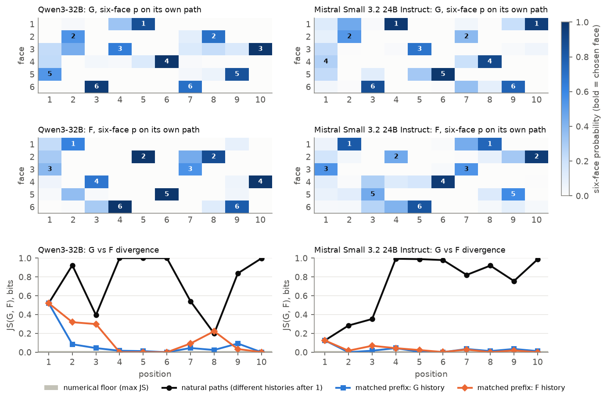

# 28 · Dice generation vs self-prediction on log-probabilities, Qwen3-32B and Mistral Small 3.2 (2026-10-31)

| | |
|---|---|
| Track | 1: static self-prediction |
| Tag | `SPAR_DICE_LOGPROB_CROSSMODEL_v2.0` |
| Design source | `Main_Experiment_SPAR_Dice_Logprob_Qwen_Mistral_Claude_Code_Handoff.md` (2026-10-31), from the 2026-10-25 discussion with Christopher Ackerman |
| Status | **Complete.** Both preflights PASS under [amendment v1.1](AMENDMENT_v1.1.md) (Qwen reproduces Experiment 21 bit for bit, Mistral reproduces Experiment 27). 600/600 main calls collected; all main checks PASS. One A100 for 16 min, **$1.90 billed**. |
| Full report | [**REPORT.md**](REPORT.md) · [manifest](manifest.json) · [analysis/](analysis/) |
| Models | Qwen3-32B @ `9216db57…` and Mistral-Small-3.2-24B-Instruct-2506 @ `95a6d26c…`, open weights on a rented GPU (Experiment 27's engine, unchanged) |
| Previous | [← 27 crossed guided self-prediction](../27_2026-10-30_crossed_guided_self_prediction/) · extends [21 dice log-probabilities](../21_2026-10-29_dice_logprob/) |

## Results in brief

- **The prediction wrapper changes the opening, not the continuation, in both models.**
  - On G's own history, the F instruction picks G's face at every roll from 2 to 10, apart from near-ties within the floor.
    Mean JS is 0.036 bits (Qwen) and 0.018 (Mistral).
  - On the natural paths, mean JS is 0.77–0.79 at rolls 2–10.
  - Roll-1 JS is 0.52 for Qwen and 0.13 for Mistral, where G's own top face is a near-tie.
- **S1–S10 do not reconstruct G or F** (1–2 matches of 10; chance 1.67). The answers barely depend on k: Qwen gives 4 or 5,
  Mistral gives 3 at nine of ten positions.
- **Windows do not cohere.** Qwen returns `4 2 6 3 5` for both W1-5 and W3-7, and its overlapping positions agree 0/5 times.
  Mistral answers every window in prose, which is invalid.
- **No evidence of self-knowledge either way.** Experiment 21's generic-model control shows the opening shift is a wrapper
  effect.



## What this is

Experiment 21's 15-condition design (G, F, S1–S10, three windows) run on two models under one common protocol, with exact
six-face log-probabilities and teacher-forced matched-prefix scoring. The windows are **W1-5, W3-7, W6-10**. Experiment 21 used
W1-5, W3-8 and W5-10, so its W3-8 and W5-10 are not this design's windows. G, F, S1–S10 and W1-5 are byte-identical to
Experiment 21, and Qwen must reproduce Experiment 21's outputs on them (a preflight gate).

| File | Contents |
|---|---|
| [`PROTOCOL_FROZEN.md`](PROTOCOL_FROZEN.md) | Questions, serving, gates, matched-prefix design, analysis plan, stop rules |
| [`prompts_frozen.md`](prompts_frozen.md), `prompts_frozen.json` | The 15 prompts, byte-exact, with SHA-256 |
| [`DATA_DICTIONARY.md`](DATA_DICTIONARY.md) | Every field of the raw and matched-prefix records |
| `preflight/`, `main/` | Raw generations and matched-prefix rows per model, environment records, gate and check reports |
| `analysis/` | Per-model CSVs, `cross_model.csv`, `summary.json`, figures (PNG + PDF) |
| `inputs_sha256.json` | Hashes of the frozen files, the code and the archived inputs (tamper check before every offline phase) |

## Re-running

```bash
PYTHONPATH=src python -m pytest tests/test_dice_logprob_crossmodel.py           # offline (fake engine + real tokenizers if cached)
PYTHONPATH=src python -m spar_dynamic.dice_logprob_crossmodel dryrun            # prompts, job counts, cost estimate
# on the GPU host, from the repo root, after src/spar_dynamic/dice_logprob_crossmodel/remote_setup.sh:
PYTHONPATH=src python -m spar_dynamic.dice_logprob_crossmodel.gpu preflight --model {qwen,mistral} --out track1_self_prediction/28_2026-10-31_dice_logprob_crossmodel/preflight/<model>
PYTHONPATH=src python -m spar_dynamic.dice_logprob_crossmodel gate_preflight <model>      # locally
PYTHONPATH=src python -m spar_dynamic.dice_logprob_crossmodel.gpu main --model <model> --out .../main/<model> --gate .../preflight/<model>/preflight_gates.json
PYTHONPATH=src python -m spar_dynamic.dice_logprob_crossmodel gate_main <model>
PYTHONPATH=src python -m spar_dynamic.dice_logprob_crossmodel analyse
```
