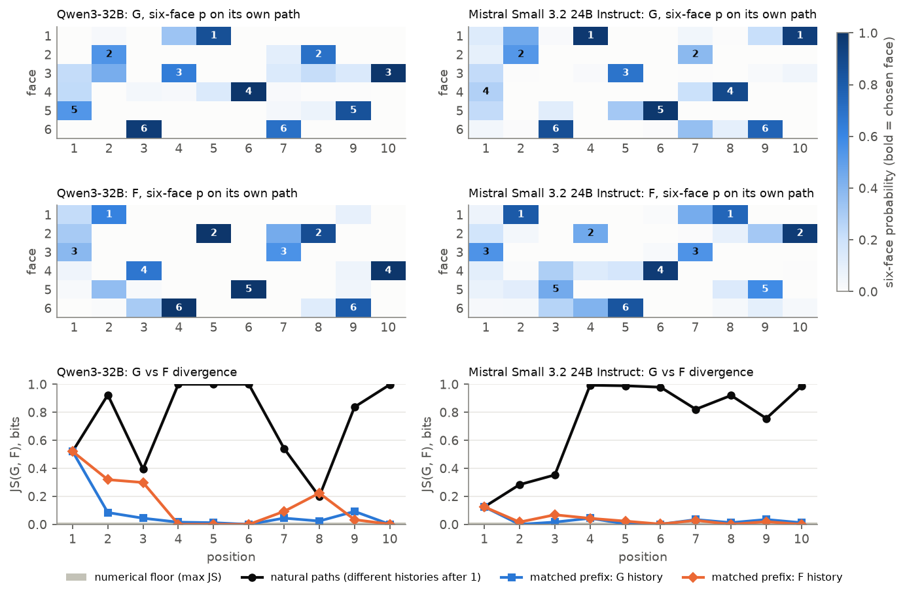
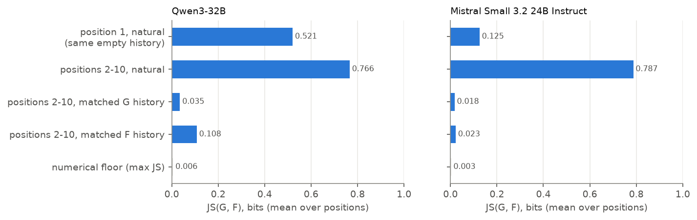
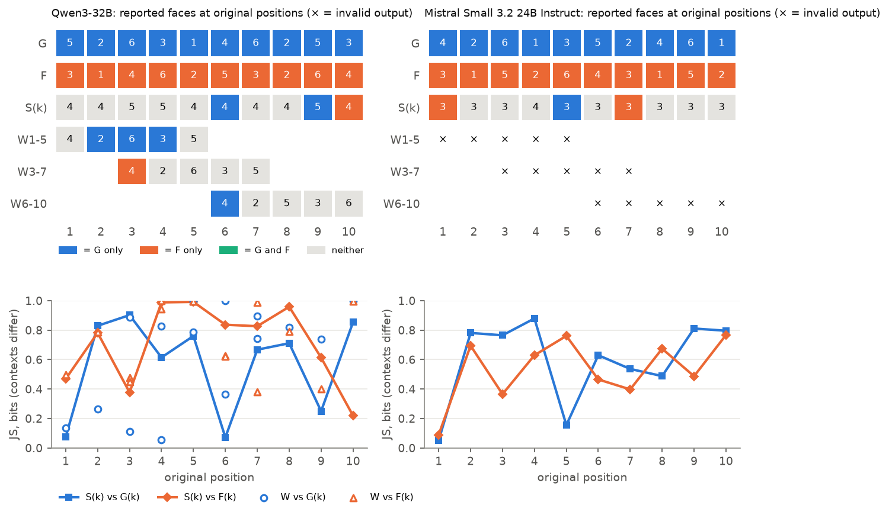

# Experiment 28: Dice generation vs self-prediction on log-probabilities, Qwen3-32B and Mistral Small 3.2 24B

`SPAR_DICE_LOGPROB_CROSSMODEL_v2.0` · 2026-10-31 · Track 1 (static self-prediction) · Fall SPAR midterm.
Follows the 2026-10-25 discussion with Christopher Ackerman. This is a behavioural study of output log-probabilities, not
mechanistic interpretability.

## Midterm summary

Ackerman asked whether a model's prediction of its own output (F, "predict what another instance of your model would
output") is the same conditional policy as direct generation (G), merely knocked onto a different path, or a genuinely
different distribution. We ran Experiment 21's 15-condition dice design on two open-weight checkpoints, Qwen3-32B and Mistral
Small 3.2 24B, with exact six-face log-probabilities at every position. Prompts were G, F, ten single-position prompts S1–S10,
and three five-position windows (1–5, 3–7, 6–10). We used teacher-forced matched-prefix scoring to separate the effect of
the instruction from the effect of the preceding rolls. Decoding is deterministic: all 600 calls (20 per condition) reproduce
their condition's single output bit for bit, so each condition is one observation, not twenty. Qwen reproduces Experiment 21
exactly.

**In both models, the prediction wrapper changes where the sequence starts, not how it continues.** The natural G and F
sequences differ almost everywhere (mean JS 0.77–0.79 bits at rolls 2–10). Given G's own history, though, the F instruction
picks G's face at every roll from 2 to 10, apart from near-ties within the numerical floor. Mean JS there is 0.036 bits
(Qwen) and 0.018 (Mistral). The opening differs more in Qwen (JS 0.52) than in Mistral (0.13, where G's own top face is a
near-tie). On F's history the G instruction departs at 4 rolls in Qwen but at only 1 in Mistral.

**Narrower prediction scopes do not reconstruct either sequence.** S(k) answers are nearly the same at every k: Qwen gives 4
or 5, Mistral gives 3 at nine of ten positions. They match G(k) or F(k) about as often as chance. Qwen's windows disagree at
all five overlapping positions and return the same string for two different windows. Mistral answers every window in prose,
which is invalid by the frozen format rule.

None of this is evidence of self-knowledge. Experiment 21's generic-model control already showed the opening shift is a
prediction-wrapper effect, not a self-reference effect. The two-model pattern is consistent with a shared generic
dice-continuation policy plus a prompt-dependent opening.

## Main outcomes

| | Qwen3-32B | Mistral Small 3.2 24B |
|---|---|---|
| G (greedy) | `5 2 6 3 1 4 6 2 5 3` | `4 2 6 1 3 5 2 4 6 1` |
| F (greedy) | `3 1 4 6 2 5 3 2 6 4` | `3 1 5 2 6 4 3 1 5 2` |
| Valid outputs / determinism | 300/300; every condition one output, bit-identical | 240/300 (60 window calls are prose); every condition one output, bit-identical |
| Archival regression | G, F, S1–S10, W1-5 identical to Experiment 21, max \|Δp\| = 0.0 | G, F identical to Experiment 27, max \|Δp\| = 0.0 |
| Numerical floor (incremental vs full pass): max \|Δp6\| / max JS | 0.091 / 0.006 bits | 0.055 / 0.003 bits |
| Roll 1, same empty history: JS(G, F) | **0.521** | **0.125** |
| Roll 1: G's face under F; F's face under G | 5: p = .021 (rank 5); 3: p = .224 (rank 3) | 4: p = .107 (rank 3); 3: p = .230 (rank 2) |
| Natural paths, rolls 2–10: mean JS; aligned matches | 0.766; 1/10 | 0.787; 0/10 |
| Natural paths: best shift alignment | F₁₋₇ = G₄₋₁₀ (7 matches, one run) | shift +2, 3 matches |
| **Matched prefix, G history, rolls 2–10**: mean JS; top-face disagreements (beyond floor) | **0.036; 0 (0)** | **0.018; 1 (0)** |
| Matched prefix, F history, rolls 2–10: mean JS; disagreements (beyond floor) | 0.108; 4 (4) at rolls 2, 3, 7, 8 | 0.023; 3 (1) at roll 7 |
| S1–S10 answers | `4 4 5 5 4 4 4 4 5 4` | `3 3 3 4 3 3 3 3 3 3` |
| S(k) = G(k) / = F(k) (chance 1.67) | 2 / 1 | 1 / 2 |
| S position-dependence: mean pairwise JS among S(k) (G's ten positions)ᵉ | 0.111 (0.722) | 0.015 (0.700) |
| Windows W1-5 / W3-7 / W6-10 | `4 2 6 3 5` / `4 2 6 3 5` / `4 2 5 3 6` | prose / prose / prose (invalid) |
| Window positions = G / = F (of 15) | 4 / 1 | n/a |
| Overlapping window positions agreeing | 0/5 | n/a |
| Probability of repeating the previous face, G / F (uniform 1/6) | .0022 / .0004 | .0004 / .0003 |
| GPU cost (one A100, both models) | $1.90 total billed | (shared) |

ᵉ exploratory, added after the analysis plan was frozen.



## 1. Rationale and hypotheses (from the 2026-10-25 discussion)

In Experiment 21, Qwen's F sequence differed from G at 9 of 10 rolls. Ackerman's question was what that mismatch is:

- **H1a, shared policy.** F re-runs the same conditional distribution as G. Mismatches are near-tie swaps, or an early
  deviation that cascades because every later roll conditions on different previous rolls.
- **H1b, distinct policy.** The prediction wrapper induces a genuinely different distribution at the same history.

Only roll 1 has the same (empty) history in G and F, so later natural-path differences are confounded with history. The
matched-prefix design scores both instructions under the same forced history, which separates the two. Pre-registered
questions (`PROTOCOL_FROZEN.md`):
- **RQ1:** shared vs distinct policy.
- **RQ2:** do single positions S(k) recover G(k) or F(k)?
- **RQ3:** are windows more coherent than single positions, and do overlapping windows agree?
- **RQ4:** is the pattern alike across the two checkpoints?

The exploratory diagnostics are marked as such.

This experiment tests the robustness and extension of Experiment 21's Qwen findings, which were already in the repository. It
does not claim them as new. Those findings are:
- on G's prefix, F picks G's faces at rolls 2–10 (JS ≤ 0.09);
- the opening shift also appears with "another language model" (the generic-model control), so it is a wrapper effect.

## 2. Methods

**Models and serving.** Both models ran as open weights on one rented vast.ai A100-SXM4-80GB (North Carolina, driver
595.91.07, the driver of Experiment 21's original host), one model loaded at a time. No hosted inference API was used.

| | Qwen | Mistral |
|---|---|---|
| Weights | `Qwen/Qwen3-32B` @ `9216db5781bf21249d130ec9da846c4624c16137` | `mistralai/Mistral-Small-3.2-24B-Instruct-2506` @ `95a6d26c4bfb886c58daf9d3f7332c857cb27b43` |
| Loading | Experiment 21's `Qwen` class, via Experiment 27's engine, unchanged | Experiment 27's `MistralEngine`: transformers' Mistral 3 class, text path only |
| Prompt format | Qwen3 chat template, `enable_thinking=False`; template SHA-256 `a55ee1b1…` | `mistral_common` 1.13.0 tekken v11 (`tekken.json` SHA-256 `6e250168…`); `<s>[INST]prompt[/INST]` |
| Stack | torch 2.11.0+cu128, transformers 5.22.0, accelerate 1.15.0, huggingface_hub 2.4.0, CUDA 12.8 | same |

Shared arithmetic:
- bf16 weights and activations, a separate fp32 copy of the output layer, fp32 logits;
- batch 1; prompt prefilled once, then one token at a time through the KV cache;
- exact full-vocabulary log-softmax at every step;
- greedy argmax, no sampling, no logit processors, no tools, no system message, at most 128 new tokens;
- deterministic flags as in Experiment 21.

Full environment records: [`manifest.json`](manifest.json) and `{preflight,main}/<model>/env_*.json`.

**Tokenisation.** In both vocabularies each face 1–6 is exactly one token: Qwen ids 16–21, Mistral ids 1049–1054. A face after
a space encodes as the separator token (Qwen 220, Mistral 1032) followed by the bare digit. A full vocabulary scan on the GPU
host found no other token whose text is a face digit, with or without whitespace, and no multi-digit ASCII number token. The
six bare-face log-probabilities therefore cover every way to write a face. The same is checked offline against the pinned
tokenizer files in `tests/test_dice_logprob_crossmodel.py`.

**Conditions.** Prompts are in [`prompts_frozen.md`](prompts_frozen.md):
- G, F and S1–S10 are Experiment 21's functions, called unchanged.
- The windows use Experiment 21's window template byte for byte. A test confirms it reproduces Experiment 21's own windows.
- G, F, S1–S10 and W1-5 are therefore byte-identical to Experiment 21. W3-7 and W6-10 are new.
- Experiment 21's W3-8 and W5-10 are different windows and are compared below only with that label.
- The F/S/W framing is "another instance of your model", and every prediction prompt embeds G verbatim.

**Collection.**
- Preflight, per model: G ×3, F ×3, and every S/W condition once, in seeded shuffled order.
- Main, per model: 20 fresh-context calls of each of the 15 conditions (300 per model, 600 total), in seeded shuffled order
  (seeds 20261031 Qwen, 20261032 Mistral), append-only and resumable.
- Every distinct output was rescored by teacher forcing, in both the incremental and the single-full-pass arithmetic.

**Matched prefix.** Each model's own greedy G and F were the references.
- Instruction ∈ {G, F} × history ∈ {G, F}, six-face vectors at all ten rolls, with incremental arithmetic as the primary method.
- Secondary: each window prompt teacher-forced on the G or F reference's own window.

**Measures.** p6 is the six face log-probabilities renormalised over the faces, i.e. the choice conditional on emitting a
face. Raw six-face mass is kept alongside it. JS is the Jensen–Shannon divergence in bits (0–1). The numerical floor is the
maximum |Δp6| between incremental and full-pass scoring of the same rows. A top face whose margin over the runner-up is below
the floor is a **near-tie** and is not interpreted.

**Gates and amendment.**
- Both preflights passed every gate except one ([`preflight/*/PREFLIGHT_REPORT.md`](preflight/)).
- The exception: Mistral answered all three window prompts with a prose preface.
- By the investigator's prior decision, [amendment v1.1](AMENDMENT_v1.1.md) moved the S/W format check from gated to reported
  before any main data existed. The G/F format check stayed gated.
- Both main runs passed all 12 checks ([`main/*/MAIN_CHECKS.md`](main/)), including the raw-file SHA-256 tamper check.

## 3. Results

Sources: [`analysis/summary.json`](analysis/summary.json), per-model CSVs in [`analysis/`](analysis/), raw records in
`main/<model>/raw_attempts.jsonl` and `main/<model>/matched_prefix.jsonl`. Every table and figure regenerates from the raw
records with `python -m spar_dynamic.dice_logprob_crossmodel analyse`.

### 3.1 Integrity and reproducibility

- **Determinism.** Every condition produced exactly one output across its 20 replicates, with bit-identical log-probabilities,
  and the same output as in preflight. The 20 replicates are reliability checks, not independent samples. No statistic in this
  report treats them as independent.
- **Rescoring.** Teacher-forced rescoring of each output reproduced its generation exactly (max difference 0.0 nats).
- **Floor.** The arithmetic-order floor is 0.091 (Qwen) and 0.055 (Mistral) in Δp6, but only 0.006 and 0.003 bits in JS.
  Small top-face reversals are therefore uninterpretable, while distribution-level differences of several hundredths of a bit
  are real.
- **Face mass.** Raw face mass at G digit steps was ≥ 0.97 in both models; the G/F distributions are nearly the whole
  next-token distribution. For Mistral's prediction prompts it was lower:
  - F roll 1: 0.60;
  - S(k): 0.86–0.96;
  - first forced position of the matched windows: 0.23–0.40.

  These are distributions conditional on emitting a face.
- **Qwen regression.** Qwen reproduced Experiment 21 bit for bit on G, F, S1–S10, W1-5 and every matched-prefix vector
  (max |Δp| = 0.0 over 75 vectors).
- **Mistral regression.** Mistral reproduced Experiment 27's G and F (max |Δp| = 0.0 over 50 vectors).

### 3.2 G vs F on the natural paths (RQ1)

**Qwen.**
- Only roll 8 matches.
- F's first seven rolls are G's rolls 4–10 (`3 1 4 6 2 5 3`): the same run, reached from a different opening.
- At roll 1, G puts .535 on 5 and F puts .388 on 3, a near-tie with 2 at .308.
- G's choice is nearly excluded under F (p = .021, rank 5). F's choice is a real competitor under G (.224, rank 3).
- So the opening is **not** a near-tie swap in Qwen: F moves the mass.

**Mistral.**
- No roll matches, and the best shift recovers only 3 matches.
- At roll 1, G's top face 4 (.279) is itself within the floor of 3 and 5 (.230 each). F puts .546 on 3.
- JS is 0.125, a quarter of Qwen's. F's face is G's runner-up (rank 2).
- **Mistral's opening difference is close to a near-tie swap, which is consistent with H1a. Qwen's is not.**

Rolls 2–10 differ heavily on the natural paths in both models (mean JS 0.77 and 0.79). The matched-prefix analysis shows that
almost all of this comes from the different histories.

### 3.3 Matched prefix (RQ1): same history, different instruction

Both models show the same three results:

- **On G's history, the F instruction continues exactly as G does.**
  - Qwen: F's top face equals G's at all nine rolls 2–10; mean JS 0.036, max 0.093.
  - Mistral: F's top face equals G's at eight of nine rolls; mean JS 0.018, max 0.044. The ninth, roll 7, is a near-tie in
    both instructions (margins 0.029 and 0.048, floor 0.055).
  - All of the natural-path disagreements at rolls 2–10 disappear (8/8 in Qwen, 8/9 with the ninth a tie in Mistral).
  - **This is a cascade:** the F instruction carries the same continuation policy as G, started from a different first roll.
- **On F's history, the G instruction mostly follows F.**
  - Qwen: G departs at rolls 2, 3, 7 and 8, all beyond the floor (JS up to 0.32). These are the same four rolls Experiment
    21 reported.
  - Mistral: G departs at one roll beyond the floor (roll 7: G prefers 1 where the history has 3; JS 0.029). It also departs
    at two near-ties (rolls 4 and 9).
  - The asymmetry is strong in Qwen and weak in Mistral. Under F's opening (`3 1 …`), Qwen's G instruction is still pulled
    back toward its own preferred continuation for a couple of rolls.
- **Residual framing effect.** Beyond roll 1, the instruction's own effect under a matched history is small:
  - mean JS 0.02–0.04 bits on G's history and 0.02–0.11 on F's history;
  - compare 0.77–0.79 on the natural paths;
  - it is above the JS floor (≤ 0.006), so it is a real but small distributional shift, not a change of policy.

**RQ1 verdict.**
- For continuation (rolls 2–10), H1a: one shared conditional policy, with the natural-path divergence almost entirely an
  autoregressive cascade from roll 1.
- For the opening, H1b in Qwen (the wrapper moves the roll-1 distribution substantially). It is borderline in Mistral, where
  the move is small and G's own choice is a near-tie.
- Experiment 21's generic-model control showed the Qwen opening shift does not depend on the self wording. That control was
  not run for Mistral.

### 3.4 Single positions S1–S10 (RQ2)

The S(k) and G(k)/F(k) contexts differ. S has no preceding rolls in its answer, while G(k) and F(k) follow k − 1 generated
rolls. The comparison asks whether the model can reconstruct a position, not whether the distributions are computed the same
way.

- **No reconstruction.**
  - Qwen: S(k) = G(k) at 2 of 10 positions (rolls 6 and 9) and = F(k) at 1 (roll 10).
  - Mistral: 1 and 2.
  - Chance is 1.67. Mean JS against G(k) and F(k) is 0.53–0.71 bits in both models.
- **Strong generic bias, almost no position dependence.**
  - Qwen answers 4 or 5 everywhere: mean S distribution .56 on 4, .29 on 5.
  - Mistral answers 3 at nine of ten positions: .43 on 3, .25 on 4, .22 on 5; its one exception, S4, is a near-tie.
  - The ten S vectors are nearly interchangeable: mean pairwise JS 0.11 bits (Qwen) and 0.015 (Mistral), against 0.72 and
    0.70 between G's own positions. This metric is exploratory.
  - The models change their answer only slightly with the requested position.
- **Roll 1 is the exception, and it is informative.** S1 has the same empty history as G(1) and F(1).
  - S1 is **closer to G(1) than F(1) is**: JS(S1, G1) is 0.076 for Qwen and 0.051 for Mistral, while JS(F1, G1) is 0.52 and
    0.13.
  - The full-sequence prediction prompt moves the opening more than the single-position prompt does.
  - In Qwen, S1's answer (4) still differs from G's (5); S1 puts .24 on 5.
- Qwen's S1–S10 are identical to Experiment 21's.

### 3.5 Windows (RQ3)

**Qwen.**
- The three windows give `4 2 6 3 5` (1–5), `4 2 6 3 5` (3–7) and `4 2 5 3 6` (6–10).
- The 3–7 window returns **the same string** as the 1–5 window. The model reports a generic five-roll opening (starting
  with S's modal 4), not the requested positions.
- 4 of 15 window positions match G (rolls 2, 3, 4 in W1-5; roll 6 in W6-10) and 1 matches F. That is no better than S(k)
  (3 of 10 match G or F).
- W1-5's partial match to G at rolls 2–4 is a continuation effect. After W's own opening 4, the shared continuation
  policy produces `2 6 3`, as G does after 5.
- **Overlaps.** The overlapping positions never agree: 0 of 3 for W1-5 vs W3-7 at rolls 3–5, and 0 of 2 for W3-7 vs W6-10
  at rolls 6–7. JS ranges from 0.33 to 0.97 bits. Each pair is counted once.
- **Matched windows.** With G's own window forced as history, the window prompt's distribution is closest to G|G for W1-5
  (mean JS 0.18, 3/5 top faces agree), where the forced history is G's true prefix. It is far for W3-7 (0.58, 1/5) and W6-10
  (0.30, 3/5).
  - The later windows start without rolls 1 to a − 1, so part of this gap is the missing history, not the window instruction.
- Experiment 21's archival windows, which are **different windows** (W3-8 `4 2 5 3 6 1`, W5-10 `3 6 2 5 1 4`), did not
  reproduce G's or F's requested positions either. W3-8 also begins `4 2 5 3 6`, Qwen's W6-10 string here.

**Mistral.**
- All 60 window calls (3 windows × 20) answered with a prose preface. They are invalid under the frozen strict format and are
  never scored. The text is quoted here as a descriptive observation only:
  - W1-5: "Here is the predicted output for the first 5 integers… `3 1 6 4 2`";
  - W3-7: writes a whole ten-roll sequence `2 5 3 1 6 4 2 5 3 1` and then its rolls 3–7 `3 1 6 4 2`, which are internally
    consistent but not G's or F's;
  - W6-10: "`3 1 5 2 6`".
- These strings track the requested positions no better than chance. W1-5 shares rolls 1–2 with F and roll 3 with G.
  **W6-10's digits are exactly F's first five rolls**, so, like Qwen, Mistral reports an opening rather than rolls 6–10.
- **Matched windows**, conditional on emitting a face (raw mass at the first forced position 0.40, 0.23, 0.28):
  - W1-5 on G's prefix tracks G|G closely (mean JS 0.048, 4/5 top faces agree);
  - W3-7 and W6-10 do not (0.41 and 0.31). This is the same history-truncation pattern as Qwen.

**RQ3 verdict.** Contiguous windows are not more faithful than single positions in Qwen, and overlapping windows are not
coherent with each other. The only window that tracks G is W1-5 on G's history. That window is matched by construction: it
shares G's history, and the shared continuation policy does the rest.

### 3.6 Conditional dynamics (descriptive)

All four reference sequences:
- have no adjacent repeats;
- open with a permutation of 1–6;
- give almost no probability to repeating the previous face (≤ .0022 vs 1/6 for a fair die).

Mistral's F is a strict period-6 cycle (`3 1 5 2 6 4 | 3 1 5 2`). The other three sequences repeat a face within six rolls.
Step sizes are mostly ±2–3 (mod 6). These are the same "avoid repeats, cover all faces early" regularities in both models.
They are the plausible source of the shared continuation policy, but they are not a test of it.

### 3.7 The two models compared (RQ4, descriptive; two checkpoints, not model families)

The qualitative pattern is the same in both models:
- the opening shifts;
- the continuation is shared;
- S(k) gives a position-insensitive generic answer;
- windows are not coherent.

The models differ in degree:
- the size of the opening shift (Qwen 0.52 vs Mistral 0.13 bits);
- the G-on-F asymmetry (4 vs 1 robust departures);
- prompt compliance (Mistral answers window prompts in prose).





Figure 1 ([`fig1_design`](analysis/figures/fig1_design.png)) maps each condition to its original positions. All figures are
in `analysis/figures/` as PNG and PDF.

## 4. Discussion

The behavioural picture behind generation-vs-self-prediction "dissociation" has three parts:

1. **The wrapper changes the opening.** Asking for a prediction of another instance's output, rather than asking for the
   output, shifts roll 1 strongly in Qwen and slightly in Mistral.
2. **After the opening, the same continuation policy runs.** Given identical history, G and F prompts choose the same faces,
   with distributions a few hundredths of a bit apart. The large natural-path divergence is an autoregressive cascade.
3. **Narrower scopes fall back on a generic answer.** Asked for one position, both models give nearly the same distribution
   regardless of which position is asked. Asked for a window, Qwen gives a generic opening and Mistral writes prose. Neither
   computes "what roll k of my sequence would be".

None of these three is evidence for or against self-modelling. A shared continuation policy is what any autoregressive
model would show when the same rolls precede the next one. Similarity therefore follows from shared computation and does not
need self-knowledge. The opening shift is a prompt effect: Experiment 21's generic-model control produced the same Qwen
shift with "another language model" in place of "another instance of your model". The control was not rerun here and
should be repeated for Mistral before the shift is attributed to anything about Mistral. Dissimilarity in S and W also does
not show the absence of a self-model. It shows that these prompts do not elicit positional self-simulation. Experiment 27
found the same thing in a crossed design: prediction prompts discard the self-advantage that plain generation has.

## 5. Caveats

- **Determinism.** Each condition is one deterministic output per model. Twenty replicates confirm reproducibility, not
  variability, so there are no p-values. Every number is a property of one greedy trajectory on one checkpoint.
- **Near-ties.** Top-face differences within the floor (0.091 Qwen, 0.055 Mistral in Δp6) are ties. This affects Qwen F at
  roll 1, Mistral G at roll 1, Mistral S4, and several matched-prefix positions, which are flagged in the CSVs.
- **Conditional distributions.** Mistral's prediction-prompt distributions are conditional on emitting a face; raw mass is
  0.60 at F roll 1 and 0.23–0.40 at matched-window starts.
- **Different contexts.** S and W comparisons with G(k)/F(k) compare different contexts by design. Matched windows for W3-7
  and W6-10 lack rolls 1 to a − 1 of history.
- **Window change.** The windows changed from Experiment 21 (3–8 and 5–10 became 3–7 and 6–10). Archival windows are cited
  only with that label.
- **Amendment v1.1.** The S/W format check became reported, not gated. It was decided before any data, applied before any main
  data, and is listed in the git history (`683598a`).
- **Post-freeze code changes.** `gates.py` changed for the amendment. `analysis.py` gained the exploratory pairwise-JS metric,
  and `figures.py` changed layout only. The GPU and engine code that produced the data is byte-identical to the freeze
  (`manifest.json`, `code_sha256_matches_frozen`).

## 6. Next steps

- **Self/other recognition.** Separate the self/other question with a recognition experiment (not run here), as Ackerman
  proposed. Experiments 22–25 show such an experiment first needs an instrument that passes a reading-check gate.
- **Generic-model control for Mistral.** Run the generic-model control N for Mistral (one prompt, about $1 when combined with
  another rental) to test whether its smaller opening shift is also a wrapper effect.
- **Sampling.** The deterministic-greedy design measures one trajectory per prompt. A sampled-sequence version (as in
  Experiment 27's corpus) would show whether "same continuation policy" holds across histories, not just on the two reference
  histories.
- Layer-wise or mechanistic analysis remains deferred, per Ackerman's priority on behaviour and output probabilities first.

## 7. Reproduction

```bash
PYTHONPATH=src python -m pytest tests/test_dice_logprob_crossmodel.py        # 17 offline tests
PYTHONPATH=src python -m spar_dynamic.dice_logprob_crossmodel gate_preflight {qwen,mistral}
PYTHONPATH=src python -m spar_dynamic.dice_logprob_crossmodel gate_main {qwen,mistral}
PYTHONPATH=src python -m spar_dynamic.dice_logprob_crossmodel analyse       # all tables, summary.json, figures
```

GPU commands are as run, on the host from the repo root after `src/spar_dynamic/dice_logprob_crossmodel/remote_setup.sh`:

```bash
PYTHONPATH=src python -m spar_dynamic.dice_logprob_crossmodel.gpu preflight --model <m> --out track1_self_prediction/28_2026-10-31_dice_logprob_crossmodel/preflight/<m>
PYTHONPATH=src python -m spar_dynamic.dice_logprob_crossmodel.gpu main --model <m> --out .../main/<m> --gate .../preflight/<m>/preflight_gates.json
```

Cost: one vast.ai A100-SXM4-80GB, instance 58556244, created 16:39:36Z and destroyed 16:56:02Z on 2026-10-31.

| Item | Charge |
|---|---|
| GPU, 0.261 h | $0.463 |
| Disk | $0.054 |
| Download, 103 GB × $0.013 | $1.373 |
| Upload | $0.006 |
| **Total billed** | **$1.896** of the $15 cap |
