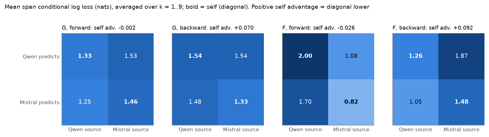

# 29 · Bidirectional cross-model dice completion (2026-10-31)

| | |
|---|---|
| Track | 1: static self-prediction |
| Tag | `SPAR_DICE_BIDIRECTIONAL_COMPLETION_v1.1` |
| Design source | `SPAR_Experiment_29_Handoff_v1_1.md` (2026-10-31); direct sequel to [28](../28_2026-10-31_dice_logprob_crossmodel/) |
| Status | **Complete.** Both preflights and both main runs PASS every hard gate; Experiment 28 reproduced bit for bit. 152 cells, 456 completions, 752 teacher-forced rows. One A100 for 1.04 h, about $3.4 (see manifest). |
| Full report | [**REPORT.md**](REPORT.md) · [decision memo](DECISION_MEMO.md) · [approvals](APPROVALS.md) · [manifest](manifest.json) |
| Models | Qwen3-32B and Mistral Small 3.2 24B open weights, Experiment 28's engine and pins, unchanged |

## Results in brief

- **No self-specific advantage.** The balanced predictor x source contrast averaged over k is -0.002 to +0.092 nats, with
  inconsistent sign across k. Source difficulty dominates: both models complete Mistral's period-6 F easily forward.
- **Forward context helps where a generic rule fixes the next roll.** Roll 6 is easy for everyone at k = 5, because each
  sequence opens with a permutation of 1-6. Elsewhere, boundary losses are mostly above uniform.
- **Direction effects belong to the sequence:** backward is easier on Qwen's F and harder on Mistral's F, for both predictors.
- **Mistral never answers in the strict format** (0/76 cells, all prose), yet its teacher-forced distributions are slightly
  better than Qwen's. Its face mass falls to 0.04-0.26 at k = 9.
- **Middle-anchored arm:** no late-tail advantage, and no consistent self effect.



## Question

Each model reconstructs missing rolls of Experiment 28's four greedy ground-truth sequences (Qwen/Mistral x G/F):
- forward: given rolls 1..k, predict k+1..10;
- backward: given rolls 11-k..10, predict 1..10-k, in left-to-right order;
- supplementary: given rolls 3-8, predict 1, 2, 9, 10.

The prompt never names the source model, so both predictors receive identical bytes. The question is whether
reconstruction is better on the predictor's own checkpoint's sequences (predictor x source interaction), and how amount and
direction of revealed history matter. Scored by teacher-forced conditional log loss on the true missing digits, plus free
completions.

| File | Contents |
|---|---|
| [`PROTOCOL_FROZEN.md`](PROTOCOL_FROZEN.md) | Hypotheses, design, gates, measurements, analysis plan, stop rules, and the 74-vs-76 prompt count note |
| [`prompts_frozen.md`](prompts_frozen.md), [`conditions.csv`](conditions.csv) | The 76 prompt slots byte-exact; the 152 cells |
| `preflight/`, `main/` | Raw generations, teacher-forced rows, environments, gate and check reports |
| `analysis/` | positions.csv, cells.csv, crossed and middle tables, summary.json, 7 figures |
| [`DATA_DICTIONARY.md`](DATA_DICTIONARY.md), `manifest_template.json`, `inputs_sha256.json` | Fields, expected counts, frozen hashes (LF-normalised) |

## Re-running

```bash
PYTHONPATH=src python -m pytest tests/test_dice_bidirectional_completion.py      # offline, fake engine
PYTHONPATH=src python -m spar_dynamic.dice_bidirectional_completion dryrun       # counts, example prompts, cost estimate
# GPU host (repo root), after src/spar_dynamic/dice_logprob_crossmodel/remote_setup.sh:
bash src/spar_dynamic/dice_bidirectional_completion/run_stage.sh preflight qwen mistral
PYTHONPATH=src python -m spar_dynamic.dice_bidirectional_completion gate_preflight <model>     # locally
bash src/spar_dynamic/dice_bidirectional_completion/run_stage.sh main qwen mistral             # after approval
PYTHONPATH=src python -m spar_dynamic.dice_bidirectional_completion gate_main <model>
PYTHONPATH=src python -m spar_dynamic.dice_bidirectional_completion analyse
```
