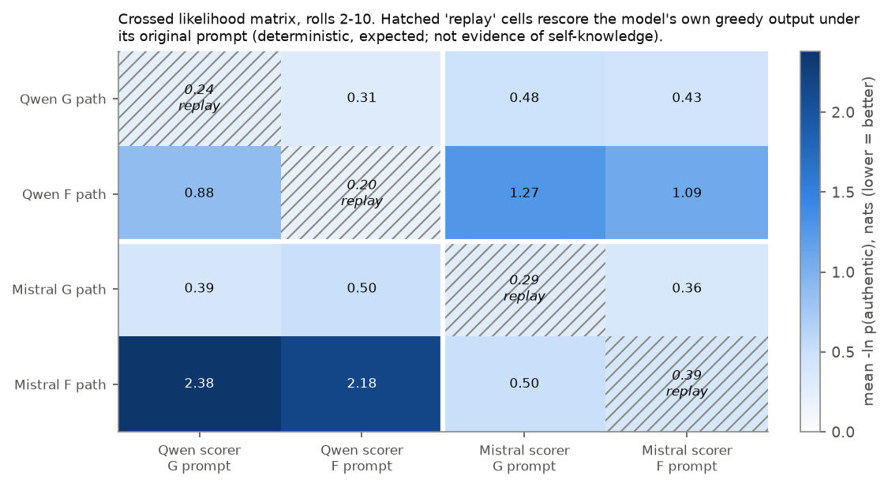

# 31 · Cross-model teacher-forced continuation probabilities (2026-11-15)

| | |
|---|---|
| Track | 1: static self-prediction |
| Tag | `SPAR_EXP31_CROSS_MODEL_TEACHER_FORCING_v1.0` |
| Design source | `GPT_SPAR_Experiments_31_32_Revised_Claude_Code_Handoff.md` (2026-11-15) |
| Status | **Complete.** Frozen at `bba03b5`; all checks PASS; 160/160 rows. One A100-80GB rental shared with 32, **$0.73**. |
| Report | [**REPORT.md**](REPORT.md) · [PROTOCOL.md](PROTOCOL.md) · [run_record.json](run_record.json) · [APPROVALS.md](APPROVALS.md) |
| Models | Qwen3-32B @ `9216db57…`, Mistral Small 3.2 24B @ `95a6d26c…` (Experiment 28 stack, reproduced bit for bit) |
| Previous / next | [← 30](../30_2026-11-01_six_roll_recognition/) · [32 →](../32_2026-11-15_roll7_intermediate_context/) |

**Result.** Each model's own dice continuation is more probable under itself than under the other model in all 8 cells, including the 4
non-replay cells (+0.12 to +1.89 nats). Both models share a near-perfect "exhaust the six faces" rule (≥ 99.6% of mass on unused
faces) and diverge mainly on how they start the second block (top-face agreement 31/40 at rolls 2-6, 14/32 at 7-10). Because G and
F give nearly the same continuation on a shared prefix, this is the alignment that deterministic decoding predicts, not
privileged self-access.

Code: `src/spar_dynamic/dice_31_32/`. Tests: `tests/test_dice_31_32.py`.
