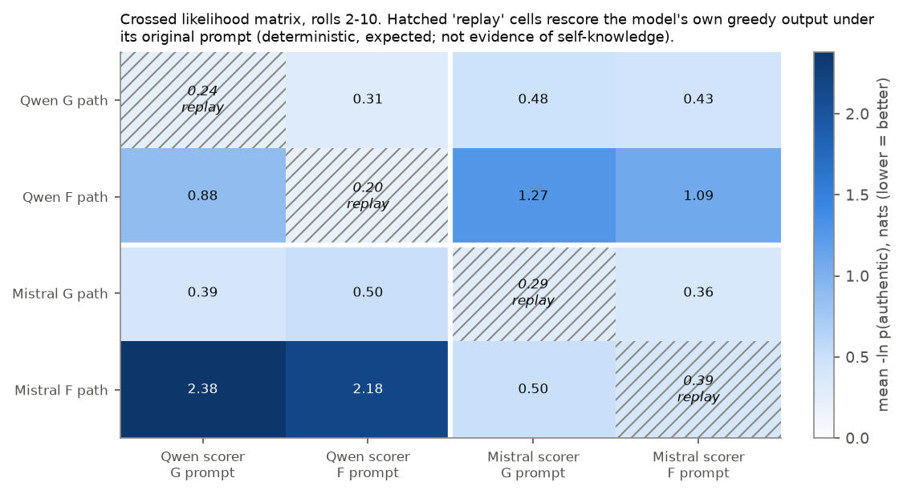
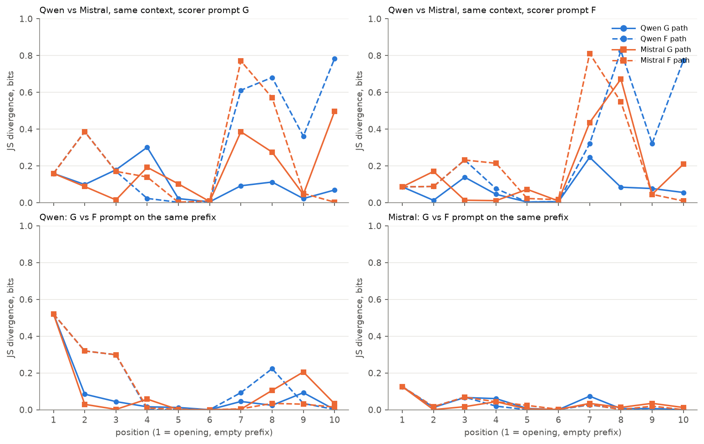
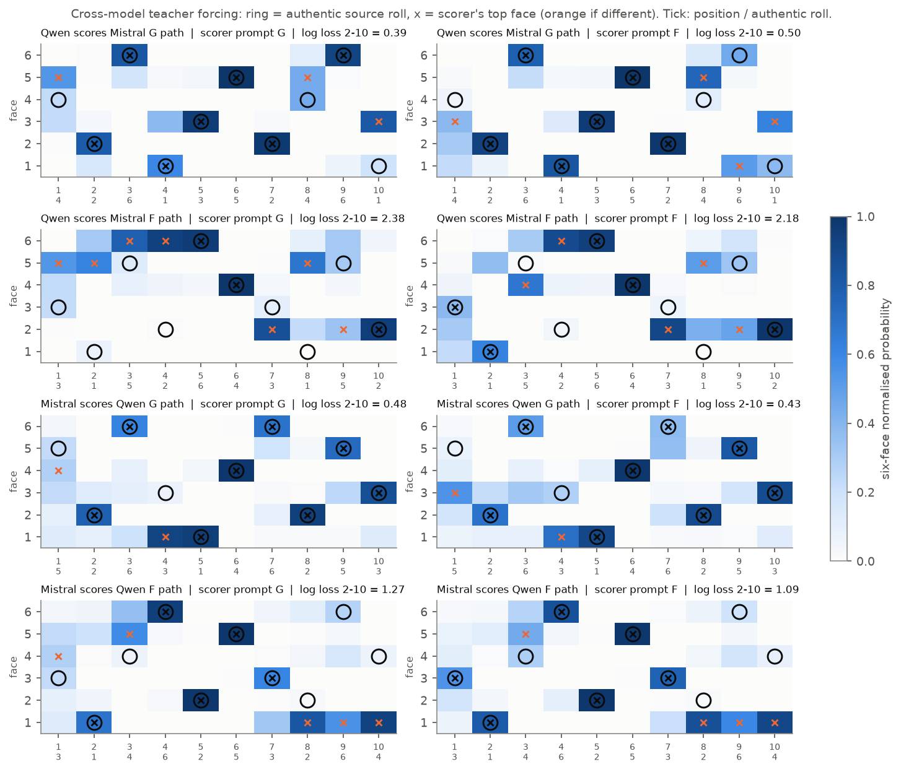

# Experiment 31: cross-model teacher-forced continuation probabilities

`SPAR_EXP31_CROSS_MODEL_TEACHER_FORCING_v1.0` · frozen `bba03b5` · run 2026-11-15 on one vast.ai A100-SXM4-80GB.

- **Shared cost:** $0.73 for this experiment and Experiment 32 together.
- **Checks:** all post-run checks PASS ([results/CHECKS.md](results/CHECKS.md)).
- **Protocol:** [PROTOCOL.md](PROTOCOL.md).
- **Companion:** [Experiment 32](../32_2026-11-15_roll7_intermediate_context/REPORT.md).

## Summary

**Each model's own authentic trajectory is more likely under that model than under the other model, in all eight source ×
scorer-instruction cells.** That includes the four cells that are not replays. The advantage is concentrated where the two
models' generic rules diverge, and it is what deterministic greedy decoding predicts. It is not evidence of privileged
self-access.

**Shared structure.** Both models put at least 99.6% of their face probability on the faces not yet used in the current
six-face block. They agree on the top face in 31 of 40 matched contexts at rolls 2-6, but in only 14 of 32 at rolls 7-10,
where the second block starts.

**G and F barely change the continuation.** Within a scorer, the two instructions give nearly the same continuation on a
shared prefix (mean JS after roll 1: 0.02-0.03 bits for Mistral, 0.04-0.11 for Qwen). So the "non-replay" own cells are close
to rescoring the model's own greedy policy.

**The F paths drive the large own-model effects.** Mistral's F output is a period-6 cycle (`3 1 5 2 6 4 | 3 1 5 2`). Mistral
partly expects the repeat; Qwen does not.

## What was run

Each of 16 streams forces a source's authentic ten rolls as the assistant turn after the scorer's archived G or F
instruction. The streams cover scorer (Qwen3-32B, Mistral Small 3.2) × scorer instruction × source trajectory (4). Each
stream is scored before every roll, giving 160 labeled rows (80 cross-model) over 140 unique contexts.

**Arithmetic:**

- Primary: incremental scoring, run twice; the two passes are bit-identical.
- Floor: a full forward pass. Its largest six-face |dp| against the incremental pass is 0.091, under the 0.25 stop.

**Reuse:** all 160 rows were computed fresh. 104 of them have an exactly equivalent archival record: 80 from Experiment 28's
within-model matched-prefix rows and 24 from Experiment 30's authentic policy rows. All 104 match **bit for bit**
(max |Δlogp| = 0.0), and the provenance is listed per row in `results/labeled_rows.csv`. The other 56 rows had no
archival equivalent.

**Preflight:** both models regenerated Experiment 28's G and F outputs identically (six-face |dp| = 0.0). The vocabulary
scan found no whitespace or multi-digit face tokens, so every boundary is a single bare-digit token.

| Ground truth (Experiment 28 raw records; agrees with the handoff, including Qwen G) | Rolls |
|---|---|
| Qwen G | `5 2 6 3 1 4 6 2 5 3` |
| Qwen F | `3 1 4 6 2 5 3 2 6 4` |
| Mistral G | `4 2 6 1 3 5 2 4 6 1` |
| Mistral F | `3 1 5 2 6 4 3 1 5 2` |

## A. Crossed likelihood table

Mean −ln p(authentic roll) over rolls 2-10, in nats (lower is better). Position 1 is reported in section C.



| Source path | Scorer instruction | Own scorer | Other scorer | Other − own | Own cell |
|---|---|---:|---:|---:|---|
| Qwen G | G | 0.235 | 0.478 | +0.243 | replay |
| Qwen G | F | 0.309 | 0.429 | +0.119 | own model, other instruction |
| Qwen F | G | 0.881 | 1.272 | +0.391 | own model, other instruction |
| Qwen F | F | 0.203 | 1.088 | +0.885 | replay |
| Mistral G | G | 0.286 | 0.395 | +0.109 | replay |
| Mistral G | F | 0.358 | 0.499 | +0.141 | own model, other instruction |
| Mistral F | G | 0.497 | 2.383 | +1.886 | own model, other instruction |
| Mistral F | F | 0.389 | 2.176 | +1.787 | replay |

### Reciprocal contrast

Own-model advantage, averaged over the two source models:

| Source instruction | Scorer instruction | Own advantage (nats) | Contains replay cells |
|---|---|---:|---|
| G | G | +0.176 | yes (trivial) |
| G | F | **+0.130** | no |
| F | G | **+1.138** | no |
| F | F | +1.336 | yes (trivial) |

### Reading

- **The replay cells are expected.** Own G-on-G and F-on-F rescore a deterministic greedy output under its own prompt, so they
  are an engineering check.
- **The two informative contrasts are positive for both sources.** These are the own scorer under the other instruction:
  +0.12 and +0.14 nats on the G paths, and +0.39 and +1.89 on the F paths. They are positive because, on a given prefix, a
  model's G and F instructions produce almost the same continuation (section B). The own scorer therefore still largely
  reproduces the policy that produced the string.
- **The advantage is not uniform.** At rolls 2-5 it changes sign: the other model is better in 3 of 8 cells, for example
  Mistral on Qwen F under G, by 0.47 nats. At rolls 7-10 it is clearly positive in 6 of 8 cells (+0.30 to +2.65) and about
  zero on the Qwen G path (+0.01 and −0.04).
  Restricted to the heuristic's discriminating rows, the own scorer is better in all 8 cells
  ([own_vs_other_discriminating.csv](results/own_vs_other_discriminating.csv)).

## B. Matched-context distributions



**Between scorers, same instruction and prefix:**

- Mean JS over rolls 2-10 is 0.07-0.18 bits on the G paths, with top-face agreement in 7-8 of 9 positions.
- On the F paths it is 0.22-0.34 bits, with agreement in 3-5 of 9.
- The divergence is near zero inside the first block and jumps at rolls 7-10 (up to 0.83 bits).

**Within a scorer, G vs F instruction on the same prefix:**

- The opening differs: roll-1 JS is 0.52 bits for Qwen and 0.13 for Mistral, reproducing Experiment 28.
- After the opening the two instructions nearly coincide: mean JS over rolls 2-10 is 0.016-0.026 bits for Mistral and
  0.036-0.108 for Qwen.
- Qwen's largest gaps are 0.32 bits at rolls 2-3 of the F paths, where its G instruction prefers 5 and 6 at the positions where the F path has 1 and 4.

Digit mass is at least 0.60 at every boundary. Every full-vocabulary argmax is a face token.

## C. Opening vs continuation

Roll 1 depends only on the scorer and its instruction, since the prefix is empty. The scorers' roll-1 distributions differ by
0.16 bits under G and 0.09 under F. Whether roll 1 counts as "own" depends only on which face the source opened with; it is
reported but excluded from the table above. The cross-model heatmaps show where each scorer's preferred face departs from the
source's.



## D. Generic remaining-face diagnostic

All four sources use six distinct faces in rolls 1-6, so the reset-at-roll-7 heuristic is defined throughout.

**How each position is labelled:**

- **Rolls 2-5 and 8-10 (discriminating):** two to five eligible faces remain, and the authentic face is always among them.
- **Roll 6 (uninformative):** exactly one face remains, so the renormalised probability is 1 by construction. Every scorer
  gives that face at least 0.967.
- **Roll 7 (unconstrained):** six faces remain.

**Findings:**

- **Both models follow the exhaustion rule almost perfectly.** On every discriminating row, both scorers put at least 0.996
  of their normalised mass on the remaining faces, in both blocks. The generic rule therefore explains *which set* the next
  roll comes from, and the cross-model differences are about the *order within that set*.
- **The own scorer beats the heuristic.** Against the uniform-over-remaining heuristic (mean ln n = 1.27 nats on these rows),
  the own scorer is better by 0.36-1.10 nats.
- **The other scorer does so only on G paths.** It is also better than the heuristic on the G paths (by 0.63-0.86), but worse
  on the F paths (by 0.09-1.46). It confidently picks the wrong eligible face, most visibly Qwen at Mistral F's cycle restart:
  p(authentic) = 0.10, 0.00 and 0.31 at rolls 7-9, against Mistral's own 0.35, 0.77 and 0.42.

See [heuristic_summary.csv](results/heuristic_summary.csv).

## Interpretation and limits

**What this shows.** Two models with a shared "use every face before repeating" rule assign each other's dice strings
similar probabilities within a six-face block. They diverge mainly on how to begin the next block. Each model's own strings
are more probable under that model, as greedy decoding requires.

**What it does not show.** That advantage survives a change of instruction (G vs F) only because the instruction barely
changes the continuation once the opening is fixed. That is model-specific likelihood alignment, not privileged access to a
self-model, and nothing here distinguishes the two.

**Limits:**

- These are four fixed sequences and the analysis is descriptive, with no tests.
- The heuristic decomposition is a diagnostic, not a claim about mechanism.

## Two sentences for the Ackerman meeting

Holding the instruction and prior rolls fixed, each model gives its own authentic dice continuation more probability than the
other model does in all eight cells, including the four non-replay cells (+0.12 to +1.89 nats). But both models put more
than 99.6% of their mass on the faces not yet used in the current six-face block, and the own-model advantage comes mostly
from how each starts the second block (top-face agreement 31/40 at rolls 2-6 vs 14/32 at rolls 7-10).

Because a model's G and F instructions give almost the same continuation on a shared prefix (0.02-0.11 bits after roll 1),
this is the alignment that deterministic decoding predicts between a model and its own outputs, not evidence of privileged
self-access.

## Reproduce

Analysis and checks run offline and are idempotent.

```bash
PYTHONPATH=src python -m pytest tests/test_dice_31_32.py        # offline: fake-model end-to-end, real tokenizers if cached
PYTHONPATH=src python -m spar_dynamic.dice_31_32 dryrun         # design counts, prompts, leakage scan, cost estimate
PYTHONPATH=src python -m spar_dynamic.dice_31_32 validate       # frozen files, code hashes, ground truth
```

On the GPU host, deploy with `git -c core.autocrlf=false archive bba03b5 src <Exp 28 main> <Exp 30 policy_benchmark> <31> <32>`,
then run `src/spar_dynamic/dice_logprob_crossmodel/remote_setup.sh`, then:

```bash
bash src/spar_dynamic/dice_31_32/run_stage.sh qwen mistral
```

Back on the local machine:

```bash
PYTHONPATH=src python -m spar_dynamic.dice_31_32 checks
PYTHONPATH=src python -m spar_dynamic.dice_31_32 analyse
```

## Files

| Path | Content |
|---|---|
| `raw/<model>/` | `streams.jsonl` (16 streams × incremental ×2 + full pass, every boundary in full), `archival.jsonl`, `env.json` |
| `results/` | `labeled_rows.csv` (160 rows, provenance), `crossed_own_vs_other.csv`, `reciprocal_contrast.csv`, `js_*.csv`, `heuristic_summary.csv`, `own_vs_other_discriminating.csv`, `summary.json`, `checks.json`, `CHECKS.md` |
| `figures/` | heatmaps (cross and own), crossed matrix, JS by position (PNG + PDF) |
| `host_logs/` | setup, validate and run logs from the GPU host |
| `run_record.json`, `APPROVALS.md` | instance, cost, environments, file hashes; decisions and rental deviations |
