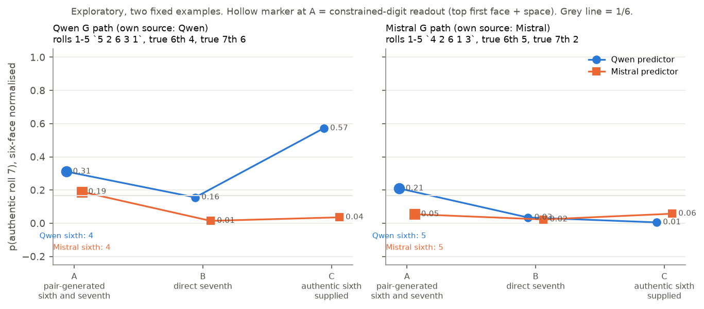

# 32 · Seventh-roll prediction with and without the sixth roll (2026-11-15)

| | |
|---|---|
| Track | 1: static self-prediction |
| Tag | `SPAR_EXP32_ROLL7_INTERMEDIATE_CONTEXT_v1.0` |
| Design source | `GPT_SPAR_Experiments_31_32_Revised_Claude_Code_Handoff.md` (2026-11-15) |
| Status | **Complete.** Frozen at `bba03b5`; all checks PASS; 12/12 cells, 12/12 free outputs valid. Shared rental with 31 ($0.73 total). |
| Report | [**REPORT.md**](REPORT.md) · [PROTOCOL.md](PROTOCOL.md) · [run_record.json](run_record.json) |
| Previous | [← 31](../31_2026-11-15_cross_model_teacher_forcing/) |

**Result.** Exploratory, two fixed examples:

- **Direct "roll 7" (B):** both models answer with the missing sixth face in all four cells.
- **Rolls 6 and 7 together (A):** the sixth is restored every time, and p(true 7th) is higher than in B in every cell.
- **Authentic sixth supplied (C):** helps substantially only for Qwen on its own sequence (0.57 vs 0.16). That matches how
  both models continue that string in generation (0.69-0.70), so it is ordinary continuation surviving the prediction
  wrapper. Mistral on its own sequence gains nothing (0.06 vs 0.02).

Code: `src/spar_dynamic/dice_31_32/` (shared with 31). Tests: `tests/test_dice_31_32.py`.
