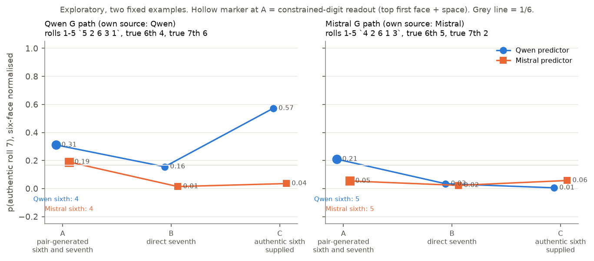

# Experiment 32: seventh-roll prediction with and without the sixth roll

`SPAR_EXP32_ROLL7_INTERMEDIATE_CONTEXT_v1.0` · frozen `bba03b5` · run 2026-11-15 on the same A100-SXM4-80GB rental as
[Experiment 31](../31_2026-11-15_cross_model_teacher_forcing/REPORT.md).

- **Shared cost:** $0.73 total.
- **Checks:** all post-run checks PASS ([results/CHECKS.md](results/CHECKS.md)).
- **Protocol:** [PROTOCOL.md](PROTOCOL.md).
- **Scope:** exploratory, with two fixed source examples. There is no inferential test.

## Summary

**B mis-indexes.** Asked directly for roll 7 (condition B), both models answered with **the missing sixth face**, in all four
cells. The direct question collapses onto the next-roll / missing-face rule.

**Asking for rolls 6 and 7 together (A) helps.** Both models restored the authentic sixth in 4 of 4 cells. In every cell,
p(true seventh) was higher than in B (+0.03 to +0.18).

**Supplying the authentic sixth (C) helps substantially in only one cell: Qwen on its own sequence.** There p(true seventh)
was 0.57, against 0.16 in B. That matches Qwen's ordinary continuation of the same string (0.70 when teacher-forced in
Experiment 31), and Mistral continues Qwen's string just as well (0.69). So it is conditional continuation surviving the
prediction wrapper, not a self-specific capacity.

Mistral on its own sequence gains nothing from C (0.06 vs 0.02), although its own continuation policy gives the true seventh
0.39.

## What was run

- 12 cells: predictor (Qwen3-32B, Mistral Small 3.2) × source (Qwen G, Mistral G) × condition (A, B, C).
- 6 distinct prompts; both predictors received identical bytes.
- Each prompt was generated twice, greedy, and the two runs were bit-identical.
- Targets came from the Experiment 28 raw records and agree with the handoff:

| Source | Rolls 1-5 | True 6th | True 7th |
|---|---|---:|---:|
| Qwen G | `5 2 6 3 1` | 4 | 6 |
| Mistral G | `4 2 6 1 3` | 5 | 2 |

**Free output.** All 12 free outputs were strictly valid (exact format, then EOS). The labelled constrained-digit readout for
A was therefore never needed. It was still computed, and it equals the free readout bit for bit in all 4 A cells.

**Scored boundaries:**

- B and C: roll 7 at the first answer token.
- A: roll 6 at the first answer token, and roll 7 after the predictor's own generated sixth digit and the space.

## The 12 cells

p7 is the six-face-normalised p(true seventh). LL7 = −ln p7. Mass is the raw digit mass at the roll-7 boundary.

| Predictor | Source | Cond. | Free output | 6th generated (correct?) | p(true 6th) | p7 | LL7 | Top 7th | Mass |
|---|---|---|---|---|---:|---:|---:|---:|---:|
| Qwen | Qwen G (own) | A | `4 3` | 4 (yes) | 0.888 | 0.311 | 1.17 | 3 | 1.00 |
| Qwen | Qwen G (own) | B | `4` | – | – | 0.156 | 1.86 | 4 | 1.00 |
| Qwen | Qwen G (own) | C | `6` | – | – | **0.572** | 0.56 | **6** | 0.98 |
| Qwen | Mistral G | A | `5 4` | 5 (yes) | 0.993 | 0.209 | 1.56 | 4 | 1.00 |
| Qwen | Mistral G | B | `5` | – | – | 0.035 | 3.36 | 5 | 1.00 |
| Qwen | Mistral G | C | `4` | – | – | 0.005 | 5.24 | 4 | 0.98 |
| Mistral | Qwen G | A | `4 1` | 4 (yes) | 0.555 | 0.189 | 1.67 | 1 | 1.00 |
| Mistral | Qwen G | B | `4` | – | – | 0.014 | 4.24 | 4 | 0.74 |
| Mistral | Qwen G | C | `4` | – | – | 0.036 | 3.34 | 4 | 0.63 |
| Mistral | Mistral G (own) | A | `5 4` | 5 (yes) | 0.607 | 0.054 | 2.92 | 4 | 1.00 |
| Mistral | Mistral G (own) | B | `5` | – | – | 0.023 | 3.78 | 5 | 0.69 |
| Mistral | Mistral G (own) | C | `4` | – | – | 0.057 | 2.86 | 4 | 0.63 |

## Contrasts on p(true seventh)

The table runs predictor × source. A uses the free readout; the constrained readout is identical.

| Predictor | Source | A − B | C − B | C − A | A's sixth correct |
|---|---|---:|---:|---:|---|
| Qwen | Qwen G (own) | +0.155 | **+0.416** | +0.261 | yes |
| Qwen | Mistral G | +0.175 | −0.029 | −0.204 | yes |
| Mistral | Qwen G | +0.175 | +0.021 | −0.154 | yes |
| Mistral | Mistral G (own) | +0.031 | +0.035 | +0.003 | yes |

## Interpretation

**A − B (requesting and outputting an intermediate forecast):** positive in all four cells, but mostly because B answers the
wrong position.

- B's top face is the authentic sixth in all four cells: 4 for the Qwen source, 5 for the Mistral source. In other words, B
  gives the face that completes the six-face permutation, as if asked for the next roll.
- In A the sixth comes first, so the seventh is asked for at the right place.
- So A − B mostly measures B's mis-indexing, not a benefit of simulating the intervening roll.

**C − B (receiving the correct intervening history):** large only for Qwen on its own sequence.

- In C, Qwen answers 6 for its own sequence, which is correct.
- Every other C cell answers 4, which is wrong for both sources. For the Mistral source, 4 is roll 8 of the authentic
  sequence.
- Compare the plain continuation policy at roll 7 under the G instruction, from Experiment 31's teacher-forced rows:

  | Scorer | Qwen G string | Mistral G string |
  |---|---:|---:|
  | Qwen | 0.70 | 0.97 |
  | Mistral | 0.69 | 0.39 |

  Both models continue both strings correctly in generation. Under the prediction wrapper with six rolls shown, only Qwen on
  its own string still does. Qwen on Mistral's string drops from 0.97 to 0.005, Mistral on its own from 0.39 to 0.06, and
  Mistral on Qwen's from 0.69 to 0.04.
- This repeats Experiment 27's finding that the prediction wrapper discards most of the generation policy. Here it does so
  unevenly. The one surviving cell is an own-source cell, but the other own-source cell (Mistral) shows no such survival.
  With two examples this cannot be separated from item-specific continuation.

**C − A (authentic vs self-generated sixth):** this is not an isolated history effect.

- In all four A cells the generated sixth was correct, so A and C share the same six rolls.
- They differ in where the sixth appears: in the prompt for C, in the model's own answer for A. They also differ in wording.
- C − A therefore measures format and position: +0.26 and +0.00 on the own-source cells, −0.20 and −0.15 on the cross cells.

**Restoring the sixth is generic.** Restoring the sixth roll in A (4 of 4) is what the missing-face rule predicts after five
distinct faces, as the handoff anticipated.

**Digit mass.** Qwen puts at least 0.98 of its mass on digits throughout. Mistral's roll-7 digit mass in B and C is 0.63-0.74,
although its greedy output is a valid single digit. The rest of the mass sits mostly on prose openings, where "To" alone takes
0.18-0.24 and "Given", "Based" and "The" take smaller shares. So Mistral is close to starting an explanation on these prompts. Normalised probabilities are
conditional on a face being emitted.

## Limits

- Two fixed prefixes, both ending in five distinct faces, so roll 6 is easy for a generic rule.
- The A, B and C wordings differ, so no contrast is a pure manipulation of history.
- Normalised probabilities are conditional on emitting a digit, and are reported beside the raw mass.
- No statistical inference.
- The optional extension with more prefixes, preselected before seeing outcomes, was not run.

## Two sentences for the Ackerman meeting

Asked directly for roll 7 after five distinct rolls, both models instead give the missing sixth face in all four cells.
Asking for rolls 6 and 7 together restores the sixth correctly every time and raises p(true seventh) in every cell, so most of
the "intermediate step helps" effect is a fix for mis-indexing.

Supplying the true sixth helps substantially only for Qwen on its own sequence (0.57 vs 0.16), which matches how both models
continue that string in generation (0.69-0.70). Mistral on its own sequence gains nothing (0.06 vs 0.02). So this looks like
ordinary conditional continuation surviving the prediction wrapper in one item, not a self-specific capacity.

## Reproduce

The commands are the same as for [Experiment 31](../31_2026-11-15_cross_model_teacher_forcing/REPORT.md#reproduce). The
GPU run writes both experiments in one pass, and `analyse` builds both.

## Files

| Path | Content |
|---|---|
| `raw/<model>/cells.jsonl` | 6 prompts × 2 replicates: full free generation (every step), first-boundary readout, A's free and constrained roll-7 readouts, full-pass floors |
| `raw/<model>/env.json` | environment; the shared archival preflight is in `../31_.../raw/<model>/archival.jsonl` |
| `results/` | `cells_12.csv`, `contrasts.csv`, `summary.json`, `checks.json`, `CHECKS.md` |
| `figures/` | `fig32_roll7_by_condition` (PNG + PDF) |
| `run_record.json` | instance, cost, environments, file hashes (decisions: `../31_.../APPROVALS.md`) |
