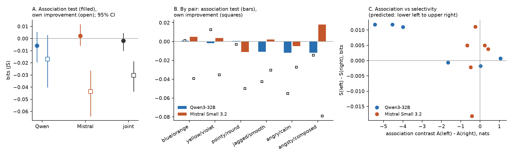

# 33 · Dice forecast scaffolding (2026-11-24)

| | |
|---|---|
| Track | 1: static self-prediction |
| Tag | `SPAR_EXP33_DICE_SCAFFOLDING_v1.0` |
| Design source | `docs/handoffs/GPT_SPAR_Dice_Scaffolding_Claude_Code_Handoff.md` |
| Status | **Complete** (run 2026-11-25). Frozen at `1992d6d`; all checks PASS; $3.88. |
| Report | [**REPORT.md**](REPORT.md) · [PROTOCOL.md](PROTOCOL.md) · [run_record.json](run_record.json) · [APPROVALS.md](APPROVALS.md) |
| Previous | [← 32](../32_2026-11-15_roll7_intermediate_context/) |

**Result.** No support for self-specific forecasting, but a weak null:

- **Words:** negative or sharp words (*angry*, *jagged*, *pointy*, *angsty*) move Qwen's forecast toward its own policy, and equally toward Mistral's. The word on an unrelated card also shifts it.
- **Associations:** the independent SELF/OTHER associations do not predict which word helps (joint −0.0018 bits, 95% CI −0.0098 to +0.0042). In Qwen the relation runs the other way.
- **Other checkpoint:** names give no consistent owner advantage.
- **Why weak:** Mistral starts a prose answer on 4,093 of 4,094 core prompts, and even Qwen's neutral forecast (0.458 bits) is no closer to its policy than a uniform vector (0.450).

Code: `src/spar_dynamic/dice_scaffolding/`. Tests: `tests/test_dice_scaffolding.py`. `posthoc/` was added after the run and is not frozen.
