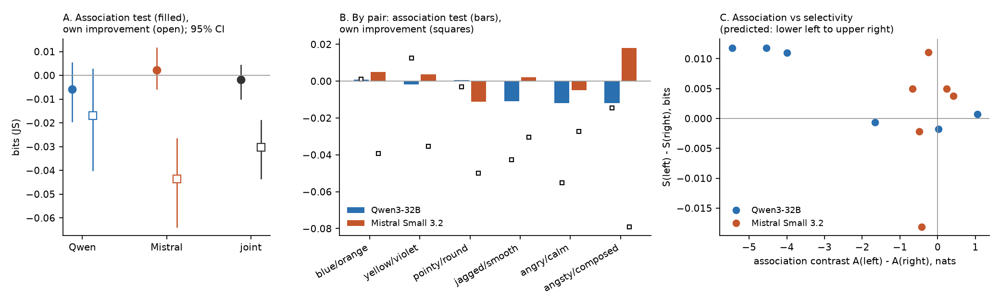
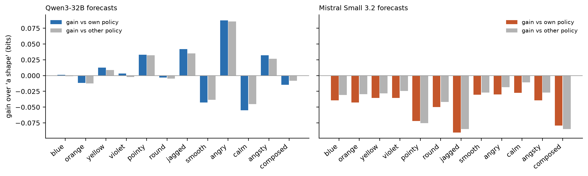
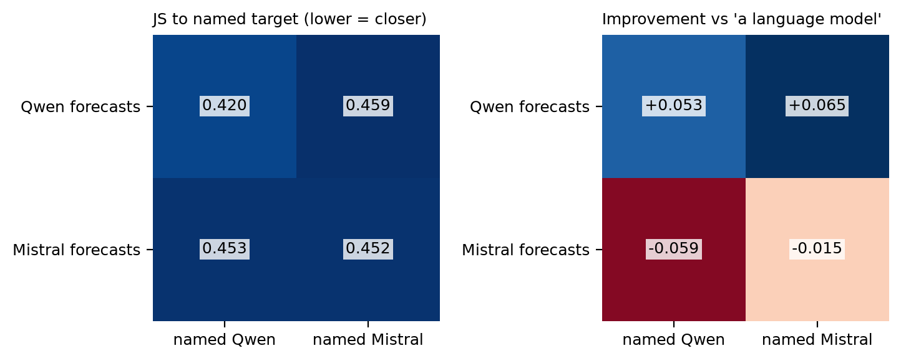
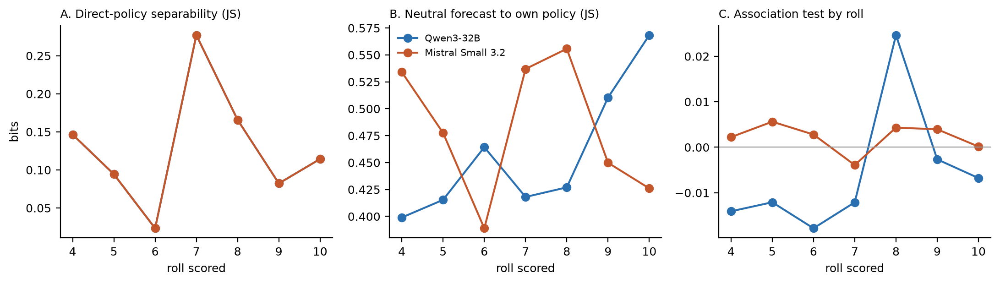
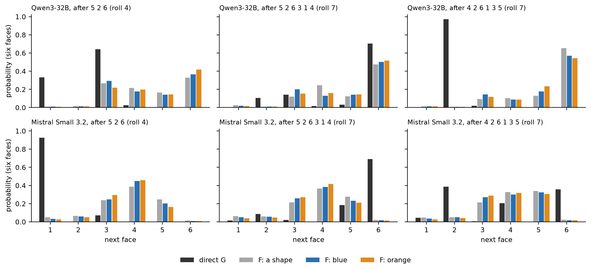

# Experiment 33: dice forecast scaffolding. Report

`SPAR_EXP33_DICE_SCAFFOLDING_v1.0` · 2026-11-25 · protocol frozen at `1992d6d` before any model call · [PROTOCOL.md](PROTOCOL.md) · [run_record.json](run_record.json)

## Summary

Each checkpoint (Qwen3-32B, Mistral Small 3.2 24B) forecast the next roll of a hypothetical roller, given the original dice instruction and the rolls so far. We varied the words describing the roller and asked whether words the model independently associates with SELF move its forecast toward its own direct-generation probabilities. Distances are Jensen–Shannon divergence in bits (0 to 1; lower is closer). A gain is the reduction in distance relative to the neutral "a shape".

1. **Which words move the forecast toward actual behaviour?** For Qwen, *angry* (+0.088 bits), *jagged* (+0.042), *pointy* (+0.033) and *angsty* (+0.032) move it toward its own policy; *calm* (−0.055) and *smooth* (−0.043) move it away. The gains against Mistral's policy are nearly the same (*angry* +0.086), and the word on an unrelated card also shifts the forecast. For Mistral, no confirmatory adjective improves on "a shape".
2. **Did independent associations predict which words?** No. The joint association test is −0.0018 bits (95% CI −0.0098 to +0.0042). The more self-associated word did not improve the forecast: joint own improvement is −0.0303 (−0.0433 to −0.0190) against "a shape". That figure depends on the neutral: against the longer neutral it is +0.0030 (−0.0110 to +0.0181).
3. **Does any improvement survive comparison with another checkpoint?** No. Word effects shift both targets together, and checkpoint names do not give a consistent owner advantage.
4. **How much does the null mean?** Little. Two working controls failed, so under the handoff's section 6 table it is inconclusive rather than a baseline estimate:
   - **Mistral does not answer with a face.** Its most likely first token is "Given", the start of a prose answer, on 4,093 of 4,094 core forecast prompts. Median face mass is 0.05 to 0.19 across the plain conditions and at most 0.024 under T2. Its forecast vectors describe the small renormalised remainder, and no Mistral condition reaches the 0.50 mass threshold.
   - **The forecasts do not track the policies, even for Qwen.** Qwen's neutral forecast is 0.458 bits from its own policy on the confirmatory bank; a uniform six-face vector is 0.450 away and a uniform over unused faces 0.205.

Other diagnostics held. The two policies are separable (mean 0.129 bits over the confirmatory bank, 0.277 at roll 7), the association probe gives non-flat contrasts with at least 0.82 of the mass on the two letters, and replay is bit-identical.

## 1. Primary: confirmatory pairs on confirmatory histories

12 opening-triple families, 84 histories, 6 pairs, T1 plain; 10,000 two-way bootstrap draws.

| | Association test (bits) [95% CI] | Pairs > 0 | Leave-one-pair-out | Own improvement (bits) [95% CI] | Pairs > 0 |
|---|---|---|---|---|---|
| Qwen | -0.0058 [-0.0193, +0.0053] | 2/6 | -0.0072 to -0.0046 | -0.0170 [-0.0400, +0.0027] | 2/6 |
| Mistral | +0.0022 [-0.0056, +0.0116] | 4/6 | -0.0010 to +0.0048 | -0.0435 [-0.0637, -0.0267] | 0/6 |
| Joint | -0.0018 [-0.0098, +0.0042] | 3/6 | -0.0028 to -0.0005 | -0.0303 [-0.0433, -0.0190] | 0/6 |

The frozen sign label for Mistral is "selective without own improvement" because its mean association test is positive. The interval includes zero, its leave-one-pair-out range crosses zero and *angsty/composed* (+0.0181) carries the mean, so this is not evidence of an effect.

Per pair (bits except `a`; S = own gain − other gain):

| Forecaster | Pair (left / right) | a (nats) | Own gain, left / right | Other gain, left / right | S, left / right | Association test | Own improvement |
|---|---|---|---|---|---|---|---|
| Qwen | blue / orange | +1.05 | +0.0010 / -0.0116 | -0.0008 / -0.0126 | +0.0018 / +0.0011 | +0.0007 | +0.0010 |
| Qwen | yellow / violet | +0.02 | +0.0127 / +0.0034 | +0.0089 / -0.0022 | +0.0038 / +0.0056 | -0.0018 | +0.0127 |
| Qwen | pointy / round | -1.66 | +0.0332 / -0.0031 | +0.0322 / -0.0047 | +0.0010 / +0.0016 | +0.0006 | -0.0031 |
| Qwen | jagged / smooth | -3.99 | +0.0419 / -0.0428 | +0.0352 / -0.0384 | +0.0067 / -0.0043 | -0.0110 | -0.0428 |
| Qwen | angry / calm | -4.54 | +0.0876 / -0.0552 | +0.0856 / -0.0453 | +0.0019 / -0.0098 | -0.0118 | -0.0552 |
| Qwen | angsty / composed | -5.45 | +0.0324 / -0.0146 | +0.0268 / -0.0083 | +0.0055 / -0.0063 | -0.0118 | -0.0146 |
| Mistral | blue / orange | +0.23 | -0.0392 / -0.0428 | -0.0307 / -0.0294 | -0.0085 / -0.0135 | +0.0050 | -0.0392 |
| Mistral | yellow / violet | +0.42 | -0.0353 / -0.0353 | -0.0280 / -0.0243 | -0.0072 / -0.0110 | +0.0038 | -0.0353 |
| Mistral | pointy / round | -0.24 | -0.0722 / -0.0499 | -0.0752 / -0.0419 | +0.0030 / -0.0081 | -0.0111 | -0.0499 |
| Mistral | jagged / smooth | -0.48 | -0.0904 / -0.0305 | -0.0847 / -0.0269 | -0.0057 / -0.0035 | +0.0022 | -0.0305 |
| Mistral | angry / calm | -0.67 | -0.0301 / -0.0274 | -0.0184 / -0.0107 | -0.0117 / -0.0167 | -0.0050 | -0.0274 |
| Mistral | angsty / composed | -0.43 | -0.0392 / -0.0790 | -0.0270 / -0.0849 | -0.0122 / +0.0059 | +0.0181 | -0.0790 |

- **Associations.** Qwen's contrasts are large and look like valence: *calm*, *composed* and *smooth* are SELF relative to *angry*, *angsty* and *jagged*. The two wordings of the association task differ in size (angry/calm −7.4 and −1.7 nats) and agree in sign for 5 of 6 confirmatory pairs in each model (they disagree on yellow/violet for Qwen and pointy/round for Mistral). Qwen also has a letter bias (A minus B, 5.6 nats), which the design balances.
- **Qwen's gains run opposite to the associations.** Over the 12 words, association and own gain correlate at r = −0.85 (association and selectivity −0.83; pair level −0.91, n = 6). For Mistral the values are +0.41, −0.14 and +0.30. These are descriptive, with few words. Because the gains are nearly the same for the other target, they are not specific to Qwen's policy.
- **Mistral.** All 12 words have negative own gain (−0.027 to −0.090) and negative other gain. Against the longer neutral, own improvement is −0.0066 (−0.0242 to +0.0107), so the deficit largely reflects the choice of neutral. "a shape" was the better neutral for both models (0.458 vs 0.487 for Qwen; 0.481 vs 0.518 for Mistral).

**Other banks and wordings, joint association test:** development pairs on confirmatory histories −0.0031 (−0.0081, +0.0023); confirmatory pairs on development histories +0.0008 (−0.0057, +0.0084); development pairs and histories −0.0018 (−0.0076, +0.0035); T1 on the 28-history subset −0.0006 (−0.0119, +0.0080); T2 on the same histories +0.0010 (−0.0060, +0.0127). Under T2, own improvement is −0.0137 (−0.0399, +0.0153) for Qwen and +0.0108 (+0.0011, +0.0228) for Mistral, the latter on forecasts with at most 2.4% of the mass on faces. With high-mass rows only, Qwen is essentially unchanged (−0.0058 and −0.0170) and Mistral lacks usable rows (72 pair-by-family cells missing).

## 2. Comparison with the other checkpoint

Within each forecaster a word's gain is close for both targets (largest |S| over the 12 words: Qwen 0.0098, Mistral 0.0167). The outsider's gain toward the same target is in `results/core_words.csv`.

**Named checkpoints** (28 histories):

| | Distance, named Qwen | Distance, named Mistral | Improvement over "a language model", named Qwen | Same, named Mistral |
|---|---|---|---|---|
| Qwen forecasts | 0.420 | 0.459 | +0.053 | +0.065 |
| Mistral forecasts | 0.453 | 0.452 | −0.059 | −0.015 |

- The owner is somewhat closer than the outsider for both named targets (0.420 vs 0.453; 0.452 vs 0.459). For target Mistral, though, the name worsens the owner's forecast and improves the outsider's. The two criteria the handoff asks for (larger owner improvement and closer absolute forecasting) hold together only for target Qwen.
- Even there the name is not specific: Qwen's forecast moves further toward Qwen's own policy with *Mistral's* name (+0.066) than with its own (+0.053). Mistral with no name ("a language model") is closer to Qwen's policy (0.394) than Qwen with its own name (0.420).
- "Another instance of the exact checkpoint" worsens the forecast for both (−0.112 Qwen, −0.090 Mistral). Mistral's only positive own gain over "a language model" is for "the language model answering this forecast" (+0.026), which helps the other target more (+0.034).

| Forecaster | Subject | D to own | D to other | Own gain vs "a language model" | Other gain |
|---|---|---|---|---|---|
| Qwen | answering | 0.520 | 0.571 | -0.0475 | -0.0484 |
| Qwen | identical | 0.585 | 0.634 | -0.1124 | -0.1105 |
| Qwen | another_lm | 0.509 | 0.554 | -0.0367 | -0.0314 |
| Qwen | generic_lm | 0.473 | 0.523 | +0.0000 | +0.0000 |
| Qwen | name_qwen | 0.420 | 0.451 | +0.0528 | +0.0719 |
| Qwen | name_mistral | 0.406 | 0.459 | +0.0664 | +0.0645 |
| Qwen | we | 0.531 | 0.583 | -0.0586 | -0.0596 |
| Mistral | answering | 0.410 | 0.359 | +0.0260 | +0.0343 |
| Mistral | identical | 0.526 | 0.502 | -0.0897 | -0.1087 |
| Mistral | another_lm | 0.476 | 0.440 | -0.0397 | -0.0459 |
| Mistral | generic_lm | 0.436 | 0.394 | +0.0000 | +0.0000 |
| Mistral | name_qwen | 0.494 | 0.453 | -0.0574 | -0.0591 |
| Mistral | name_mistral | 0.452 | 0.411 | -0.0152 | -0.0173 |
| Mistral | we | 0.531 | 0.492 | -0.0948 | -0.0982 |

The names contain digits ("3", "32", "24"), which may steer a digit forecast.

## 3. Controls on what the words do

- **Incidental words** (roller stays "a shape", word on an unrelated card). Roller gains are relative to "a shape", card gains to a blank card, so the two columns use different neutrals.

| Word | Qwen: roller own gain | Qwen: card own gain | Mistral: roller own gain | Mistral: card own gain |
|---|---|---|---|---|
| blue | -0.0026 | +0.0346 | -0.0282 | -0.0330 |
| orange | -0.0194 | +0.0344 | -0.0302 | -0.0272 |
| pointy | +0.0335 | +0.1617 | -0.0704 | -0.0121 |
| round | -0.0181 | +0.0550 | -0.0331 | +0.0134 |
| angry | +0.1038 | +0.1151 | -0.0359 | -0.0044 |
| calm | -0.0377 | +0.0540 | -0.0148 | -0.0034 |

For Qwen the card gain is larger for all six words, including *calm*. Words act without describing the roller, so lexical steering is a live explanation.

- **Cued direct generation.** "For this task, the roller is ..." shifts Qwen's actual policy by 0.008 to 0.167 bits (*calm* largest) and Mistral's by 0.001 to 0.013. The neutral cue alone shifts it by 0.009 and 0.007. Forecast and generation shifts do not line up facewise: Pearson −0.19 to +0.16 (Qwen) and −0.04 to +0.26 (Mistral).
- **Objects and combinations.** For Qwen's own policy, *pointy* is closer than *round* by 0.057 bits and *blue* closer than *orange* by 0.014 (interaction +0.006). *Blue square* and *red square* are further than "a shape" (−0.021, −0.040), as is *a dead salmon* (−0.067). For Mistral, *sad* is closer than *angry* by 0.062 to its own policy, and color and form effects are at most 0.005.
- **Factual descriptions** (vs "a language model"). Own gains are −0.059 to +0.007 for Qwen and −0.063 to −0.002 for Mistral, nearly the same on both targets. Both parameter counts are the worst for Qwen (−0.050 and −0.059).

## 4. Scaffolds

- **Qwen.** Physical imagery lowers own distance in all seven descriptions, by 0.018 to 0.078 bits against plain and 0.057 to 0.132 against the neutral preamble. The gain is similar for the other target (0.010 to 0.074 against plain). The neutral preamble is worse than plain (by 0.029 to 0.110), and textual simulation is mixed (−0.012 to +0.010).
- **Mistral.** Textual simulation lowers own distance by 0.050 to 0.107 against plain, and by 0.041 to 0.105 for the other target; physical imagery is mixed (−0.021 to +0.022). Median face mass is 0.04 to 0.33 in these conditions.
- The cue's effect depends on the scaffold (*angry* for Qwen: own gain +0.104 plain, +0.086 physical, +0.102 textual, +0.025 preamble).

## 5. Rolls, coverage and baselines

| Forecaster | Roll | Direct-policy separability | Neutral forecast to own policy | Association test | Own improvement |
|---|---|---|---|---|---|
| Qwen | 4 | 0.146 | 0.399 | -0.0141 | -0.0160 |
| Qwen | 5 | 0.094 | 0.415 | -0.0121 | -0.0488 |
| Qwen | 6 | 0.023 | 0.464 | -0.0178 | +0.0064 |
| Qwen | 7 | 0.277 | 0.418 | -0.0121 | -0.0135 |
| Qwen | 8 | 0.166 | 0.427 | +0.0247 | -0.0662 |
| Qwen | 9 | 0.082 | 0.510 | -0.0027 | +0.0192 |
| Qwen | 10 | 0.114 | 0.568 | -0.0068 | -0.0001 |
| Mistral | 4 | 0.146 | 0.534 | +0.0022 | -0.0121 |
| Mistral | 5 | 0.094 | 0.478 | +0.0056 | -0.0497 |
| Mistral | 6 | 0.023 | 0.389 | +0.0028 | -0.1085 |
| Mistral | 7 | 0.277 | 0.537 | -0.0039 | -0.0253 |
| Mistral | 8 | 0.166 | 0.556 | +0.0043 | -0.0246 |
| Mistral | 9 | 0.082 | 0.450 | +0.0039 | -0.0258 |
| Mistral | 10 | 0.114 | 0.426 | +0.0002 | -0.0588 |

(Panel A shows one curve because separability does not depend on the forecaster.)

- **Within a block,** both direct policies put 94% to 99.6% of mass on unused faces at rolls 4 to 6; forecasts put only 36% to 61% there. At roll 6, Qwen puts 39% of its forecast on the one unused face, where its policy puts 99%. The forecasts do not apply the remaining-face rule both models use when they generate.
- **Top-face agreement** with the own policy (rolls 4-5, 6, 7, 8-10): Qwen 0.46, 0.42, 0.33, 0.19; Mistral 0.29, 0.50, 0.00, 0.06.
- **Default faces.** Qwen's most likely answer is "6" on 2,342 of 4,094 core prompts. Mistral under-weights 6 (residual −0.20 to −0.32).
- **Baselines (distance to own target, 84 histories):** uniform 0.450 (Qwen) and 0.405 (Mistral); uniform over unused faces 0.205 and 0.195; two-policy mixture 0.038 and 0.034; the other checkpoint's policy 0.129; own neutral forecast 0.458 and 0.481.

## 6. Other extensions

- **Openings.** With no rolls shown, the neutral forecast is 0.053 (Qwen) and 0.017 (Mistral) from the own policy, so the opening is forecast well. With one roll shown it rises to 0.530 and 0.481. The empty history is a single prompt, and "another instance of the exact checkpoint" gives 0.024 for both models there.
- **Natural histories** (84 prefixes, 80 unseen): association test −0.0031 (Qwen) and −0.0020 (Mistral); own improvement −0.0117 and −0.0427. *Angry* helps Qwen on own-source and other-source histories alike (+0.102 and +0.103). Roll-7 separability is 0.403 in the natural bank.
- **Facts.** Both models answer correctly about the named developers and countries (P ≥ 0.998) and mostly correctly about parameter counts (Qwen 0.81 and 0.82; Mistral 0.97 and 0.95). About themselves, P(correct) is, for Qwen, 0.63 (developer), 0.86 (country) and 0.68 (parameters); for Mistral, 0.98, 0.45 and 0.26.
- **Verbal six-number reports.** 100 of 280 Qwen replies and 0 of 280 Mistral replies meet the format rule. Qwen's valid reports are no closer to its policy than the token forecasts on the same rows in any condition (for *calm* they are equal within 0.003).
- **Free ten-roll sequences.** Qwen 10/10 valid, each starting with a permutation; with the neutral subject and with "identical checkpoint", the first six rolls equal Qwen's archived greedy opening. Mistral 0/10 valid under the exact rule (prose, and one list after a preface).
- **Low mass.** All 71 Mistral core conditions and all 35 Mistral extension conditions are flagged, and no Qwen condition is (lowest median 0.923).

## 7. Interpretation against the handoff table

| Handoff row | Verdict |
|---|---|
| Cue helps both targets about equally | Yes for Qwen: steers forecasts, little evidence of model-specific identification |
| Selective gain without own accuracy | Mistral's mean is slightly positive but not reliable, and own accuracy is worse |
| Association predicts selective gain and positive own improvement | Not observed |
| Effects with card words, or valid mass collapses | Both observed: lexical steering and answer-format dependence are live explanations |
| Separated targets, reliable association, working controls, near-zero effects | Not met. Targets and associations are fine; the answer format and forecast-to-policy controls are not |

The run gives no support for cue-facilitated self-specific prediction. It cannot rule it out, because neither model forecasts its own policy in this format.

## 8. Limitations and deviations

- Six confirmatory pairs, two checkpoints, one answer format. No population claim about adjectives or model families.
- The single-face readout fails for Mistral. A follow-up needs a minimum face-mass gate on a pilot, or a forced answer prefix, before any word manipulation.
- The forecast prompt and G differ in surface form, so distance to G mixes self-knowledge with format.
- Extension tables have no bootstrap. `summary.json` holds `NaN` for the Mistral high-mass row.
- **Deviations from the frozen protocol:** none in prompts, design, code or analysis. `posthoc/` (greedy-token counts; a copy of the primary figure with clearer titles, since the frozen version's titles overlap) was added after the run and reads stored files only.
- **Checks:** all pass, including replay, boundaries, hashes, associations sealed before any dice row, 64 re-scored forecasts per model bit-identical, and leakage ([results/CHECKS.md](results/CHECKS.md)).
- **Cost:** $3.88 against a self-imposed $15 cap.
