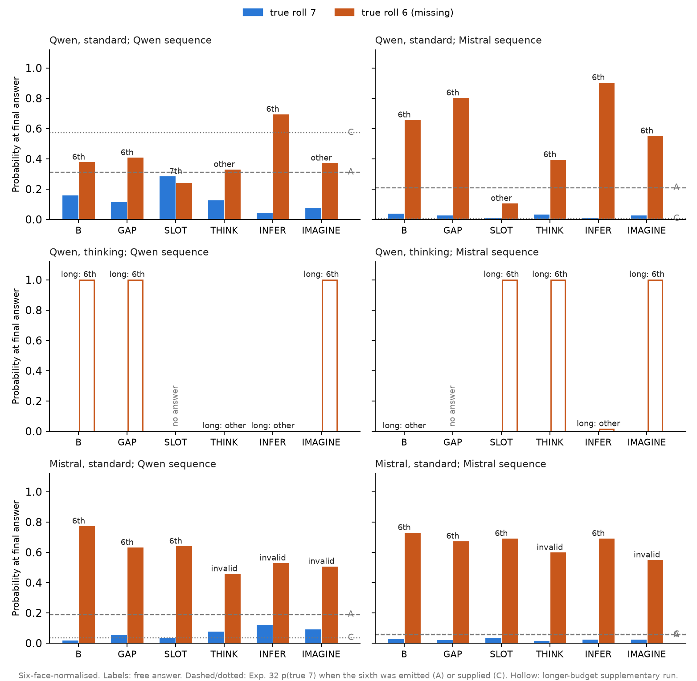

# 35 · Roll-7 prompt scaffolding (2026-11-25)

| | |
|---|---|
| Track | 1: static self-prediction |
| Tag | `SPAR_EXP35_ROLL7_PROMPT_SCAFFOLDING_v1.0` |
| Design source | `docs/handoffs/GPT_SPAR_Roll_7_Prompt_Scaffolding_Handoff.md` |
| Status | **Complete.** Frozen at `5374f6d`; all checks PASS; 36 cells × 2. |
| Report | [**REPORT.md**](REPORT.md) · [PROTOCOL.md](PROTOCOL.md) · [APPROVALS.md](APPROVALS.md) |
| Previous | [← 32](../32_2026-11-15_roll7_intermediate_context/) (same task) · [34](../34_2026-11-25_dice_unused_faces/) |

**Result.** No scaffold reliably helps a model skip to roll 7. Standard mode: 1 of 24 cells correct, 15 give the missing sixth. All 12 Qwen native-thinking cells were cut off at 1,024 tokens; in supplementary 4,096-token runs 10 finished and none was correct.

Code: `src/spar_dynamic/roll7_scaffolding/`. Tests: `tests/test_roll7_scaffolding.py`.
