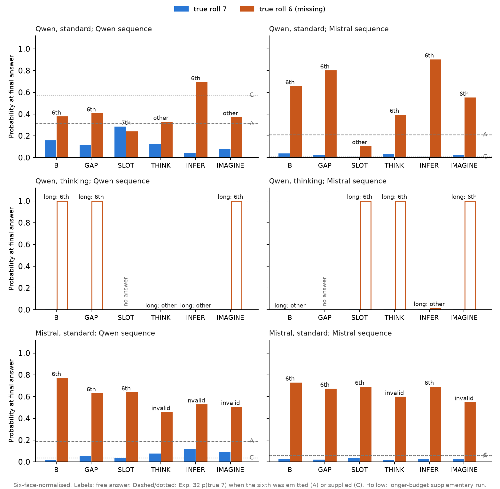

# Experiment 35: can a prompt scaffold help a model skip ahead to roll 7?

Exploratory pilot, two fixed sequences. Follow-up to Experiment 32. Frozen at `5374f6d`; all checks pass ([CHECKS.md](results/CHECKS.md)), including a bit-identical replay of Experiment 32's B prompts and bit-identical replicates in all 36 cells.

## Verdict

**No scaffold reliably helps.** In standard mode 1 of 24 cells gives the true seventh roll, 15 give the missing sixth, 3 another face and 5 no valid answer. The one hit (Qwen, SLOT, its own sequence) does not recur for the other sequence or the other model.

**Native thinking did not finish within 1,024 tokens** in any of the 12 Qwen cells, so the primary thinking cells are all missing. In a labelled supplementary run of the same greedy path with 4,096 tokens, 10 of 12 finished: 6 gave the sixth, 4 another face, **none the true seventh**.

## Free answers

True sixth / seventh: Qwen sequence 4 / 6; Mistral sequence 5 / 2. "Prose" means the model began an explanation and hit the 128-token limit.

| Predictor, mode, sequence | B | GAP | SLOT | THINK | INFER | IMAGINE |
|---|---|---|---|---|---|---|
| Qwen standard, Qwen seq. (6th 4, 7th 6) | 4 (6th) | 4 (6th) | **6 (7th)** | 3 | 4 (6th) | 3 |
| Qwen standard, Mistral seq. (6th 5, 7th 2) | 5 (6th) | 5 (6th) | 3 | 5 (6th) | 5 (6th) | 5 (6th) |
| Mistral standard, Qwen seq. | 4 (6th) | 4 (6th) | 4 (6th) | prose | prose | prose |
| Mistral standard, Mistral seq. | 5 (6th) | 5 (6th) | 5 (6th) | prose | 5 (6th) | prose |
| Qwen thinking, 1,024 tokens (12 cells) | cut off | cut off | cut off | cut off | cut off | cut off |
| *Supplementary 4,096, Qwen seq.* | 4 (6th) | 4 (6th) | cut off | 2 | 5 | 4 (6th) |
| *Supplementary 4,096, Mistral seq.* | 4 | cut off | 5 (6th) | 5 (6th) | 4 | 5 (6th) |

## Probability of the true seventh

Six-face-normalised at the first answer token. Digit mass is the raw probability on the six faces; where it is low (Mistral under THINK, INFER, IMAGINE) the distribution describes an answer the model mostly does not give.

| Predictor, sequence | B | GAP | SLOT | THINK | INFER | IMAGINE | Exp. 32 A (emits 6th) | Exp. 32 C (6th supplied) |
|---|---|---|---|---|---|---|---|---|
| Qwen, Qwen seq. | 0.156 | 0.111 | **0.281** | 0.125 | 0.041 | 0.075 | 0.311 | 0.572 |
| Qwen, Mistral seq. | 0.035 | 0.022 | 0.005 | 0.029 | 0.004 | 0.022 | 0.210 | 0.005 |
| Mistral, Qwen seq. | 0.014 | 0.050 | 0.032 | 0.073 | 0.116 | 0.087 | 0.189 | 0.036 |
| Mistral, Mistral seq. | 0.023 | 0.017 | 0.032 | 0.011 | 0.022 | 0.019 | 0.054 | 0.057 |
| Mistral digit mass, Qwen / Mistral seq. | .74 / .69 | .53 / .59 | .84 / .80 | .06 / .06 | .47 / .47 | .30 / .31 | | |

Against B (standard mode, 4 cells per ending):

| Ending | p(true 7) higher | Mean change | Range | log P(7) − log P(6) higher |
|---|---|---|---|---|
| GAP | 1 of 4 | −0.007 | −0.044 to +0.035 | 1 of 4 |
| SLOT | 3 of 4 | +0.031 | −0.030 to +0.125 | 3 of 4 |
| THINK | 1 of 4 | +0.003 | −0.031 to +0.058 | 2 of 4 |
| INFER | 1 of 4 | −0.011 | −0.115 to +0.101 | 2 of 4 |
| IMAGINE | 1 of 4 | −0.006 | −0.081 to +0.073 | 2 of 4 |

- **Making the gap explicit (GAP, SLOT) versus using a guessed sixth (INFER, IMAGINE).** SLOT is the only ending that raises p(true 7) in most cells, mainly on one (Qwen on its own sequence, 0.156 to 0.281). It also moves Qwen off the sixth on the Mistral sequence, but to a wrong face (3) with p(true 7) lower than under B.
- **INFER backfires in Qwen:** p(sixth) rises from 0.375 to 0.691 and from 0.654 to 0.901. Asking Qwen to consider the sixth makes it answer the sixth.
- **No scaffold beats writing the sixth out** (Experiment 32 A) in any of the four predictor × sequence combinations.
- **THINK (generic deliberation)** does no better than B, and makes Mistral write prose.

## Thinking mode

All 12 cells opened a thinking block and were cut off inside it at 1,024 tokens. Nothing was forced or retried, and there is no answer distribution to compare with standard mode. The thinking-versus-standard comparison at the specified budget is therefore unavailable.

In the supplementary runs (1,251 to 3,902 tokens; two still unfinished at 4,096) the final digit is nearly deterministic given the thinking. The ends of the traces show two patterns: picking the face missing from the first five (which is the sixth), or inferring the sixth correctly and then assuming the sequence starts again from its first face. The true sequences do not restart that way. These distributions are conditional on one generated trace.

## Limits

- Two sequences, so each cell is one observation. Leaving the sixth-roll answer is not success in itself, and the one correct answer does not show that Qwen represented roll 6.
- The 4,096-token runs are an addition to the handoff (in the frozen protocol) and are reported separately.
- The handoff allows wording ablations only if a rich prompt helps. None did, so none were run.

Cost: shared rental with Experiments 36 and 37; see `run_record.json`.
