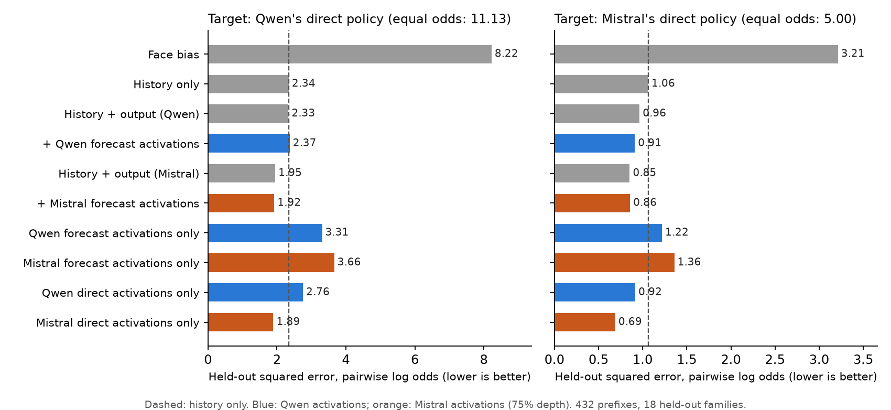

# 36 · Is Qwen's own dice policy decodable while it forecasts? (2026-11-25)

| | |
|---|---|
| Track | 1: static self-prediction |
| Tag | `SPAR_EXP36_HIDDEN_ACTIVATION_DICE_POLICY_v1.0` |
| Design source | `docs/handoffs/GPT_SPAR_Hidden_Activation_Dice_Policy_Claude_Code_Handoff.md` |
| Status | **Complete.** Frozen at `b9bcda3`; all gates and checks PASS. |
| Report | [**REPORT.md**](REPORT.md) · [PROTOCOL.md](PROTOCOL.md) · [APPROVALS.md](APPROVALS.md) |
| Previous | [← 35](../35_2026-11-25_roll7_prompt_scaffolding/) · follow-up [37 →](../37_2026-11-25_frozen_probe_policy_swap/) |

**Result.** No evidence that Qwen's forecast activations carry Qwen-specific policy information beyond history and output (gain −0.035, CI −0.136 to +0.047; own-minus-cross −0.040). The positive control (Qwen's direct activations) does not beat a history-only model either, so the null is not sharp.

Code: `src/spar_dynamic/hidden_policy/`. Tests: `tests/test_hidden_policy.py`. Arrays (`arrays/`) are not in git; hashes are in `raw/<model>/env.json`.
