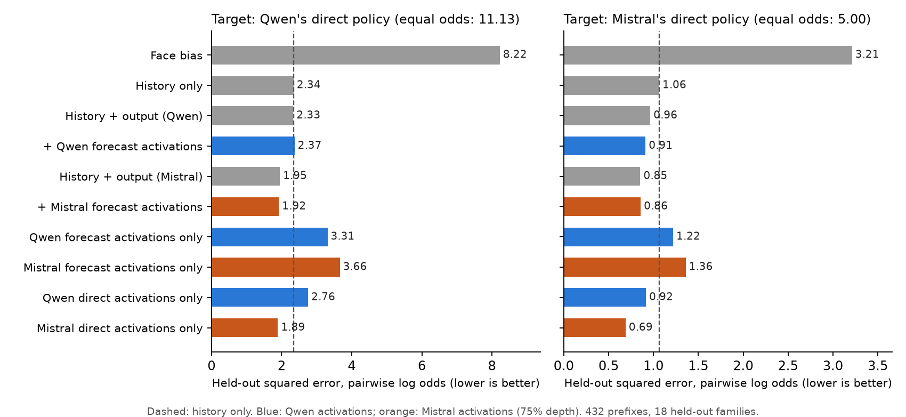

# Experiment 36: is Qwen's own dice policy decodable while it forecasts?

Exploratory. Frozen at `b9bcda3` before any model call. All gates and checks pass for both models ([CHECKS.md](results/CHECKS.md)): 124 rows per model that also occur in Experiment 33 replay bit-identically, all 2,400 rows per model repeat bit-identically, and scores are identical with hooks off.

## Answers

| Question | Answer |
|---|---|
| (a) Does Qwen avoid repeats? | **When generating, yes; when forecasting, no.** Probability on unused faces is 99.4% in direct generation and 42.5% in the agent forecast (shape 46.9%, self 44.7%, generic 49.3%). |
| (b) Do its forecast probabilities express its own ranking? | **Barely.** The forecast's top unused face matches its own policy on 47.5% of prefixes (chance 45.8%), and its raw pairwise log odds are worse than equal odds (squared error 19.8 against 11.1). After calibration they beat face bias (6.94 against 8.22), far short of a history-only model (2.34). |
| (c) Do its forecast activations carry extra checkpoint-specific ranking information? | **No evidence.** Adding Qwen's activations to history + output does not reduce error on Qwen's policy (gain −0.035, 95% CI −0.136 to +0.047), and the own-minus-cross contrast goes the wrong way. |

Activations do contain ranking information, but Qwen's own policy is **more accurately predicted from the prefix alone** than from either model's forecast activations.

**The positive control limits the null.** The frozen protocol says a null in (c) is uninformative unless Qwen's direct-generation activations beat the history model. They do not (2.76 against 2.34; gain −0.41, CI −0.97 to +0.003). They strongly beat face bias (gain +5.47, CI +3.48 to +7.80), so the linear probe works, but it cannot be shown to read more than the history supplies. The design can rule out a large extra signal; it is not a sharp negative.

## Data

432 prefixes (108 at roll 4, 324 at roll 5), 648 pairs, 18 held-out families; families 146 and 125 (6 pilot prefixes) were excluded. Loss is the held-out squared error of the pairwise direct log odds, equal weight per family. Intervals resample families over out-of-fold predictions and are conditional on this design and these fits.

| Held-out error (75% depth) | Qwen target | Mistral target |
|---|---|---|
| Equal odds | 11.13 | 5.00 |
| Face bias | 8.22 | 3.21 |
| **History only** | **2.34** | **1.06** |
| Raw forecast, Qwen / Mistral | 19.77 / 24.58 | 19.16 / 15.31 |
| Calibrated output, Qwen / Mistral | 6.94 / 7.02 | 2.65 / 2.95 |
| History + output, Qwen / Mistral | 2.33 / 1.95 | 0.97 / 0.85 |
| … + forecast activations, Qwen / Mistral | 2.37 / 1.92 | 0.91 / 0.86 |
| Forecast activations only, Qwen / Mistral | 3.31 / 3.66 | 1.22 / 1.36 |
| Direct activations only, Qwen / Mistral | 2.76 / 1.89 | 0.92 / 0.69 |
| History + output + direct activations, Qwen / Mistral | 2.29 / 1.80 | 0.66 / 0.62 |

## Prespecified comparisons (positive = helps)

| Comparison | Gain [95% CI] | Families |
|---|---|---|
| **1. Qwen activations beyond history + output, Qwen target (primary)** | **−0.035 [−0.136, +0.047]** | 4 of 18 |
| 3. Qwen activations beyond history, both outputs and Mistral activations | +0.011 [−0.008, +0.033] | 5 of 18 |
| Mistral activations beyond history + output, Qwen target | +0.027 [−0.056, +0.102] | 9 of 18 |
| 4. Qwen direct activations vs face bias / vs history | +5.47 [+3.48, +7.80] / −0.41 [−0.97, +0.003] | 17 / 7 of 18 |
| Mistral direct activations vs history, **Qwen** target | +0.45 [+0.13, +0.83] | 13 of 18 |
| Qwen forecast activations vs face bias / vs history | +4.92 [+3.12, +7.02] / −0.97 [−1.58, −0.42] | 17 / 4 of 18 |

2. **Specificity** (gains divided by the history-only loss on that target):

| | Qwen target | Mistral target |
|---|---|---|
| Qwen activations | −0.015 [−0.061, +0.022] | +0.050 [+0.010, +0.103] |
| Mistral activations | +0.012 [−0.027, +0.042] | −0.004 [−0.050, +0.040] |

Balanced own minus cross: **−0.040 [−0.084, −0.002]**. The only cell with an interval above zero is Qwen's activations on *Mistral's* policy, so nothing here is self-specific. The base models differ by checkpoint (each uses its own forecast output), and Mistral's output predicts Qwen's policy better than Qwen's does: history + output + activations is 0.45 worse with Qwen's forecasts than with Mistral's (CI −1.01 to −0.06).

7. **Permutation null** (100 permutations within family and unused set): observed gain −0.035, null mean +0.006, 97.5% point +0.164, p = 0.73.

## Secondary

- **Depth and rank:** no depth or rank gives a Qwen-target gain with an interval above zero (25%: −0.086; 50%: −0.020; 100%: +0.154, CI −0.073 to +0.391; ranks 8, 16, 64 between −0.051 and −0.033).
- **Prompts:** activations beyond history + output: shape −0.058, self +0.104 (CI −0.036 to +0.259), generic +0.001. Refitting on the self prompt beats the agent-fitted probe in activation-only error (+0.394, CI +0.041 to +0.872), but that is a property of the activations-only model, which the history model still beats.
- **Transfer without refit fails.** The agent probe applied to other prompts is worse than face bias (shape −22.9, self −6.1, generic −21.7), so the probe direction depends on the wording. This matters for Experiment 37's shape arm.
- **Agent vs shape:** shape's raw forecast fits Qwen's policy better than agent's (+3.50, CI +1.80 to +5.10). Neither is neutral.
- **Logits:** full-logit PCA adds +0.12 to history (CI −0.24 to +0.41); activations add −0.0005 beyond it.
- **Disagreement subset** (100 prefixes, 18 families; 25 at roll 4, 75 at roll 5): share favouring Qwen's preferred face on the Qwen target is 61% history, 62% history + output, 60% with Qwen activations, 60% with Mistral activations, 62% Qwen activations only, 77% raw Qwen forecast. The raw forecast's preference does not carry over: its error on these rows is 10.0 against 1.9 for history, and it favours Qwen's face on the Mistral target's rows equally, because it is the same forecast.
- **Mistral's forecasts begin "Given the se…" on 480 of 480 agent prompts** (digit mass 0.23). Its rows were kept, as specified. Its forecast distributions are conditional on a digit it does not emit. Qwen emits a single digit on all 480 (5 or 6 on 454), which is mostly a fixed-digit habit.
- **Face bias:** every model includes a face bias. Results per favoured face and per fold are in `results/`.

## Interpretation

A large amount of next-face policy is readable from the prefix and from activations, for both models' policies and both models' states. At the forecast site, with this probe class and these layers, we found nothing specific to Qwen's own policy beyond the history and output. Qwen's and Mistral's direct policies also agree on the favourite unused face for 77% of prefixes, which leaves little room for specificity. No causal claim is made, and the handoff's condition for a causal follow-up (a reliable, selective readout) is not met. Experiment 37 tests the weaker question of whether the probe follows an induced policy change.

## Deviations and limits

- The pilot covered 6 prefixes because c10 has the same first-three set as c02; this is in the frozen protocol.
- 18 families and 432 prefixes from one enumeration; four-face prefixes with the same faces can fall in different folds (the handoff's family definition).
- Final answers are for next-face rolls 4 and 5 only.
- Activation arrays are not in git. Hashes are in `raw/<model>/env.json`; regenerate with `python -m spar_dynamic.hidden_policy.gpu --model <m>` on the pinned image (the capture is bit-reproducible), then `python -m spar_dynamic.hidden_policy analyse`. Set `OMP_NUM_THREADS=1`.
- Model calls: per model 2,400 captured rows plus a full repeat and a hooks-off pass, 30 pilot rows (same gates), and the archival replay. Cost is in `run_record.json` (shared rental with 35 and 37).
