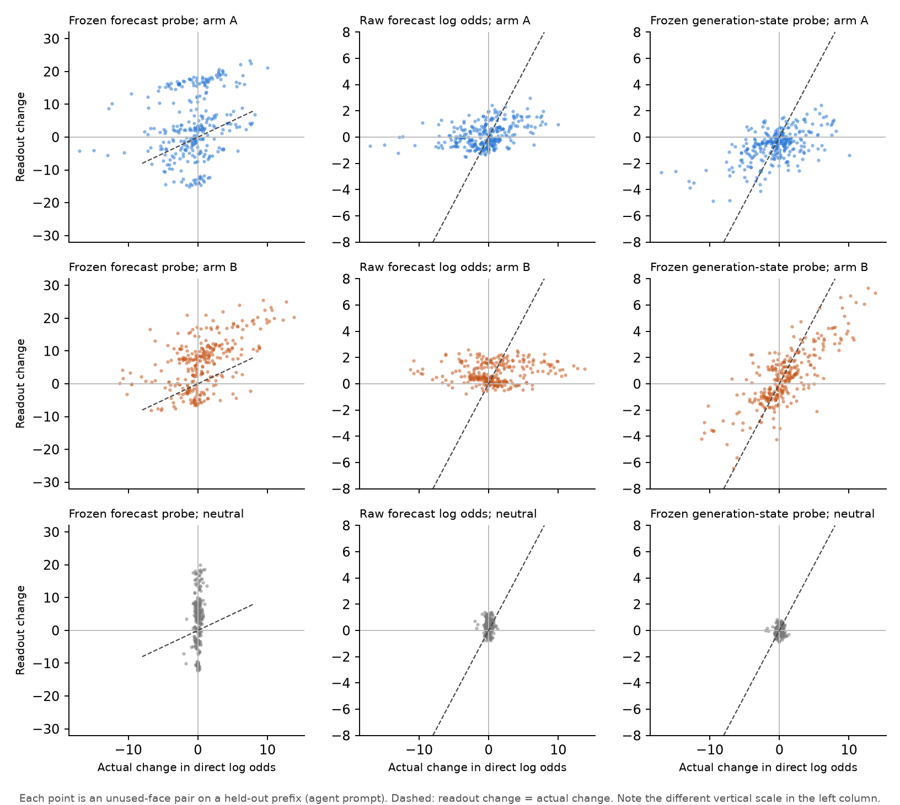

# 37 · Does a frozen probe follow Qwen when its dice policy changes? (2026-11-25)

| | |
|---|---|
| Track | 1: static self-prediction |
| Tag | `SPAR_EXP37_FROZEN_PROBE_POLICY_SWAP_v1.0` |
| Design source | `docs/handoffs/GPT_SPAR_Frozen_Probe_Policy_Swap_Claude_Code_Handoff.md` |
| Status | **Complete.** Frozen at `6b22a50`, probes at `2f49cb1`; all checks PASS; both adapters pass the holdout gates. |
| Report | [**REPORT.md**](REPORT.md) · [PROTOCOL.md](PROTOCOL.md) · [APPROVALS.md](APPROVALS.md) · [run_record.json](run_record.json) |
| Previous | [← 36](../36_2026-11-25_hidden_activation_dice_policy/) |

**Result.** Not established. The swap changed Qwen's policy, and the generation-state probe follows it (correlation 0.73; A minus B 0.63). The frozen forecast probe moves as much under a neutral adapter that barely changes the policy (median 5.66 against 5.96 for A), and does not track A minus B (−0.10).

Code: `src/spar_dynamic/policy_swap/`. Tests: `tests/test_policy_swap.py`. Arrays, adapters and probes (`arrays/`) are not in git.
