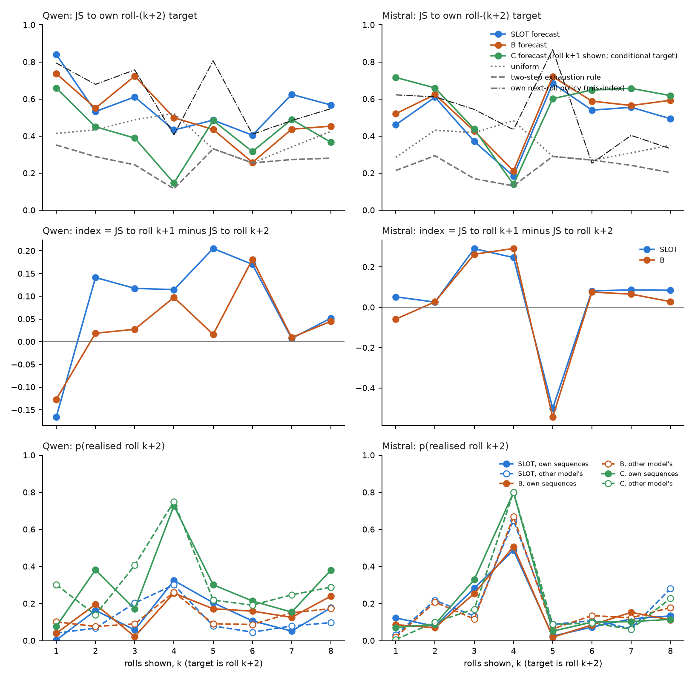

# 38 · SLOT at every position (2026-11-27)

| | |
|---|---|
| Track | 1: static self-prediction |
| Tag | `SPAR_EXP38_SLOT_SKIP_AHEAD_v1.0` |
| Design source | Investigator request in session ([APPROVALS.md](APPROVALS.md)); follow-up to [35](../35_2026-11-25_roll7_prompt_scaffolding/) |
| Status | **Complete.** Frozen at `9fcf00c`; all 13 checks PASS; 548 prompts × 2 models; $1.63 |
| Report | [**REPORT.md**](REPORT.md) · [PROTOCOL.md](PROTOCOL.md) · [APPROVALS.md](APPROVALS.md) · [run_record.json](run_record.json) |
| Previous | [← 35](../35_2026-11-25_roll7_prompt_scaffolding/) (same SLOT ending, k = 5 only) · [32](../32_2026-11-15_roll7_intermediate_context/) |

**Result.** Experiment 35's SLOT ending ("Roll k+1: [blank]. Roll k+2: [predict this position].") applied at every k = 1..8 over 170 prefixes:
- **Qwen** stops answering the missing roll (58 → 16 of 368), but its forecasts move further from its own roll-(k+2) policy.
- **Mistral** moves slightly closer, mostly because SLOT stops its prose answers.
- **Neither model** forecasts its roll k+2 better than a uniform guess or a "use each face once per six" rule. Hits are below chance in both SLOT and B.
- **No self-specific advantage** (−0.004 bits, CI −0.010 to +0.005).
- **Experiment 35's correct "6"** was a face already shown: under SLOT at k = 5, Qwen never answers the missing face (0 of 24).

Code: `src/spar_dynamic/slot_skip_ahead/` (`freeze`, `validate`, `dryrun`, `analyse`; GPU stage `gpu.py`, host driver `run_stage.sh`). Tests: `tests/test_slot_skip_ahead.py`. Post-hoc counts: `posthoc/distinct_sequences.py`.
