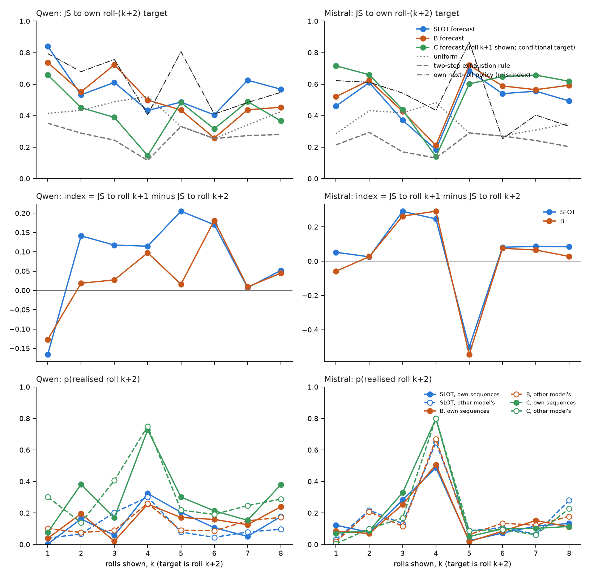

# Experiment 38: does the SLOT prompt let a model skip ahead at every position?

`SPAR_EXP38_SLOT_SKIP_AHEAD_v1.0` · 2026-11-27 · protocol, prompts and analysis frozen at `9fcf00c` before any model call · [PROTOCOL.md](PROTOCOL.md) · all checks pass ([CHECKS.md](results/CHECKS.md)) · $1.63

## Summary

Experiment 35's only correct roll-7 answer came from the SLOT ending ("Roll 6: [blank]. Roll 7: [predict this position]."), Qwen on its own sequence. Here the same ending is applied at every position: rolls 1..k shown, roll k+1 blank, predict roll k+2, for k = 1..8. The prompts cover 170 prefixes drawn from all 66 G sequences on record (Experiment 28 greedy, Experiment 27 sampled). B (no slot markers) and C (roll k+1 supplied) are controls. Each forecast is scored against the model's exact teacher-forced two-step policy for roll k+2. Distances are Jensen-Shannon divergence in bits.

1. **SLOT changes what the models answer, but does not bring forecasts closer to the target.**
   - **Qwen** stops answering the missing roll: free answers equal to roll k+1 fall from 58 to 16 of 368 distinct sequence positions. Its forecasts move further from its own roll-(k+2) policy, though (B minus SLOT distance −0.072 bits, CI −0.098 to −0.044). The frozen index rises (+0.044, CI +0.024 to +0.066) because the forecast moves away from roll k+1 faster than it moves toward roll k+2.
   - **Mistral**'s forecasts move slightly closer (+0.047, CI +0.034 to +0.060). Much of that is format: under B it answers in prose on 123 of 368 positions (66 of 170 prompts below 0.5 digit mass), and SLOT keeps it answering a digit. It still answers roll k+1 about as often (63 vs 52).
2. **Neither model forecasts its roll k+2 better than simple baselines.**
   - Mean distance to the model's own target under SLOT: Qwen 0.537, Mistral 0.496.
   - A uniform guess is closer (0.390 and 0.348), and a model-free two-step "use each face once per six" rule is much closer (0.262 and 0.226). SLOT beats that rule on 15 of 170 prefixes (Qwen) and 12 of 170 (Mistral).
   - The *other* model's exact policy is closer than either model's own forecast (0.212 bits). The two models generate alike but do not forecast their own generation.
   - Free-answer hits on the true roll k+2 are 48 (Qwen) and 53 (Mistral) of 368 under SLOT, against 51 and 50 under B. Picking a face at random would get about 61.
3. **No self-specific signal.** The crossed own-versus-other advantage is −0.004 bits under SLOT (CI −0.010 to +0.005), −0.012 under B (−0.020 to −0.003; slightly favouring the *other* model) and −0.005 under C (−0.019 to +0.010).
4. **Experiment 35's hit is explained (post hoc).** At k = 5 across all 24 prefixes, Qwen under SLOT never answers the face missing from rolls 1-5, which is roll 6 under the permutation rule. It answers a face already shown in 24 of 24, repeating roll 5 in 14. Its answer matches its own most likely roll-7 face in 4 of 24. On Qwen's greedy sequence `5 2 6 3 1` it answers 6 (a shown face), which happens to be the true roll 7. Mistral under SLOT at k = 5 answers the missing roll 6 in 22 of 24.

Under the frozen interpretation rules, SLOT does not help either model skip ahead. Qwen's Q1 index is positive but its distance to the target worsens, and no SLOT forecast beats the two-step exhaustion rule on average. There is no evidence of self-specific anticipation.

## 1. Primary results (frozen analysis; [results/primary.csv](results/primary.csv))

Means over the 170 prefixes; 95% cluster-bootstrap intervals (clusters: prefixes sharing their first two rolls, 14 clusters; approximate).

| Measure | Qwen | Mistral |
|---|---|---|
| Q1 index, SLOT − B | +0.044 [+0.024, +0.066] | +0.024 [+0.018, +0.031] |
| Q1 distance to own target, B − SLOT | −0.072 [−0.098, −0.044] | +0.047 [+0.034, +0.060] |
| Q2 index, SLOT | +0.096 [+0.073, +0.117] | +0.037 [+0.016, +0.059] |
| Q2 index, B | +0.052 [+0.025, +0.074] | +0.014 [−0.010, +0.038] |

By block (target roll ≤ 6 / ≥ 7):
- **Qwen:** B − SLOT distance is +0.059 [+0.019, +0.090] in the first block and −0.128 [−0.167, −0.094] in the second. SLOT helps a little where the permutation rule fixes the answer and hurts once the second block starts.
- **Mistral:** the index under SLOT is +0.203 in the first block and −0.034 [−0.052, −0.017] in the second, so there it remains closer to roll k+1 than to roll k+2.

| Q3 crossed own advantage (bits) | All | First block | Second block |
|---|---|---|---|
| SLOT | −0.004 [−0.010, +0.005] | −0.002 [−0.010, +0.008] | −0.004 [−0.013, +0.009] |
| B | −0.012 [−0.020, −0.003] | −0.012 [−0.026, +0.001] | −0.012 [−0.022, −0.001] |
| C | −0.005 [−0.019, +0.010] | +0.010 [−0.002, +0.019] | −0.013 [−0.031, +0.008] |

## 2. Distances and baselines (pooled over prefixes; [results/prompts_scored.csv](results/prompts_scored.csv))

| | Own target, SLOT | Own target, B | Uniform | Two-step rule | Own next-roll policy | Other model's policy |
|---|---|---|---|---|---|---|
| Qwen | 0.537 | 0.465 | 0.390 | 0.262 | 0.570 | 0.212 |
| Mistral | 0.496 | 0.544 | 0.348 | 0.226 | 0.467 | 0.212 |

With roll k+1 supplied (C), forecasts of the next roll are 0.392 (Qwen) and 0.564 (Mistral) from the own conditional policy. A one-step unused-face rule is closer (0.285 and 0.248).

Per position ([results/by_k.csv](results/by_k.csv)): the only position where forecasts come close to the target is k = 4 (roll 6, the last face of the first block, which the rule fixes): Qwen SLOT 0.433, Mistral SLOT 0.184, rule 0.115 and 0.131.

## 3. Free answers ([posthoc/summary.json](posthoc/summary.json); counted once per distinct sequence, 46 × 8 = 368 positions)

| | Target roll k+2 | Roll k+1 (mis-index) | Other face | Invalid |
|---|---|---|---|---|
| Qwen SLOT | 48 | 16 | 304 | 0 |
| Qwen B | 51 | 58 | 259 | 0 |
| Qwen C (roll k+1 shown) | 135 | — | 233 | 0 |
| Mistral SLOT | 53 | 63 | 252 | 0 |
| Mistral B | 50 | 52 | 143 | 123 |
| Mistral C | 67 | — | 287 | 14 |

The frozen per-source table ([results/realised.csv](results/realised.csv)) counts duplicated sampled sequences each time. Many Qwen samples begin `5 2 6 3 1 4 6`, so sequence-weighted hit rates at k = 5 overstate Qwen's SLOT accuracy (16 of its 33 own-generator sources, but 7 of the 46 distinct sequences).

## 4. Checks

All 13 frozen checks pass ([results/CHECKS.md](results/CHECKS.md)):
- Both models reproduce the Experiment 28 archival outputs.
- All six k = 5 anchors (Experiment 35 SLOT, Experiment 32 B and C) are bit-identical to the earlier runs.
- The teacher-forced policy reproduces Experiment 31 bit for bit (32/32 rows per model).
- First-answer replicates are bit-identical.
- The run used a newer driver (610.57.04) than Experiments 28-35 (595.91.07); the reproduction was nevertheless bit-identical.

## 5. Limitations and deviations

- Two checkpoints, one prompt template per condition, greedy decoding. Prefixes are nested and the bootstrap has 10-14 clusters, so intervals are approximate.
- Targets are six-face-normalised native policies at T = 1; the sampled sources were drawn at T = 0.7. Realised-roll scores therefore mix sampling noise with forecast quality. The distance measures do not depend on the realised rolls.
- k = 1 uses a singular wording ("The first roll it produced was:").
- Mistral's B answers are often prose (low digit mass), which makes B a weak control for Mistral in the second block.
- **Deviations from the frozen protocol:** none in prompts, design, code or analysis. `posthoc/` (distinct-sequence counts and the k = 5 answer breakdown) was added after the run and reads stored files only.
- **Cost:** $1.63 billed (GPU $1.30 for 1.04 h, disk $0.05, download $0.27) against a $5 cap.
